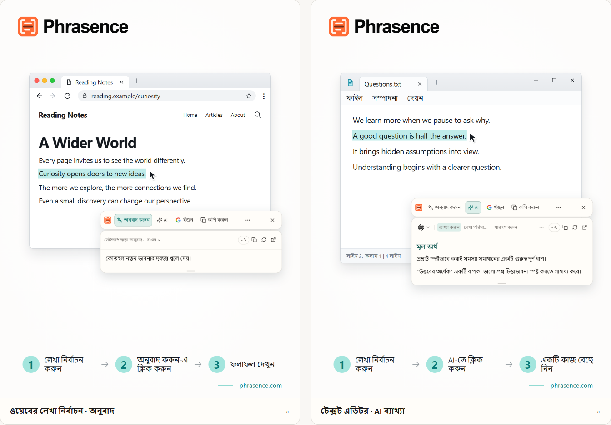

# Phrasence | নির্বাচিত লেখার জন্য ডেস্কটপ AI অনুবাদক ও সহায়ক

[English](README.md) | [Español](README.es.md) | [Português (Brasil)](README.pt-BR.md) | [Português (Portugal)](README.pt-PT.md) | [Français](README.fr.md) | [Deutsch](README.de.md) | [Italiano](README.it.md) | [Nederlands](README.nl.md)

[Русский](README.ru.md) | [Polski](README.pl.md) | [Türkçe](README.tr.md) | [Українська](README.uk.md) | [日本語](README.ja.md) | [한국어](README.ko.md) | [Bahasa Indonesia](README.id.md) | [Tiếng Việt](README.vi.md)

[ไทย](README.th.md) | [Bahasa Melayu](README.ms.md) | [हिन्दी](README.hi.md) | [বাংলা](README.bn.md) | [简体中文](README.zh-CN.md) | [繁體中文](README.zh-TW.md)

[অফিশিয়াল ওয়েবসাইট](https://phrasence.com/) · [ডাউনলোড](https://phrasence.com/bn/download) · [ব্যবহার নির্দেশিকা](https://phrasence.com/bn/docs/getting-started)

## Phrasence সম্পর্কে

Phrasence দিয়ে ব্রাউজার, নথি বা এডিটরে লেখা নির্বাচন করে অনুবাদ, ব্যাখ্যা, সারসংক্ষেপ বা পরিমার্জন বেছে নিন। টুলগুলো নির্বাচিত লেখার পাশে থাকে, তাই পড়া ও লেখার ছন্দ বজায় রাখতে পারেন।

Phrasence সাধারণ লেখার কাজগুলো নির্বাচিত অংশের পাশে রাখে। এরপর কী হবে, তা আপনি ঠিক করেন।

**লেখা নির্বাচন করুন → টুলবার খুলুন → পরবর্তী কাজ বেছে নিন**



_ইন্টারফেসের নমুনা: নির্বাচিত টেক্সটের অনুবাদ ও AI ব্যাখ্যা। ছবির টেক্সট ও ক্রেডিটের সংখ্যা শুধু উদাহরণ। প্রকৃত ব্যবহারে অ্যাপের বর্তমান নিয়ম প্রযোজ্য।_

## কাদের জন্য উপযোগী

- **অন্য ভাষায় লেখা পড়েন যারা**: কোনো পেজ বা নথির বাক্য অন্য ট্যাবে কপি না করেই অনুবাদ করুন।
- **শিক্ষার্থী ও গবেষক**: পড়ার প্রেক্ষাপট ধরে রেখেই কোনো শব্দের ব্যাখ্যা, দীর্ঘ বাক্যের বিশ্লেষণ বা কঠিন অংশের সারসংক্ষেপ পান।
- **ডেভেলপার ও প্রযুক্তিগত নথির পাঠক**: পড়ার জায়গা না হারিয়েই কারিগরি শব্দ, জটিল বাক্য, গবেষণার অংশ বা কোড বোঝার জন্য প্রয়োজনীয় প্রেক্ষাপট পান।
- **লেখক ও অফিসকর্মী**: খসড়ার একটি অংশ নির্বাচন করে AI-কে নতুনভাবে লিখতে, মূল কথা সংক্ষিপ্ত করতে বা ভঙ্গি বদলাতে বলুন।

## মূল সুবিধা

- **নির্বাচিত লেখার অনুবাদ**: ব্যবহারযোগ্য অনুবাদ সেবা ও লক্ষ্য ভাষা বেছে নিন, বর্তমান অ্যাপের পাশে ফলাফল দেখুন, তারপর কপি করুন বা আবার তৈরি করুন।
- **AI দিয়ে ব্যাখ্যা, সারসংক্ষেপ ও কাস্টম প্রম্পট**: নির্বাচিত লেখা ব্যাখ্যা, সংক্ষিপ্ত, পরিমার্জন, মূল বিষয় বের বা সংশোধন করা। “ইমেইল হিসেবে লিখুন” ধরনের নিজের অ্যাকশনও তৈরি করা যায়।
- **পূর্ণ কর্মক্ষেত্র**: দীর্ঘ লেখা নিয়ে কাজ করার সময় মূল লেখা নিজে সম্পাদনা করুন এবং অনুবাদ ও AI ফলাফলের মধ্যে সহজে যাতায়াত করুন।
- **সার্চ বা কপি করুন**: নির্বাচিত লেখা সরাসরি কপি করুন অথবা পছন্দের সার্চ ইঞ্জিনে পাঠিয়ে সিস্টেম ব্রাউজারে খোঁজ চালিয়ে যান।
- **স্থানীয় ইতিহাস**: আগের অনুবাদ ও AI ফলাফল আবার খুলুন। ইতিহাস এই ডিভাইসেই থাকে এবং যেকোনো সময় বন্ধ বা মুছে ফেলা যায়।
- **আপনার ডেস্কটপের সঙ্গে মানানসই**: আড়াআড়ি বা লম্বালম্বি, হালকা বা গাঢ়, সব সময় ওপরে বা স্বাধীনভাবে—নিজের স্ক্রিন ও কাজের অভ্যাস অনুযায়ী Phrasence সাজান।

### অনুবাদ পরিষেবা

**সেটিংস → অনুবাদ পরিষেবা**

কীভাবে বাছবেন: তিনটি বিকল্প আছে—সেটআপ ছাড়া অনুবাদ, লোকাল মডেল এবং অনুবাদ প্রদানকারী। একটি বেছে “ব্যবহার করুন” চাপুন; কাজের জায়গা ও দ্রুত টুলবার সেটিই ব্যবহার করবে।

- সেটআপ ছাড়া অনুবাদ: কোনো সেটআপ দরকার নেই। সাইন ইন করে “ব্যবহার করুন” চাপুন। প্রতিটি অনুবাদে ক্রেডিট খরচ হয়, যা মূল লেখার অক্ষরসংখ্যা অনুযায়ী হিসাব করা হয়; আসলে কাটা পরিমাণই চূড়ান্ত।
- লোকাল অনুবাদ মডেল: প্রথম ব্যবহারের আগে মডেল ডাউনলোড করুন। এরপর ক্রেডিট ছাড়া অফলাইনে অনুবাদ করা যায়; লেখা শুধু এই কম্পিউটারেই প্রক্রিয়া হয়।
- অনুবাদ প্রদানকারী: Baidu, Microsoft, DeepL বা Google API কী থাকলে এখানে দিন। কী এই কম্পিউটারেই থাকে; মূল্য ও বিনামূল্যের সীমা প্রদানকারী ঠিক করে।

লোকাল মডেলে আপনার প্রয়োজনীয় ভাষার সমর্থন থাকতে হবে। মডেল ডাউনলোড বা আপডেট করতে ইন্টারনেট লাগে। লোকাল মডেল বা নিজের API দিয়ে অনুবাদ করলে Phrasence ক্রেডিট লাগে না। API সেবাদাতা আলাদা ফি নিতে পারে। প্রয়োজনীয় সংযোগের তথ্য সংরক্ষণ করে সংযোগ পরীক্ষা করুন।

অনুবাদ ও AI কাজগুলো কনফিগার করা সেবা, নেটওয়ার্ক সংযোগ, ব্যবহারযোগ্য ক্রেডিট এবং বর্তমান রিলিজ অবস্থার ওপর নির্ভর করে।

[মূল্য](https://phrasence.com/bn/pricing)

## ব্যবহার নির্দেশিকা

### 1. ডাউনলোড ও ইনস্টল করুন

[ডাউনলোড পেজ](https://phrasence.com/bn/download) খুলুন। আপনার অপারেটিং সিস্টেম ও প্রসেসরের সঙ্গে মেলে এমন সংস্করণ বেছে নিন।

ডাউনলোড বোতাম না থাকলে ওই ইনস্টলার এখনো পাওয়া যাচ্ছে না। অনানুষ্ঠানিক ওয়েবসাইট থেকে Phrasence ডাউনলোড করবেন না।

### 2. প্রথম সেটিং সম্পূর্ণ করুন

Phrasence চালু করে **সেটিংস** খুলুন। ক্রমে এগুলো দেখুন:

1. **সাধারণ সেটিংস** থেকে ইন্টারফেসের ভাষা, থিম ও ডিফল্ট লেআউট বেছে নিন।
2. **দ্রুত অ্যাকশন** থেকে টেক্সট নির্বাচনের অন্তত একটি উপায় চালু করুন।
3. **অনুবাদ পরিষেবা** থেকে বর্তমানে পাওয়া সেবাগুলো দেখুন।
4. **AI টুল**: ফলাফলের ভাষা এবং যে কাজগুলো ব্যবহার করবেন তা বেছে নিন।
5. সিস্টেম অনুমতি চাইলে বার্তা অনুসরণ করে সিস্টেম সেটিংস খুলুন।

**অনুবাদ প্রদানকারী → কনফিগারেশন সংরক্ষণ করুন → সংযোগ পরীক্ষা করুন**

### 3. টেক্সট নির্বাচন করে টুলবার খুলুন

#### টেক্সট বাছলে নিজে থেকে দেখান

1. **টেক্সট বাছলে নিজে থেকে দেখান** চালু করুন।
2. অন্য অ্যাপে টেক্সট নির্বাচন করুন।
3. Phrasence টেক্সট পেলে নির্বাচনের পাশে টুলবার দেখাবে।
4. অনুবাদ, AI, কপি বা সার্চ বেছে নিন।

#### শর্টকাট দিয়ে দেখান

1. **শর্টকাট দিয়ে দেখান** চালু করুন।
2. টুলবারের বর্তমান শর্টকাট চাপুন।
3. টুলবার আগে মাউস পয়েন্টারের পাশে দেখাবে।
4. যে টেক্সট নিয়ে কাজ করবেন তা নির্বাচন করুন।
5. Phrasence টেক্সট পেলে কাজগুলো চালু হবে।

**সেটিংস → দ্রুত অ্যাকশন → বর্তমান শর্টকাট**

টুলবার দেখা গেলে যেকোনো সময় Esc চেপে লুকিয়ে রাখা যায়। এটি বন্ধ করার বোতামের মতোই কাজ করে।

### 4. একটি কাজ বেছে নিন

- **অনুবাদ**: বর্তমান অনুবাদ সেবা ও লক্ষ্য ভাষা ব্যবহার করে।
- **AI**: ব্যাখ্যা, ভাষা উন্নত, সারসংক্ষেপ বা অন্য সেট করা কাজ করে। সাইন ইন ও ব্যবহারযোগ্য ক্রেডিট দরকার।
- **সার্চ**: নির্বাচিত সার্চ ইঞ্জিন সিস্টেম ব্রাউজারে খোলে।
- **কপি**: বর্তমান টেক্সট ক্লিপবোর্ডে লেখে।
- **আরও**: ওয়ার্কস্পেস, ইতিহাস, সেটিংস ও নির্বাচন পদ্ধতির নিয়ন্ত্রণ খোলে।
- **বন্ধ করুন**: টুলবার লুকায়। `Esc` চাপলেও হবে।

খরচ: সেটিং বদলানো, সাজানো ও অ্যাকশন তৈরি করতে ক্রেডিট লাগে না। চালাতে সাইন ইন করতে হবে এবং নির্বাচিত মডেলের দেখানো ক্রেডিট কাটা হবে।

### 5. ওয়ার্কস্পেসে কাজ চালিয়ে যান

**আরও → ওয়ার্কস্পেস খুলুন**

দ্রুত টুলবার বর্তমান অ্যাপের পাশে নির্বাচিত লেখা দ্রুত প্রক্রিয়া করার জন্য। পূর্ণ কর্মক্ষেত্রে সম্পাদনা ও দীর্ঘ লেখার জন্য বেশি জায়গা থাকে। দুটিতেই একই বর্তমান ফলাফল চলতে থাকে, তাই অনুরোধ আবার চালাতে হয় না।

ওয়ার্কস্পেসের অনুবাদ ট্যাবে খালি নয় এমন ইনপুট বদলালে অনুবাদ নিজে থেকে শুরু হতে পারে। AI অ্যাকশন চালাতে আপনাকে সেটি নিজে বেছে নিতে হবে। ইতিহাস সংরক্ষণ করা হবে কি না, তা আপনার সেটিং এবং নির্বাচিত সেবার নিয়মের ওপর নির্ভর করে।

### 6. নিজের AI অ্যাকশন সংরক্ষণ করুন

**সেটিংস → AI টুল → নতুন অ্যাকশন**

অ্যাকশনের নাম ও নির্দেশনা লিখুন। সংরক্ষণ করে AI অ্যাকশনের তালিকা থেকে সেটি বেছে নিন। কঠিন লেখা পড়ার জন্য, উদাহরণ হিসেবে, এই নির্দেশনা সংরক্ষণ করতে পারেন:

কীভাবে সেট করবেন: “চালু” ঠিক করে অ্যাকশন ব্যবহার করা যাবে কি না। “টুলবার” সুইচ ঠিক করে দ্রুত টুলবারে দেখাবে কি না। ক্রম বদলাতে টেনে নিন।

```text
নির্বাচিত টেক্সটের মূল বক্তব্য বুঝিয়ে বলুন এবং গুরুত্বপূর্ণ বিষয়গুলো লিখুন।
মূল লেখার নাম, সংখ্যা ও শর্ত অক্ষুণ্ণ রাখুন।
অনিশ্চিত বিষয় স্পষ্ট করে বলুন। ভিত্তিহীন তথ্য যোগ করবেন না।
```

এই নির্দেশনা একটি উদাহরণ। অনুবাদ ও AI-এর উত্তর মূল লেখার সঙ্গে মিলিয়ে দেখুন। বিশেষ করে নাম, সংখ্যা, তারিখ ও শর্ত পরীক্ষা করুন।

## সাধারণ প্রশ্ন

### টুলবার না দেখা গেলে কী করবেন?

দেখুন Phrasence চলছে কি না এবং দ্রুত অ্যাকশনের সেটিংয়ে খোলার অন্তত একটি উপায় চালু আছে কি না। সিস্টেমের অনুমতি এবং মূল অ্যাপে টেক্সট নির্বাচন করা যায় কি না, তা পরীক্ষা করুন। নির্বাচন পড়া না গেলে ওয়ার্কস্পেসে টেক্সট লিখুন বা পেস্ট করুন।

### অ্যাপ কেন কপি বা পেস্ট করতে বলে?

কিছু অ্যাপ নির্বাচন দেখালেও তার টেক্সট দেয় না। কপি করতে বলা হলে মূল অ্যাপ সক্রিয় রাখুন এবং `Ctrl+C`, বা macOS-এ `⌘C` চাপুন। হাতে পেস্ট করতে বলা হলে দেখানো ইনপুট ঘর খুলে `Ctrl+V`, বা macOS-এ `⌘V` চাপুন। হাতে বা স্বয়ংক্রিয়ভাবে কপি করলে ক্লিপবোর্ডের আগের লেখা বদলে যেতে পারে। সেটিংস → দ্রুত অ্যাকশন থেকে স্বয়ংক্রিয় কপি বন্ধ করতে পারেন।

### Phrasence ব্যবহার করতে কি অ্যাকাউন্ট লাগে?

সাধারণ ফিচারের জন্য লাগে না; সেগুলো লগইন ছাড়াই চলে। AI টুল, প্ল্যানের সুবিধা ও অ্যাকাউন্টের ফিচার দরকার হলে আপনাকে লগইন করতে বলবে।

খরচ: সেটিং বদলানো, সাজানো ও অ্যাকশন তৈরি করতে ক্রেডিট লাগে না। চালাতে সাইন ইন করতে হবে এবং নির্বাচিত মডেলের দেখানো ক্রেডিট কাটা হবে।

## ডেটা ও গোপনীয়তা

- লেখা নির্বাচন করলে শুধু প্রাসঙ্গিক তথ্য প্রস্তুত হয়। এতে কোনো অনুরোধ পাঠানো, ক্রেডিট কাটা বা ইতিহাসে সফল কাজ যোগ করা হয় না।
- লেখা কোথায় যায়: সরাসরি ব্যবহারযোগ্য অনুবাদে লেখা Phrasence পরিষেবা এবং তারপর বর্তমান ইঞ্জিনে যায়। নিজের API কী ব্যবহার করলে কম্পিউটার সরাসরি প্রদানকারীর কাছে পাঠায়। লোকাল মডেলে লেখা কম্পিউটারেই থাকে।
- লেখা কোথায় যায়: নির্বাচিত লেখা ও অ্যাকশনের নির্দেশ Phrasence-এর মাধ্যমে নির্বাচিত AI পরিষেবায় যায়। বিলিং রেকর্ড মূল লেখা রাখে না; শুধু মডেল ও খরচ হওয়া ক্রেডিট রাখে।
- ইতিহাস চালু থাকলে শুধু এই ডিভাইসে সংরক্ষিত হয় এবং কখনো ক্লাউডে সিঙ্ক হয় না। চাইলে যেকোনো সময় বন্ধ বা মুছে ফেলতে পারেন।

ওয়ার্কস্পেসের অনুবাদ ট্যাবে খালি নয় এমন ইনপুট বদলালে অনুবাদ নিজে থেকে শুরু হতে পারে। AI অ্যাকশন চালাতে আপনাকে সেটি নিজে বেছে নিতে হবে। ইতিহাস সংরক্ষণ করা হবে কি না, তা আপনার সেটিং এবং নির্বাচিত সেবার নিয়মের ওপর নির্ভর করে।

[গোপনীয়তা ও ডেটা](https://phrasence.com/bn/docs/privacy-security) · [গোপনীয়তা নীতি (EN)](https://phrasence.com/privacy-policy)

## অফিশিয়াল ওয়েবসাইট ও সহায়তা

- [অফিশিয়াল ওয়েবসাইট: phrasence.com](https://phrasence.com/)
- [ডাউনলোড, ইনস্টল ও প্রথমবার চালু করা](https://phrasence.com/bn/docs/getting-started)
- [সমস্যা সমাধান](https://phrasence.com/bn/docs/troubleshooting)
- [Telegram-এ যোগাযোগ করুন](https://t.me/phrasence)

সহায়তা চাইতে বা সমস্যা জানাতে ওয়েবসাইটে সাইন ইন করে সেটিংসের সহায়তা ও মতামত বিভাগ খুলুন। অপারেটিং সিস্টেম, অ্যাপের সংস্করণ, নির্বাচিত সেবা এবং সমস্যাটি আবার দেখানোর ধাপগুলো লিখুন।
