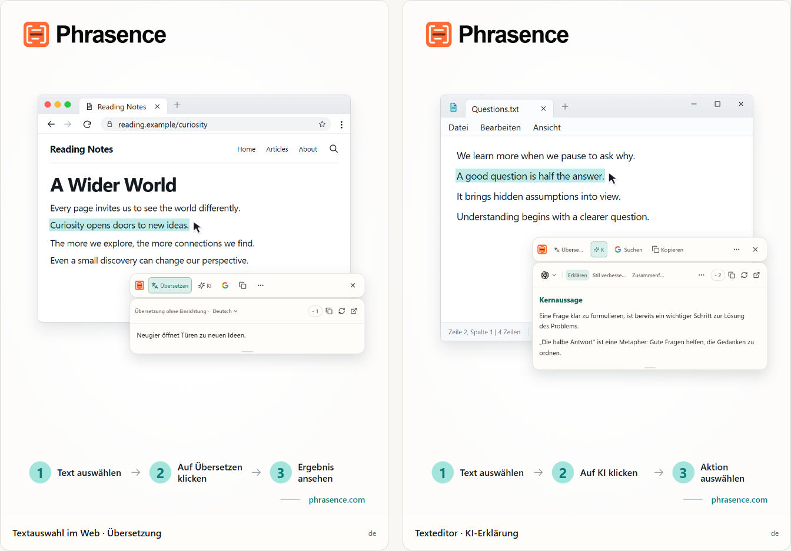

# Phrasence | KI-Übersetzer und Textassistent für den Desktop

[English](README.md) | [Español](README.es.md) | [Português (Brasil)](README.pt-BR.md) | [Português (Portugal)](README.pt-PT.md) | [Français](README.fr.md) | [Deutsch](README.de.md) | [Italiano](README.it.md) | [Nederlands](README.nl.md)

[Русский](README.ru.md) | [Polski](README.pl.md) | [Türkçe](README.tr.md) | [Українська](README.uk.md) | [日本語](README.ja.md) | [한국어](README.ko.md) | [Bahasa Indonesia](README.id.md) | [Tiếng Việt](README.vi.md)

[ไทย](README.th.md) | [Bahasa Melayu](README.ms.md) | [हिन्दी](README.hi.md) | [বাংলা](README.bn.md) | [简体中文](README.zh-CN.md) | [繁體中文](README.zh-TW.md)

[Offizielle Website](https://phrasence.com/) · [Download](https://phrasence.com/de/download) · [Benutzerhandbuch](https://phrasence.com/de/docs/getting-started)

## Über Phrasence

Mit Phrasence markierst du Text im Browser, Dokument oder Editor und wählst Übersetzen, Erklären, Zusammenfassen oder Überarbeiten. Die Werkzeuge bleiben neben deiner Auswahl, damit du beim Lesen und Schreiben im Fluss bleibst.

Phrasence platziert häufige Textaktionen direkt neben deiner Auswahl. Du entscheidest, was als Nächstes geschieht.

**Text markieren → Leiste einblenden → Nächsten Schritt wählen**



_Darstellung der Oberfläche: Übersetzung von markiertem Text und KI-Erklärung. Text und Credit-Werte sind Beispiele. Für die tatsächliche Nutzung gelten die aktuellen Regeln in der App._

## Für wen ist Phrasence gedacht

- **Menschen, die fremdsprachige Texte lesen**: Übersetze einen Satz auf einer Webseite oder in einem Dokument, ohne ihn in einen anderen Tab zu kopieren.
- **Studierende und Forschende**: Lass dir einen Begriff erklären, einen langen Satz aufschlüsseln oder eine schwierige Passage zusammenfassen, ohne deinen Lesekontext zu verlieren.
- **Entwickler und Leser technischer Dokumentation**: Erhalte den nötigen Kontext zu einem Fachbegriff, einem komplexen Satz, einer wissenschaftlichen Passage oder einem Codeausschnitt, ohne die Orientierung zu verlieren.
- **Menschen, die Texte oder Büroarbeiten erledigen**: Markiere einen Teil deines Entwurfs und lass ihn von der KI umformulieren, straffen oder im Ton anpassen.

## Funktionen

- **Übersetzung markierter Texte**: Wähle einen verfügbaren Übersetzungsdienst und die Zielsprache, sieh dir das Ergebnis neben der aktuellen App an und kopiere oder generiere es anschließend neu.
- **Erklären, Zusammenfassen und benutzerdefinierte Prompts mit KI**: KI-Werkzeuge können markierten Text erklären, zusammenfassen, verbessern, gliedern oder korrigieren. Du kannst auch eigene Aktionen wie „Als E-Mail umschreiben“ erstellen.
- **Vollständiger Arbeitsbereich**: Bei längeren Texten kannst du das Original von Hand bearbeiten und bequem zwischen Übersetzungs- und KI-Ergebnissen wechseln.
- **Suchen oder kopieren**: Kopiere den markierten Text direkt oder sende ihn an deine bevorzugte Suchmaschine und suche im Systembrowser weiter.
- **Lokaler Verlauf**: Öffne frühere Übersetzungen und KI-Ergebnisse erneut. Der Verlauf bleibt auf diesem Gerät und lässt sich jederzeit deaktivieren oder löschen.
- **Passt auf deinen Desktop**: Horizontal oder vertikal, hell oder dunkel, angeheftet oder flexibel – passe Phrasence an deinen Bildschirm und deine Arbeitsweise an.

### Übersetzungsdienste

**Einstellungen → Übersetzungsdienste**

Auswahl: Es gibt drei Möglichkeiten: Übersetzung ohne Einrichtung, lokales Übersetzungsmodell und Übersetzungsanbieter. Wähle eine aus und klicke auf „Verwenden“. Arbeitsbereich und Schnellleiste verwenden sie anschließend zum Übersetzen.

- Übersetzung ohne Einrichtung: Es ist keine Einrichtung nötig. Melde dich an und klicke auf „Verwenden“. Jede Übersetzung verbraucht Credits, die nach der Zeichenzahl des Ausgangstextes berechnet werden; maßgeblich ist der tatsächliche Abzug.
- Lokales Übersetzungsmodell: Vor der ersten Verwendung muss das Modell heruntergeladen werden. Danach kannst du offline und ohne Credits übersetzen; der Text wird nur auf diesem Computer verarbeitet.
- Übersetzungsanbieter: Wenn du bereits einen API-Schlüssel von Baidu, Microsoft, DeepL oder Google hast, kannst du ihn hier eingeben. Er bleibt auf diesem Computer; Preise und kostenlose Kontingente legt der Anbieter fest.

Das lokale Modell muss deine Sprachen unterstützen. Zum Herunterladen und Aktualisieren brauchst du eine Internetverbindung. Übersetzungen mit einem lokalen Modell oder einer eigenen Anbieter-API verbrauchen keine Phrasence-Credits. Der API-Anbieter kann eigene Gebühren berechnen. Speichere die erforderlichen Zugangsdaten und teste die Verbindung.

Übersetzungen und KI-Aktionen hängen vom eingerichteten Anbieter, der Netzwerkverbindung, verfügbaren Credits und dem aktuellen Veröffentlichungsstatus ab.

[Preise](https://phrasence.com/de/pricing)

## Bedienung

### 1. Herunterladen und installieren

Öffne die [Downloadseite](https://phrasence.com/de/download). Wähle die Version für dein Betriebssystem und deinen Prozessor.

Wenn kein Download-Schalter vorhanden ist, steht das zugehörige Installationsprogramm noch nicht bereit. Lade Phrasence nicht von inoffiziellen Websites herunter.

### 2. Die ersten Einstellungen vornehmen

Starte Phrasence und öffne **Einstellungen**. Prüfe diese Punkte der Reihe nach:

1. Wähle unter **Allgemeine Einstellungen** die Sprache der Oberfläche, das Design und das Standardlayout.
2. Aktiviere unter **Schnellaktionen** mindestens eine Art der Textauswahl.
3. Prüfe unter **Übersetzungsdienste**, welche Dienste verfügbar sind.
4. **KI-Werkzeuge**: Wähle die Ausgabesprache und die Aktionen, die du nutzen möchtest.
5. Wenn das System eine Berechtigung anfordert, folge dem Hinweis zu den Systemeinstellungen.

**Übersetzungsanbieter → Konfiguration speichern → Verbindung testen**

### 3. Text markieren und die Leiste öffnen

#### Beim Markieren von Text anzeigen

1. Aktiviere **Beim Markieren von Text anzeigen**.
2. Markiere Text in einer anderen App.
3. Sobald Phrasence den Text erhält, erscheint die Leiste neben der Auswahl.
4. Wähle Übersetzen, KI, Kopieren oder Suchen.

#### Mit Tastenkürzel anzeigen

1. Aktiviere **Mit Tastenkürzel anzeigen**.
2. Drücke das aktuelle Tastenkürzel der Leiste.
3. Die Leiste erscheint zunächst neben dem Mauszeiger.
4. Markiere den gewünschten Text.
5. Sobald Phrasence den Text erhält, werden die Aktionen verfügbar.

**Einstellungen → Schnellaktionen → Aktuelles Tastenkürzel**

Wenn die Leiste sichtbar ist, blendest du sie mit Esc jederzeit aus. Dies entspricht dem Schließen-Button.

### 4. Eine Aktion wählen

- **Übersetzen**: Verwendet den aktuellen Übersetzungsdienst und die Zielsprache.
- **KI**: Erklärt, verbessert, fasst zusammen oder führt eine andere eingerichtete Aktion aus. Anmeldung und verfügbare Credits sind erforderlich.
- **Suchen**: Öffnet die gewählte Suchmaschine im Systembrowser.
- **Kopieren**: Schreibt den aktuellen Text in die Zwischenablage.
- **Mehr**: Öffnet Arbeitsbereich, Verlauf, Einstellungen und Auswahlsteuerung.
- **Schließen**: Blendet die Leiste aus. Du kannst auch `Esc` drücken.

Kosten: Einstellungen bearbeiten, Aktionen sortieren und erstellen verbraucht keine Credits. Für die Ausführung musst du angemeldet sein; abgezogen werden die beim Modell angezeigten Credits.

### 5. Im Arbeitsbereich weiterarbeiten

**Mehr → Arbeitsbereich öffnen**

Die Schnellleiste verarbeitet eine Auswahl direkt neben der verwendeten App. Der vollständige Arbeitsbereich bietet Platz zum Bearbeiten oder für längere Texte. Beide führen dasselbe aktuelle Ergebnis fort, sodass du die Anfrage nicht erneut ausführen musst.

Im Übersetzungsbereich kann eine Änderung an einer nicht leeren Eingabe automatisch eine Übersetzung starten. KI-Aktionen musst du weiterhin ausdrücklich auswählen. Ob der Verlauf gespeichert wird, hängt von deinen Einstellungen und den Regeln des gewählten Dienstes ab.

### 6. Eine eigene KI-Aktion speichern

**Einstellungen → KI-Werkzeuge → Aktion erstellen**

Gib der Aktion einen Namen und eine Anweisung. Speichere sie und wähle sie danach in der Liste der KI-Aktionen aus. Für schwierige Texte kannst du zum Beispiel diese Anweisung speichern:

Einrichtung: „Aktiviert“ bestimmt, ob eine Aktion verwendet werden kann. Der Schalter „Werkzeugleiste“ bestimmt, ob sie in der Schnellleiste erscheint. Ziehe Aktionen, um sie zu sortieren.

```text
Erkläre die Hauptaussage des markierten Textes und liste die wichtigsten Punkte auf.
Behalte Namen, Zahlen und Bedingungen aus dem Original bei.
Benenne Unsicherheiten klar. Ergänze keine unbelegten Fakten.
```

Die Anweisung ist ein Beispiel. Vergleiche Übersetzungen und KI-Antworten mit dem Original. Prüfe besonders Namen, Zahlen, Termine und Bedingungen.

## Häufige Fragen

### Was tun, wenn die Leiste nicht erscheint?

Prüfe, ob Phrasence läuft und in den Schnellaktionen mindestens eine Methode zum Öffnen aktiviert ist. Prüfe auch die Systemberechtigungen und ob sich in der anderen App Text markieren lässt. Kann Phrasence die Auswahl nicht lesen, gib den Text im Arbeitsbereich ein oder füge ihn dort ein.

### Warum soll ich Text kopieren oder einfügen?

Manche Apps zeigen eine Auswahl an, geben den Text aber nicht frei. Sollst du kopieren, lass die ursprüngliche App aktiv und drücke `Strg+C` beziehungsweise `⌘C` unter macOS. Sollst du manuell einfügen, öffne das angezeigte Eingabefeld und drücke `Strg+V` beziehungsweise `⌘V` unter macOS. Manuelles oder automatisches Kopieren kann den Inhalt der Zwischenablage ersetzen. Automatisches Kopieren lässt sich unter Einstellungen → Schnellaktionen abschalten.

### Brauche ich ein Konto, um Phrasence zu nutzen?

Für die grundlegenden Funktionen nicht; sie sind ohne Anmeldung verfügbar. KI-Werkzeuge, Planvorteile und Kontofunktionen fordern dich bei Bedarf zur Anmeldung auf.

Kosten: Einstellungen bearbeiten, Aktionen sortieren und erstellen verbraucht keine Credits. Für die Ausführung musst du angemeldet sein; abgezogen werden die beim Modell angezeigten Credits.

## Daten und Datenschutz

- Das Markieren bereitet lediglich den Kontext vor. Es sendet keine Anfrage, verbraucht keine Credits und legt keinen abgeschlossenen Eintrag im Verlauf an.
- Wohin der Text gesendet wird: Bei der sofort nutzbaren Übersetzung geht er an den Phrasence-Übersetzungsdienst und danach an die aktuelle Engine. Mit eigenem API-Schlüssel sendet dieser Computer ihn direkt an den Anbieter. Beim lokalen Modell bleibt er auf diesem Computer.
- Wohin der Text gesendet wird: Markierter Text und Aktionsanweisung werden über Phrasence an den gewählten KI-Dienst gesendet. Die Abrechnung speichert nicht den Ausgangstext, sondern nur Modell und verbrauchte Credits.
- Wenn aktiviert, wird der Verlauf ausschließlich auf diesem Gerät gespeichert und nie mit der Cloud synchronisiert. Du kannst ihn jederzeit deaktivieren oder löschen.

Im Übersetzungsbereich kann eine Änderung an einer nicht leeren Eingabe automatisch eine Übersetzung starten. KI-Aktionen musst du weiterhin ausdrücklich auswählen. Ob der Verlauf gespeichert wird, hängt von deinen Einstellungen und den Regeln des gewählten Dienstes ab.

[Datenschutz und Daten](https://phrasence.com/de/docs/privacy-security) · [Datenschutzerklärung (EN)](https://phrasence.com/privacy-policy)

## Offizielle Website und Hilfe

- [Offizielle Website: phrasence.com](https://phrasence.com/)
- [Herunterladen, installieren und erstmals starten](https://phrasence.com/de/docs/getting-started)
- [Fehlerbehebung](https://phrasence.com/de/docs/troubleshooting)
- [Kontakt über Telegram](https://t.me/phrasence)

Melde dich für Hilfe oder einen Fehlerbericht auf der Website an und öffne Hilfe und Feedback in den Einstellungen. Nenne dein Betriebssystem, die App-Version, den gewählten Dienst und die Schritte, mit denen sich das Problem nachstellen lässt.
