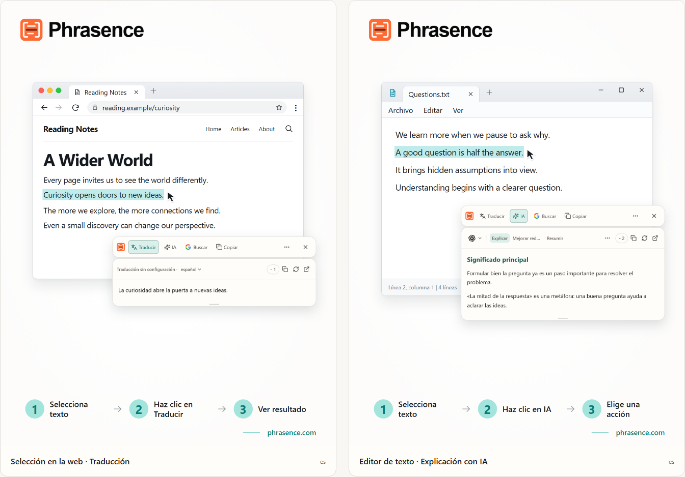

# Phrasence | Traductor y asistente de texto con IA para escritorio

[English](README.md) | [Español](README.es.md) | [Português (Brasil)](README.pt-BR.md) | [Português (Portugal)](README.pt-PT.md) | [Français](README.fr.md) | [Deutsch](README.de.md) | [Italiano](README.it.md) | [Nederlands](README.nl.md)

[Русский](README.ru.md) | [Polski](README.pl.md) | [Türkçe](README.tr.md) | [Українська](README.uk.md) | [日本語](README.ja.md) | [한국어](README.ko.md) | [Bahasa Indonesia](README.id.md) | [Tiếng Việt](README.vi.md)

[ไทย](README.th.md) | [Bahasa Melayu](README.ms.md) | [हिन्दी](README.hi.md) | [বাংলা](README.bn.md) | [简体中文](README.zh-CN.md) | [繁體中文](README.zh-TW.md)

[Sitio web oficial](https://phrasence.com/) · [Descargar](https://phrasence.com/es/download) · [Guía de uso](https://phrasence.com/es/docs/getting-started)

## Qué es Phrasence

Con Phrasence, selecciona texto en un navegador, documento o editor y elige traducirlo, explicarlo, resumirlo o mejorarlo. Las herramientas quedan junto a la selección para que sigas leyendo y escribiendo.

Phrasence coloca las acciones habituales junto al texto seleccionado. Tú decides qué ocurre después.

**Selecciona el texto → Abre la barra → Elige el siguiente paso**



_Ilustración de la interfaz: traducción del texto seleccionado y explicación de IA. El texto y los créditos mostrados son ejemplos. El uso real se rige por las condiciones actuales de la aplicación._

## Para quién es

- **Personas que leen en otro idioma**: Traduce una frase de una página o un documento sin copiarla en otra pestaña.
- **Estudiantes e investigadores**: Aclara un término, desentraña una frase larga o resume un fragmento difícil sin perder el contexto de lectura.
- **Desarrolladores y lectores de documentación técnica**: Añade el contexto necesario a un término técnico, una frase compleja, un fragmento académico o un bloque de código sin perder el hilo.
- **Personas que redactan textos o trabajan en una oficina**: Selecciona una parte del borrador y pide a la IA que la reformule, condense la idea o ajuste el tono.

## Funciones principales

- **Traducción del texto seleccionado**: Elige un servicio de traducción disponible y el idioma de destino, consulta el resultado junto a la aplicación actual y después cópialo o vuelve a generarlo.
- **Explicación, resumen y prompts personalizados con IA**: Explicar, resumir, mejorar, extraer puntos clave o corregir el texto seleccionado. También puedes crear acciones como «Convertir en correo» o «Generar respuesta».
- **Espacio de trabajo completo**: Para textos largos, edita manualmente el original y cambia con comodidad entre los resultados de traducción e IA.
- **Busca o copia**: Copia directamente el texto seleccionado o envíalo al motor de búsqueda que prefieras para continuar en el navegador del sistema.
- **Historial local**: Vuelve a abrir traducciones y resultados de IA anteriores. El historial permanece en este dispositivo y puedes desactivarlo o borrarlo cuando quieras.
- **Se adapta a tu escritorio**: Horizontal o vertical, claro u oscuro, fijado o libre: adapta Phrasence a tu pantalla y a tu forma de trabajar.

### Servicios de traducción

**Ajustes → Servicios de traducción**

Cómo elegir: Hay tres opciones: traducción sin configuración, modelo de traducción local y proveedores de traducción. Elige una y pulsa «Usar»; el área de trabajo y la barra rápida la usarán para traducir.

- Traducción sin configuración: No requiere configuración. Inicia sesión y pulsa «Usar». Cada traducción consume créditos, calculados según los caracteres del texto original; prevalece el descuento real.
- Modelo de traducción local: Debes descargarlo antes del primer uso. Después podrás traducir sin conexión y sin gastar créditos; el texto se procesa solo en este equipo.
- Proveedores de traducción: Si ya tienes una clave API de Baidu, Microsoft, DeepL o Google, introdúcela aquí. La clave permanece en este equipo; el proveedor decide los precios y las cuotas gratuitas.

El modelo local debe admitir los idiomas que necesitas. Descargarlo o actualizarlo requiere conexión. La traducción con un modelo local o con tu propia API no consume créditos de Phrasence. El proveedor de tu API puede cobrar por su servicio. Guarda los datos de conexión que solicite y comprueba la conexión.

Las acciones de traducción e IA dependen del proveedor configurado, la conexión de red, los créditos disponibles y el estado actual de la versión.

[Precios](https://phrasence.com/es/pricing)

## Guía de uso

### 1. Descargar e instalar

Abre la [página de descargas](https://phrasence.com/es/download). Elige la versión que corresponda a tu sistema operativo y procesador.

Si no hay un botón de descarga, ese instalador todavía no está disponible. No descargues Phrasence desde sitios no oficiales.

### 2. Completar la configuración inicial

Inicia Phrasence y abre **Ajustes**. Revisa estos elementos en orden:

1. En **Ajustes generales**, elige el idioma de la interfaz, el tema y la distribución predeterminada.
2. En **Acciones rápidas**, activa al menos un método de selección de texto.
3. En **Servicios de traducción**, comprueba qué servicios están disponibles.
4. **Herramientas de IA**: Elige el idioma de salida y las acciones que quieres usar.
5. Si el sistema pide un permiso, sigue el aviso para abrir los ajustes del sistema.

**Proveedores de traducción → Guardar configuración → Probar conexión**

### 3. Seleccionar texto y abrir la barra

#### Mostrar al seleccionar texto

1. Activa **Mostrar al seleccionar texto**.
2. Selecciona texto en otra aplicación.
3. Cuando Phrasence reciba el texto, la barra aparecerá cerca de la selección.
4. Elige Traducir, IA, Copiar o Buscar.

#### Mostrar mediante un atajo

1. Activa **Mostrar mediante un atajo**.
2. Pulsa el atajo actual de la barra.
3. La barra aparecerá primero cerca del puntero.
4. Selecciona el texto que quieras procesar.
5. Cuando Phrasence reciba el texto, se activarán las acciones.

**Ajustes → Acciones rápidas → Atajo actual**

Mientras la barra esté visible, pulsa Esc para ocultarla. Tiene el mismo efecto que el botón Cerrar.

### 4. Elegir una acción

- **Traducir**: usa el servicio de traducción y el idioma de destino actuales.
- **IA**: explica, mejora, resume o ejecuta otra acción configurada. Requiere iniciar sesión y tener créditos disponibles.
- **Buscar**: abre el motor de búsqueda elegido en el navegador del sistema.
- **Copiar**: escribe el texto actual en el portapapeles.
- **Más**: abre el espacio de trabajo, el historial, los ajustes y los controles de selección.
- **Cerrar**: oculta la barra. También puedes pulsar `Esc`.

Coste: Editar ajustes, ordenar y crear acciones no consume créditos. Para ejecutar una acción debes iniciar sesión y se descuentan los créditos mostrados para el modelo elegido.

### 5. Continuar en el espacio de trabajo

**Más → Abrir espacio de trabajo**

La barra rápida sirve para procesar una selección junto a la aplicación que estás usando. El espacio de trabajo completo permite editar o tratar textos más largos. Ambos continúan con el mismo resultado actual, por lo que no hace falta repetir la solicitud.

En la pestaña de traducción del espacio de trabajo, cambiar una entrada que no esté vacía puede iniciar una traducción automática. Las acciones de IA requieren una elección explícita. El guardado del historial depende de tus ajustes y de las reglas del servicio elegido.

### 6. Guardar una acción de IA personalizada

**Ajustes → Herramientas de IA → Crear acción**

Asigna un nombre y una instrucción a la acción. Guárdala y después elígela en la lista de acciones de IA. Por ejemplo, puedes guardar esta instrucción para leer un texto difícil:

Cómo configurar: «Activada» decide si una acción se puede usar. El interruptor «Barra rápida» decide si aparece en la barra rápida. Arrastra las acciones para ordenarlas.

```text
Explica la idea principal del texto seleccionado y enumera sus puntos clave.
Conserva los nombres, las cifras y las condiciones del original.
Indica con claridad cualquier duda. No añadas datos sin respaldo.
```

La instrucción es un ejemplo. Revisa las traducciones y respuestas de IA con el original, sobre todo nombres, cifras, fechas y condiciones.

## Preguntas frecuentes

### ¿Qué hago si no aparece la barra?

Comprueba que Phrasence esté abierto y que haya al menos un método de apertura activado en Acciones rápidas. Revisa los permisos del sistema y si la aplicación de origen permite seleccionar texto. Si no se puede leer la selección, escribe o pega el texto en el espacio de trabajo.

### ¿Por qué se me pide copiar o pegar?

Algunas aplicaciones muestran una selección sin facilitar su texto. Si el mensaje pide copiar, mantén activa la aplicación de origen y pulsa `Ctrl+C`, o `⌘C` en macOS. Si pide pegar manualmente, abre el área indicada y pulsa `Ctrl+V`, o `⌘V` en macOS. La copia manual o automática puede sustituir el contenido del portapapeles. Puedes desactivar la copia automática en Ajustes → Acciones rápidas.

### ¿Necesito una cuenta para usar Phrasence?

No para las funciones básicas, que están disponibles sin iniciar sesión. Las herramientas de IA, las ventajas del plan y las funciones de la cuenta te pedirán que inicies sesión cuando sea necesario.

Coste: Editar ajustes, ordenar y crear acciones no consume créditos. Para ejecutar una acción debes iniciar sesión y se descuentan los créditos mostrados para el modelo elegido.

## Datos y privacidad

- Seleccionar texto solo prepara el contexto: no envía solicitudes, no consume créditos ni añade resultados al historial.
- Dónde se envía el texto: Con la traducción lista para usar, se envía al servicio de Phrasence y después al motor actual. Con tu propia clave API, este equipo lo envía directamente al proveedor. Con el modelo local, no sale del equipo.
- Dónde se envía el texto: El texto seleccionado y las instrucciones se envían mediante Phrasence al servicio de IA elegido. El registro de cobro no guarda el texto original; solo registra el modelo y los créditos consumidos.
- Cuando está activado, el historial solo se guarda en este dispositivo y nunca se sincroniza con la nube. Puedes desactivarlo o borrarlo en cualquier momento.

En la pestaña de traducción del espacio de trabajo, cambiar una entrada que no esté vacía puede iniciar una traducción automática. Las acciones de IA requieren una elección explícita. El guardado del historial depende de tus ajustes y de las reglas del servicio elegido.

[Privacidad y datos](https://phrasence.com/es/docs/privacy-security) · [Política de privacidad (EN)](https://phrasence.com/privacy-policy)

## Sitio oficial y ayuda

- [Sitio web oficial: phrasence.com](https://phrasence.com/)
- [Descarga, instalación y primer inicio](https://phrasence.com/es/docs/getting-started)
- [Solución de problemas](https://phrasence.com/es/docs/troubleshooting)
- [Contactar por Telegram](https://t.me/phrasence)

Para pedir ayuda o informar de un error, inicia sesión en el sitio web y abre Ayuda y comentarios en los ajustes. Incluye el sistema operativo, la versión de la aplicación, el servicio elegido y los pasos para reproducir el problema.
