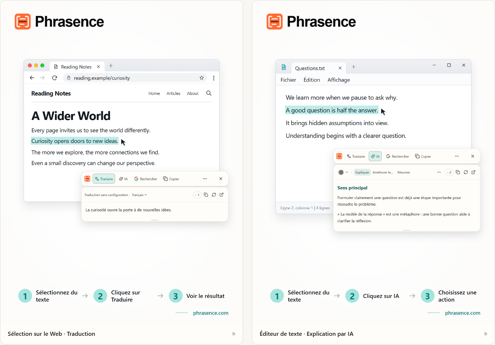

# Phrasence | Traducteur et assistant de texte IA pour ordinateur

[English](README.md) | [Español](README.es.md) | [Português (Brasil)](README.pt-BR.md) | [Português (Portugal)](README.pt-PT.md) | [Français](README.fr.md) | [Deutsch](README.de.md) | [Italiano](README.it.md) | [Nederlands](README.nl.md)

[Русский](README.ru.md) | [Polski](README.pl.md) | [Türkçe](README.tr.md) | [Українська](README.uk.md) | [日本語](README.ja.md) | [한국어](README.ko.md) | [Bahasa Indonesia](README.id.md) | [Tiếng Việt](README.vi.md)

[ไทย](README.th.md) | [Bahasa Melayu](README.ms.md) | [हिन्दी](README.hi.md) | [বাংলা](README.bn.md) | [简体中文](README.zh-CN.md) | [繁體中文](README.zh-TW.md)

[Site officiel](https://phrasence.com/) · [Télécharger](https://phrasence.com/fr/download) · [Guide d'utilisation](https://phrasence.com/fr/docs/getting-started)

## Présentation du produit

Avec Phrasence, sélectionnez du texte dans un navigateur, un document ou un éditeur, puis choisissez de le traduire, de l’expliquer, de le résumer ou de le retravailler. Les outils restent près de votre sélection pour garder le fil de votre lecture et de votre écriture.

Phrasence place les actions courantes à côté de votre sélection. Vous décidez de la suite.

**Sélectionnez le texte → Affichez la barre d'outils → Choisissez l'action suivante**



_Illustration de l’interface : traduction du texte sélectionné et explication d’IA. Le texte et les crédits affichés sont des exemples. L’utilisation réelle suit les règles en vigueur dans l’application._

## À qui s’adresse Phrasence

- **Personnes qui lisent dans une autre langue** : Traduisez une phrase d'une page ou d'un document sans la copier dans un autre onglet.
- **Étudiants et chercheurs** : Expliquez un terme, décortiquez une longue phrase ou résumez un passage difficile tout en gardant votre contexte de lecture.
- **Développeurs et lecteurs de documentation technique** : Obtenez le contexte nécessaire pour un terme technique, une phrase dense, un passage de recherche ou un extrait de code sans perdre le fil.
- **Personnes qui rédigent des textes au quotidien** : Sélectionnez une partie de votre brouillon et demandez à l'IA de la reformuler, de resserrer l'idée ou d'ajuster le ton.

## Fonctionnalités

- **Traduction du texte sélectionné** : Choisissez un service de traduction disponible et la langue cible, consultez le résultat à côté de l'application active, puis copiez-le ou relancez la traduction.
- **Explication, résumé et prompts personnalisés par IA** : Expliquer, résumer, améliorer, extraire les points clés ou corriger le texte sélectionné. Vous pouvez aussi créer des actions comme « Réécrire en e-mail » ou « Générer une réponse ».
- **Espace de travail complet** : Pour les textes longs, modifiez manuellement l'original et passez facilement des résultats de traduction à ceux de l'IA.
- **Rechercher ou copier** : Copiez directement le texte sélectionné ou envoyez-le vers votre moteur de recherche préféré pour continuer dans le navigateur système.
- **Historique local** : Rouvrez vos traductions et résultats IA précédents. L'historique reste sur cet appareil et peut être désactivé ou effacé à tout moment.
- **S'adapte à votre bureau** : Horizontal ou vertical, clair ou sombre, épinglé ou libre : adaptez Phrasence à votre écran et à vos habitudes.

### Services de traduction

**Paramètres → Services de traduction**

Comment choisir : Trois options sont disponibles : traduction sans configuration, modèle local et fournisseurs de traduction. Choisissez-en une et cliquez sur « Utiliser » ; l’espace de travail et la barre rapide l’utiliseront pour traduire.

- Traduction sans configuration : Aucune configuration n’est nécessaire. Connectez-vous et cliquez sur « Utiliser ». Chaque traduction consomme des crédits calculés selon le nombre de caractères du texte source ; le débit réel fait foi.
- Modèle de traduction local : Téléchargez-le avant la première utilisation. Vous pourrez ensuite traduire hors ligne sans dépenser de crédits ; le texte est traité uniquement sur cet ordinateur.
- Fournisseurs de traduction : Si vous avez déjà une clé API Baidu, Microsoft, DeepL ou Google, saisissez-la ici. Elle reste sur cet ordinateur ; le fournisseur fixe les tarifs et quotas gratuits.

Le modèle local doit prendre en charge vos langues. Son téléchargement et ses mises à jour nécessitent une connexion. La traduction avec un modèle local ou votre propre API ne consomme pas de crédits Phrasence. Le fournisseur de l’API peut facturer son service. Enregistrez les paramètres de connexion demandés, puis testez la connexion.

Les actions de traduction et d'IA dépendent du fournisseur configuré, de l'accès au réseau, des crédits disponibles et de l'état actuel de la version.

[Tarifs](https://phrasence.com/fr/pricing)

## Guide d’utilisation

### 1. Télécharger et installer

Ouvrez la [page de téléchargement](https://phrasence.com/fr/download). Choisissez la version adaptée à votre système et à votre processeur.

S’il n’y a pas de bouton de téléchargement, le fichier correspondant n’est pas encore disponible. Ne téléchargez pas Phrasence depuis un site non officiel.

### 2. Effectuer la première configuration

Démarrez Phrasence et ouvrez **Paramètres**. Vérifiez les éléments suivants dans l’ordre :

1. Dans **Paramètres généraux**, choisissez la langue de l’interface, le thème et la disposition par défaut.
2. Dans **Actions rapides**, activez au moins un mode de sélection de texte.
3. Dans **Services de traduction**, consultez les services actuellement disponibles.
4. **Outils d'IA** : Choisissez la langue du résultat et les actions à utiliser.
5. Si le système demande une autorisation, suivez le message pour ouvrir les réglages système.

**Fournisseurs de traduction → Enregistrer la configuration → Tester la connexion**

### 3. Sélectionner du texte et ouvrir la barre

#### Afficher lors de la sélection de texte

1. Activez **Afficher lors de la sélection de texte**.
2. Sélectionnez du texte dans une autre application.
3. Lorsque Phrasence reçoit le texte, la barre s’affiche près de la sélection.
4. Choisissez Traduire, IA, Copier ou Rechercher.

#### Afficher avec un raccourci

1. Activez **Afficher avec un raccourci**.
2. Appuyez sur le raccourci actuel de la barre.
3. La barre s’affiche d’abord près du pointeur.
4. Sélectionnez le texte à traiter.
5. Lorsque Phrasence reçoit le texte, les actions deviennent disponibles.

**Paramètres → Actions rapides → Raccourci actuel**

Lorsque la barre est visible, appuyez sur Échap pour la masquer. L'effet est identique au bouton Fermer.

### 4. Choisir une action

- **Traduire** : utilise le service de traduction et la langue cible actuels.
- **IA** : explique, améliore, résume ou exécute une autre action configurée. Une connexion et des crédits disponibles sont nécessaires.
- **Rechercher** : ouvre le moteur de recherche choisi dans le navigateur système.
- **Copier** : place le texte actuel dans le presse-papiers.
- **Plus** : ouvre l’espace de travail, l’historique, les paramètres et les réglages de sélection.
- **Fermer** : masque la barre. Vous pouvez aussi appuyer sur `Esc`.

Coût : Modifier les réglages, réordonner et créer des actions ne consomme pas de crédits. L’exécution nécessite une connexion et débite les crédits affichés pour le modèle choisi.

### 5. Continuer dans l’espace de travail

**Plus → Ouvrir l'espace de travail**

La barre rapide sert à traiter une sélection à côté de l'application utilisée. L'espace de travail complet offre davantage de place pour modifier ou traiter un texte long. Les deux reprennent le même résultat en cours : inutile de relancer la requête.

Dans l’onglet de traduction de l’espace de travail, modifier une saisie non vide peut lancer une traduction automatique. Les actions d’IA nécessitent toujours un choix explicite. L’enregistrement de l’historique dépend de vos réglages et des règles du service choisi.

### 6. Enregistrer une action d’IA personnalisée

**Paramètres → Outils d'IA → Créer une action**

Donnez un nom à l’action et rédigez une consigne. Enregistrez-la, puis choisissez-la dans la liste des actions d’IA. Voici un exemple de consigne pour lire un passage difficile :

Configuration : « Activée » détermine si l’action est utilisable. L’option « Barre rapide » détermine si elle apparaît dans la barre rapide. Faites glisser les actions pour les réordonner.

```text
Explique l’idée principale du texte sélectionné et énumère ses points clés.
Conserve les noms, les chiffres et les conditions du texte original.
Signale clairement les incertitudes. N’ajoute aucun fait sans fondement.
```

La consigne est un exemple. Comparez les traductions et les réponses d’IA au texte original, surtout les noms, les chiffres, les dates et les conditions.

## Questions fréquentes

### Que faire si la barre ne s’affiche pas ?

Vérifiez que Phrasence est ouvert et qu’au moins un mode d’ouverture est activé dans Actions rapides. Contrôlez les autorisations du système et la possibilité de sélectionner du texte dans l’application d’origine. Si la sélection ne peut pas être lue, saisissez ou collez le texte dans l’espace de travail.

### Pourquoi l’application demande-t-elle de copier ou de coller ?

Certaines applications affichent une sélection sans fournir son texte. Si le message demande une copie, gardez l’application d’origine active et appuyez sur `Ctrl+C`, ou `⌘C` sur macOS. S’il demande un collage manuel, ouvrez la zone indiquée et appuyez sur `Ctrl+V`, ou `⌘V` sur macOS. La copie manuelle ou automatique peut remplacer le contenu du presse-papiers. Vous pouvez désactiver la copie automatique dans Paramètres → Actions rapides.

### Faut-il un compte pour utiliser Phrasence ?

Pas pour les fonctions essentielles, qui restent accessibles sans connexion. Les outils d'IA, les avantages du forfait et les fonctions du compte vous demandent de vous connecter lorsque c'est nécessaire.

Coût : Modifier les réglages, réordonner et créer des actions ne consomme pas de crédits. L’exécution nécessite une connexion et débite les crédits affichés pour le modèle choisi.

## Données et confidentialité

- La sélection prépare uniquement le contexte : elle n'envoie aucune requête, ne consomme aucun crédit et n'ajoute aucun résultat à l'historique.
- Où va le texte : Avec la traduction prête à l’emploi, il est envoyé au service Phrasence puis au moteur actuel. Avec votre clé API, cet ordinateur l’envoie directement au fournisseur. Avec le modèle local, il ne quitte pas l’ordinateur.
- Où va le texte : Le texte sélectionné et les instructions sont envoyés via Phrasence au service d’IA choisi. Le relevé ne conserve pas le texte source ; il enregistre uniquement le modèle et les crédits consommés.
- Lorsqu'il est activé, l'historique est conservé uniquement sur cet appareil et n'est jamais synchronisé avec le cloud. Désactivez-le ou effacez-le à tout moment.

Dans l’onglet de traduction de l’espace de travail, modifier une saisie non vide peut lancer une traduction automatique. Les actions d’IA nécessitent toujours un choix explicite. L’enregistrement de l’historique dépend de vos réglages et des règles du service choisi.

[Confidentialité et données](https://phrasence.com/fr/docs/privacy-security) · [Politique de confidentialité (EN)](https://phrasence.com/privacy-policy)

## Site officiel et assistance

- [Site officiel : phrasence.com](https://phrasence.com/)
- [Télécharger, installer et démarrer](https://phrasence.com/fr/docs/getting-started)
- [Dépannage](https://phrasence.com/fr/docs/troubleshooting)
- [Nous contacter sur Telegram](https://t.me/phrasence)

Pour demander de l’aide ou signaler un problème, connectez-vous au site et ouvrez Aide et commentaires dans les paramètres. Indiquez le système d’exploitation, la version de l’application, le service choisi et les étapes permettant de reproduire le problème.
