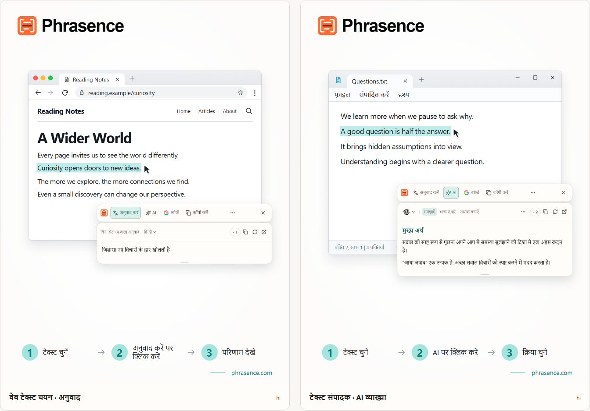

# Phrasence | चुने गए टेक्स्ट के लिए डेस्कटॉप AI अनुवादक और सहायक

[English](README.md) | [Español](README.es.md) | [Português (Brasil)](README.pt-BR.md) | [Português (Portugal)](README.pt-PT.md) | [Français](README.fr.md) | [Deutsch](README.de.md) | [Italiano](README.it.md) | [Nederlands](README.nl.md)

[Русский](README.ru.md) | [Polski](README.pl.md) | [Türkçe](README.tr.md) | [Українська](README.uk.md) | [日本語](README.ja.md) | [한국어](README.ko.md) | [Bahasa Indonesia](README.id.md) | [Tiếng Việt](README.vi.md)

[ไทย](README.th.md) | [Bahasa Melayu](README.ms.md) | [हिन्दी](README.hi.md) | [বাংলা](README.bn.md) | [简体中文](README.zh-CN.md) | [繁體中文](README.zh-TW.md)

[आधिकारिक वेबसाइट](https://phrasence.com/) · [डाउनलोड](https://phrasence.com/hi/download) · [उपयोगकर्ता गाइड](https://phrasence.com/hi/docs/getting-started)

## Phrasence के बारे में

Phrasence के साथ ब्राउज़र, दस्तावेज़ या एडिटर में टेक्स्ट चुनें, फिर अनुवाद, व्याख्या, सारांश या सुधार का विकल्प चुनें। टूल चुने गए टेक्स्ट के पास रहते हैं, ताकि पढ़ने और लिखने का प्रवाह बना रहे।

Phrasence आम टेक्स्ट कार्रवाइयों को चुने गए हिस्से के पास रखता है। आगे क्या करना है, यह आप तय करते हैं।

**टेक्स्ट चुनें → टूलबार खोलें → अगला कदम चुनें**



_इंटरफ़ेस का उदाहरण: चुने हुए टेक्स्ट का अनुवाद और AI की व्याख्या। दिखाया गया टेक्स्ट और क्रेडिट की संख्या केवल उदाहरण हैं। असली इस्तेमाल पर ऐप के मौजूदा नियम लागू होते हैं।_

## यह किनके लिए है

- **दूसरी भाषा में पढ़ने वाले लोग**: किसी पेज या दस्तावेज़ का वाक्य दूसरी टैब में कॉपी किए बिना अनुवाद करें।
- **छात्र और शोधकर्ता**: पढ़ने का संदर्भ बनाए रखते हुए किसी शब्द की व्याख्या पाएँ, लंबा वाक्य समझें या कठिन अंश का सारांश लें।
- **डेवलपर और तकनीकी दस्तावेज़ पढ़ने वाले लोग**: अपनी पढ़ने की जगह खोए बिना तकनीकी शब्द, जटिल वाक्य, शोध के अंश या कोड के लिए ज़रूरी संदर्भ पाएँ।
- **लिखने वाले लोग और दफ़्तर के कर्मचारी**: मसौदे का एक हिस्सा चुनें और AI से उसे अलग ढंग से लिखने, बात को छोटा करने या लहजा बदलने को कहें।

## मुख्य सुविधाएँ

- **चुने गए टेक्स्ट का अनुवाद**: उपलब्ध अनुवाद सेवा और लक्ष्य भाषा चुनें, मौजूदा ऐप के पास परिणाम देखें और फिर उसे कॉपी करें या दोबारा बनाएँ।
- **AI से व्याख्या, सारांश और कस्टम प्रॉम्प्ट**: चुने हुए पाठ को समझाना, संक्षिप्त करना, बेहतर बनाना, मुख्य बिंदु निकालना या सुधारना। आप “ईमेल के रूप में लिखें” जैसे अपने ऐक्शन भी बना सकते हैं।
- **पूरा वर्कस्पेस**: लंबे टेक्स्ट के लिए मूल सामग्री को खुद संपादित करें और अनुवाद तथा AI के परिणामों के बीच आसानी से जाएँ।
- **खोजें या कॉपी करें**: चुना हुआ टेक्स्ट सीधे कॉपी करें या अपने पसंदीदा सर्च इंजन को भेजकर सिस्टम ब्राउज़र में खोज जारी रखें।
- **स्थानीय इतिहास**: पुराने अनुवाद और AI परिणाम फिर खोलें। इतिहास इसी डिवाइस पर रहता है और इसे कभी भी बंद या साफ़ किया जा सकता है।
- **आपके डेस्कटॉप के अनुसार**: आड़ा या खड़ा, हल्का या गहरा, हमेशा ऊपर या स्वतंत्र—Phrasence को अपनी स्क्रीन और काम करने के तरीके के अनुसार ढालें।

### अनुवाद सेवाएँ

**सेटिंग → अनुवाद सेवाएँ**

कैसे चुनें: तीन विकल्प हैं—बिना सेटअप वाला अनुवाद, स्थानीय मॉडल और अनुवाद प्रदाता। एक विकल्प चुनकर “उपयोग करें” दबाएँ; कार्यक्षेत्र और त्वरित टूलबार उसी से अनुवाद करेंगे।

- बिना सेटअप वाला अनुवाद: किसी सेटअप की ज़रूरत नहीं है। साइन इन करके “उपयोग करें” दबाएँ। हर अनुवाद में क्रेडिट खर्च होते हैं, जो मूल पाठ के अक्षरों की संख्या से तय होते हैं; वास्तविक कटौती अंतिम मानी जाएगी।
- स्थानीय अनुवाद मॉडल: पहली बार उपयोग से पहले मॉडल डाउनलोड करें। इसके बाद बिना क्रेडिट खर्च किए ऑफ़लाइन अनुवाद कर सकते हैं; पाठ केवल इसी कंप्यूटर पर प्रोसेस होता है।
- अनुवाद प्रदाता: अगर आपके पास Baidu, Microsoft, DeepL या Google की API कुंजी है, तो यहाँ भरें। कुंजी इसी कंप्यूटर पर रहती है; शुल्क और मुफ़्त सीमा प्रदाता तय करता है।

लोकल मॉडल में आपकी ज़रूरत की भाषाओं का समर्थन होना चाहिए। मॉडल डाउनलोड या अपडेट करने के लिए इंटरनेट चाहिए। लोकल मॉडल या अपनी API से अनुवाद करने पर Phrasence क्रेडिट नहीं लगते। API देने वाली सेवा अलग शुल्क ले सकती है। माँगी गई कनेक्शन जानकारी सेव करें और कनेक्शन जाँचें।

अनुवाद और AI कार्रवाइयाँ चुनी गई सेवा, नेटवर्क, उपलब्ध क्रेडिट और मौजूदा रिलीज़ स्थिति पर निर्भर करती हैं।

[कीमतें](https://phrasence.com/hi/pricing)

## इस्तेमाल कैसे करें

### 1. डाउनलोड और इंस्टॉल करें

[डाउनलोड पेज](https://phrasence.com/hi/download) खोलें। अपने ऑपरेटिंग सिस्टम और प्रोसेसर के अनुसार सही वर्शन चुनें।

अगर डाउनलोड बटन नहीं है, तो वह इंस्टॉलर अभी उपलब्ध नहीं है। Phrasence को किसी अनजान वेबसाइट से डाउनलोड न करें।

### 2. पहली सेटिंग पूरी करें

Phrasence शुरू करें और **सेटिंग** खोलें। इन चीज़ों को क्रम से जाँचें:

1. **बुनियादी सेटिंग** में इंटरफ़ेस की भाषा, थीम और डिफ़ॉल्ट लेआउट चुनें।
2. **क्विक ऐक्शन** में टेक्स्ट चुनने का कम से कम एक तरीका चालू करें।
3. **अनुवाद सेवाएँ** में देखें कि कौन-सी सेवाएँ उपलब्ध हैं।
4. **AI टूल**: जवाब की भाषा और इस्तेमाल करने वाले ऐक्शन चुनें।
5. अगर सिस्टम अनुमति माँगे, तो संदेश के अनुसार सिस्टम सेटिंग खोलें।

**अनुवाद प्रदाता → कॉन्फ़िगरेशन सेव करें → कनेक्शन जाँचें**

### 3. टेक्स्ट चुनें और टूलबार खोलें

#### टेक्स्ट चुनने पर अपने आप दिखाएँ

1. **टेक्स्ट चुनने पर अपने आप दिखाएँ** चालू करें।
2. किसी दूसरे ऐप में टेक्स्ट चुनें।
3. Phrasence को टेक्स्ट मिलने पर चुने हुए हिस्से के पास टूलबार दिखेगा।
4. अनुवाद, AI, कॉपी या खोज चुनें।

#### शॉर्टकट से दिखाएँ

1. **शॉर्टकट से दिखाएँ** चालू करें।
2. टूलबार का मौजूदा शॉर्टकट दबाएँ।
3. टूलबार पहले माउस पॉइंटर के पास दिखेगा।
4. वह टेक्स्ट चुनें जिस पर काम करना है।
5. Phrasence को टेक्स्ट मिलने पर कार्रवाइयाँ चालू हो जाएँगी।

**सेटिंग → क्विक ऐक्शन → मौजूदा शॉर्टकट**

टूलबार दिखाई देने पर उसे कभी भी Esc दबाकर छिपाया जा सकता है। यह बंद करें बटन जैसा ही काम करता है।

### 4. कोई काम चुनें

- **अनुवाद**: मौजूदा अनुवाद सेवा और लक्ष्य भाषा इस्तेमाल करता है।
- **AI**: समझाता, सुधारता, सार बनाता या दूसरी सेट की गई कार्रवाई चलाता है। साइन इन और उपलब्ध क्रेडिट चाहिए।
- **खोज**: चुना हुआ सर्च इंजन सिस्टम ब्राउज़र में खोलता है।
- **कॉपी**: मौजूदा टेक्स्ट क्लिपबोर्ड में लिखता है।
- **ज़्यादा**: वर्कस्पेस, इतिहास, सेटिंग और चयन के स्विच खोलता है।
- **बंद करें**: टूलबार छिपाता है। आप `Esc` भी दबा सकते हैं।

खर्च: सेटिंग बदलने, क्रम बदलने और ऐक्शन बनाने पर क्रेडिट नहीं लगता। चलाने के लिए साइन इन करें; चुने हुए मॉडल के सामने दिखे क्रेडिट कटेंगे।

### 5. वर्कस्पेस में आगे काम करें

**और → वर्कस्पेस खोलें**

क्विक टूलबार मौजूदा ऐप के पास चुने हुए टेक्स्ट को तुरंत संभालने के लिए है। पूरे वर्कस्पेस में संपादन और लंबे टेक्स्ट के लिए अधिक जगह मिलती है। दोनों उसी मौजूदा परिणाम को आगे बढ़ाते हैं, इसलिए अनुरोध दोबारा चलाने की ज़रूरत नहीं है।

वर्कस्पेस के अनुवाद टैब में, खाली न होने वाले टेक्स्ट को बदलने पर अनुवाद अपने आप शुरू हो सकता है। AI ऐक्शन चलाने के लिए आपको उसे खुद चुनना होता है। इतिहास सेव होगा या नहीं, यह आपकी सेटिंग और चुनी गई सेवा के नियमों पर निर्भर है।

### 6. अपना AI ऐक्शन सेव करें

**सेटिंग → AI टूल → नया ऐक्शन**

ऐक्शन का नाम और निर्देश लिखें। उसे सेव करें, फिर AI ऐक्शन की सूची से चुनें। मुश्किल टेक्स्ट पढ़ने के लिए, उदाहरण के तौर पर, आप यह निर्देश सेव कर सकते हैं:

कैसे सेट करें: “चालू” तय करता है कि ऐक्शन इस्तेमाल हो सकता है या नहीं। “टूलबार” स्विच तय करता है कि वह त्वरित टूलबार में दिखेगा या नहीं। क्रम बदलने के लिए खींचें।

```text
चुने हुए टेक्स्ट का मुख्य विचार समझाएँ और ज़रूरी बिंदु लिखें।
मूल टेक्स्ट के नाम, संख्याएँ और शर्तें बनाए रखें।
जो बात पक्की नहीं है, उसे साफ़ बताएँ। बिना आधार के तथ्य न जोड़ें।
```

यह निर्देश केवल एक उदाहरण है। अनुवाद और AI के जवाब को मूल टेक्स्ट से मिलाएँ। खास तौर पर नाम, संख्याएँ, तारीखें और शर्तें जाँचें।

## आम सवाल

### टूलबार न दिखे तो क्या करें?

जाँचें कि Phrasence चल रहा है और क्विक ऐक्शन में खोलने का कम से कम एक तरीका चालू है। सिस्टम की अनुमतियाँ देखें और जाँचें कि मूल ऐप में टेक्स्ट चुना जा सकता है या नहीं। अगर चुना हुआ टेक्स्ट पढ़ा नहीं जा सकता, तो वर्कस्पेस में उसे लिखें या पेस्ट करें।

### ऐप कॉपी या पेस्ट करने के लिए क्यों कहता है?

कुछ ऐप चयन दिखाते हैं, लेकिन उसका टेक्स्ट उपलब्ध नहीं कराते। अगर संदेश कॉपी करने को कहे, तो मूल ऐप को सक्रिय रखें और `Ctrl+C`, या macOS पर `⌘C` दबाएँ। अगर खुद पेस्ट करने को कहे, तो बताया गया इनपुट क्षेत्र खोलें और `Ctrl+V`, या macOS पर `⌘V` दबाएँ। खुद या अपने आप कॉपी करने से क्लिपबोर्ड की सामग्री बदल सकती है। सेटिंग → क्विक ऐक्शन में अपने आप कॉपी करना बंद किया जा सकता है।

### क्या Phrasence इस्तेमाल करने के लिए खाता चाहिए?

सामान्य सुविधाओं के लिए नहीं; वे बिना लॉगिन काम करती हैं। AI टूल, प्लान के लाभ और खाते की सुविधाएँ ज़रूरत होने पर आपसे लॉगिन करने को कहेंगी।

खर्च: सेटिंग बदलने, क्रम बदलने और ऐक्शन बनाने पर क्रेडिट नहीं लगता। चलाने के लिए साइन इन करें; चुने हुए मॉडल के सामने दिखे क्रेडिट कटेंगे।

## डेटा और गोपनीयता

- टेक्स्ट चुनने से केवल संदर्भ तैयार होता है। इससे कोई अनुरोध नहीं भेजा जाता, क्रेडिट नहीं कटता और इतिहास में सफल कार्रवाई दर्ज नहीं होती।
- पाठ कहाँ जाता है: तुरंत उपयोग वाले अनुवाद में पाठ Phrasence सेवा और फिर मौजूदा इंजन को जाता है। अपनी API कुंजी पर कंप्यूटर पाठ सीधे प्रदाता को भेजता है। स्थानीय मॉडल में पाठ कंप्यूटर पर ही रहता है।
- पाठ कहाँ जाता है: चुना हुआ पाठ और ऐक्शन का निर्देश Phrasence के ज़रिए चुनी गई AI सेवा को भेजा जाता है। बिलिंग रिकॉर्ड मूल पाठ नहीं रखता; केवल मॉडल और खर्च हुए क्रेडिट दर्ज करता है।
- इतिहास चालू होने पर केवल इसी डिवाइस पर रखा जाता है और क्लाउड से कभी सिंक नहीं होता। आप जब चाहें इसे बंद या साफ़ कर सकते हैं।

वर्कस्पेस के अनुवाद टैब में, खाली न होने वाले टेक्स्ट को बदलने पर अनुवाद अपने आप शुरू हो सकता है। AI ऐक्शन चलाने के लिए आपको उसे खुद चुनना होता है। इतिहास सेव होगा या नहीं, यह आपकी सेटिंग और चुनी गई सेवा के नियमों पर निर्भर है।

[प्राइवेसी और डेटा](https://phrasence.com/hi/docs/privacy-security) · [निजता नीति (EN)](https://phrasence.com/privacy-policy)

## आधिकारिक वेबसाइट और मदद

- [आधिकारिक वेबसाइट: phrasence.com](https://phrasence.com/)
- [डाउनलोड, इंस्टॉल और पहली बार शुरू करना](https://phrasence.com/hi/docs/getting-started)
- [समस्या हल करना](https://phrasence.com/hi/docs/troubleshooting)
- [Telegram पर संपर्क करें](https://t.me/phrasence)

मदद माँगने या समस्या बताने के लिए वेबसाइट पर साइन इन करें और सेटिंग में मदद और फ़ीडबैक खोलें। अपना ऑपरेटिंग सिस्टम, ऐप वर्शन, चुनी हुई सेवा और समस्या दोबारा दिखाने के कदम लिखें।
