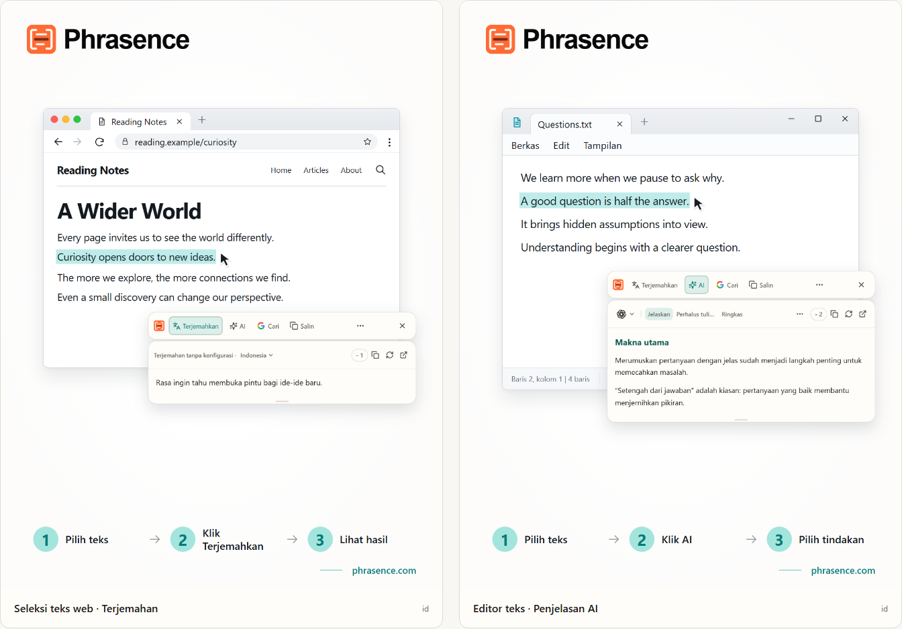

# Phrasence | Penerjemah dan asisten teks AI untuk desktop

[English](README.md) | [Español](README.es.md) | [Português (Brasil)](README.pt-BR.md) | [Português (Portugal)](README.pt-PT.md) | [Français](README.fr.md) | [Deutsch](README.de.md) | [Italiano](README.it.md) | [Nederlands](README.nl.md)

[Русский](README.ru.md) | [Polski](README.pl.md) | [Türkçe](README.tr.md) | [Українська](README.uk.md) | [日本語](README.ja.md) | [한국어](README.ko.md) | [Bahasa Indonesia](README.id.md) | [Tiếng Việt](README.vi.md)

[ไทย](README.th.md) | [Bahasa Melayu](README.ms.md) | [हिन्दी](README.hi.md) | [বাংলা](README.bn.md) | [简体中文](README.zh-CN.md) | [繁體中文](README.zh-TW.md)

[Situs resmi](https://phrasence.com/) · [Unduh](https://phrasence.com/id/download) · [Panduan pengguna](https://phrasence.com/id/docs/getting-started)

## Tentang Phrasence

Dengan Phrasence, pilih teks di browser, dokumen, atau editor, lalu pilih untuk menerjemahkan, menjelaskan, merangkum, atau menyuntingnya. Alatnya tetap di dekat pilihan teks agar Anda bisa terus membaca dan menulis.

Phrasence menempatkan tindakan teks yang umum di samping pilihan. Anda yang menentukan langkah selanjutnya.

**Pilih teks → Tampilkan bilah alat → Pilih langkah berikutnya**



_Ilustrasi antarmuka: terjemahan teks yang dipilih dan penjelasan AI. Teks dan jumlah kredit yang ditampilkan adalah contoh. Penggunaan sebenarnya mengikuti aturan terbaru di aplikasi._

## Untuk siapa

- **Pembaca teks dalam bahasa lain**: Terjemahkan kalimat di halaman atau dokumen tanpa menyalinnya ke tab lain.
- **Pelajar dan peneliti**: Jelaskan istilah, uraikan kalimat panjang, atau rangkum bagian yang sulit tanpa kehilangan konteks bacaan.
- **Pengembang dan pembaca dokumentasi teknis**: Tambahkan konteks untuk istilah teknis, kalimat yang rumit, kutipan penelitian, atau potongan kode tanpa kehilangan posisi membaca.
- **Penulis dan pekerja kantor**: Pilih sebagian draf dan minta AI menyusun ulang, memadatkan pokok pikiran, atau menyesuaikan nada.

## Fitur utama

- **Terjemahan teks pilihan**: Pilih layanan terjemahan yang tersedia dan bahasa tujuan, lihat hasil di samping aplikasi saat ini, lalu salin atau buat ulang.
- **AI dengan penjelasan, rangkuman, dan prompt kustom**: Menjelaskan, merangkum, memperbaiki gaya, mengambil poin penting, atau mengoreksi teks terpilih. Anda juga dapat membuat tindakan seperti “Ubah menjadi email”.
- **Ruang kerja lengkap**: Untuk teks yang lebih panjang, edit teks asli secara manual dan beralih dengan nyaman antara hasil terjemahan dan AI.
- **Cari atau salin**: Salin teks pilihan secara langsung atau kirim ke mesin pencari pilihan Anda dan lanjutkan di browser sistem.
- **Riwayat lokal**: Buka kembali terjemahan dan hasil AI sebelumnya. Riwayat tetap berada di perangkat ini dan dapat dinonaktifkan atau dihapus kapan saja.
- **Menyesuaikan dengan desktop Anda**: Horizontal atau vertikal, terang atau gelap, selalu di atas atau bebas—sesuaikan Phrasence dengan layar dan kebiasaan kerja Anda.

### Layanan terjemahan

**Pengaturan → Layanan terjemahan**

Cara memilih: Ada tiga opsi—terjemahan tanpa konfigurasi, model lokal, dan penyedia terjemahan. Pilih satu lalu klik “Gunakan”; ruang kerja dan bilah alat cepat akan memakainya untuk menerjemahkan.

- Terjemahan tanpa konfigurasi: Tidak memerlukan konfigurasi. Masuk lalu klik “Gunakan”. Setiap terjemahan memakai kredit yang dihitung dari jumlah karakter teks sumber; jumlah yang benar-benar dipotong adalah jumlah akhir.
- Model terjemahan lokal: Unduh model sebelum penggunaan pertama. Setelah itu Anda dapat menerjemahkan offline tanpa kredit; teks hanya diproses di komputer ini.
- Penyedia terjemahan: Jika sudah memiliki kunci API Baidu, Microsoft, DeepL, atau Google, masukkan di sini. Kunci tetap di komputer ini; biaya dan kuota gratis ditentukan oleh penyedia.

Model lokal harus mendukung bahasa yang Anda perlukan. Mengunduh dan memperbarui model memerlukan koneksi internet. Terjemahan dengan model lokal atau API Anda sendiri tidak memakai kredit Phrasence. Penyedia API dapat mengenakan biaya terpisah. Simpan data koneksi yang diminta, lalu uji koneksinya.

Tindakan terjemahan dan AI bergantung pada penyedia yang dikonfigurasi, akses jaringan, kredit yang tersedia, dan status rilis saat ini.

[Harga](https://phrasence.com/id/pricing)

## Panduan penggunaan

### 1. Unduh dan instal

Buka [halaman unduhan](https://phrasence.com/id/download). Pilih versi yang sesuai dengan sistem operasi dan prosesor Anda.

Jika tidak ada tombol unduh, pemasang tersebut belum tersedia. Jangan mengunduh Phrasence dari situs tidak resmi.

### 2. Selesaikan pengaturan awal

Jalankan Phrasence dan buka **Pengaturan**. Periksa bagian berikut secara berurutan:

1. Di **Pengaturan dasar**, pilih bahasa antarmuka, tema, dan tata letak bawaan.
2. Di **Tindakan cepat**, aktifkan setidaknya satu cara memilih teks.
3. Di **Layanan terjemahan**, lihat layanan yang tersedia saat ini.
4. **Alat AI**: Pilih bahasa hasil dan tindakan yang ingin digunakan.
5. Jika sistem meminta izin, ikuti petunjuk untuk membuka pengaturan sistem.

**Penyedia terjemahan → Simpan konfigurasi → Uji koneksi**

### 3. Pilih teks dan buka bilah alat

#### Tampilkan otomatis saat teks dipilih

1. Aktifkan **Tampilkan otomatis saat teks dipilih**.
2. Pilih teks di aplikasi lain.
3. Saat Phrasence menerima teks, bilah alat muncul di dekat pilihan.
4. Pilih Terjemahkan, AI, Salin, atau Cari.

#### Tampilkan dengan pintasan

1. Aktifkan **Tampilkan dengan pintasan**.
2. Tekan pintasan bilah alat saat ini.
3. Bilah alat muncul terlebih dahulu di dekat penunjuk tetikus.
4. Pilih teks yang ingin diproses.
5. Saat Phrasence menerima teks, tindakannya akan tersedia.

**Pengaturan → Tindakan cepat → Pintasan saat ini**

Saat bilah alat terlihat, tekan Esc kapan saja untuk menyembunyikannya. Efeknya sama seperti tombol tutup.

### 4. Pilih tindakan

- **Terjemahkan**: memakai layanan terjemahan dan bahasa tujuan saat ini.
- **AI**: menjelaskan, memperbaiki, meringkas, atau menjalankan tindakan lain yang sudah diatur. Anda harus masuk dan memiliki kredit.
- **Cari**: membuka mesin pencari pilihan di browser sistem.
- **Salin**: menulis teks saat ini ke papan klip.
- **Lainnya**: membuka ruang kerja, riwayat, pengaturan, dan kontrol cara pemilihan.
- **Tutup**: menyembunyikan bilah alat. Anda juga dapat menekan `Esc`.

Biaya: Mengedit pengaturan, mengurutkan, dan membuat tindakan tidak memakai kredit. Untuk menjalankan tindakan, Anda harus masuk dan kredit yang ditampilkan untuk model pilihan akan dipotong.

### 5. Lanjutkan di ruang kerja

**Lainnya → Buka ruang kerja**

Bilah alat cepat digunakan untuk mengolah pilihan di samping aplikasi yang sedang dipakai. Ruang kerja lengkap menyediakan tempat untuk mengedit atau menangani teks yang lebih panjang. Keduanya melanjutkan hasil yang sama, sehingga permintaan tidak perlu dijalankan ulang.

Di tab terjemahan ruang kerja, mengubah masukan yang tidak kosong dapat memulai terjemahan secara otomatis. Tindakan AI tetap harus dipilih secara langsung. Penyimpanan riwayat bergantung pada pengaturan Anda dan aturan layanan yang dipilih.

### 6. Simpan tindakan AI khusus

**Pengaturan → Alat AI → Tindakan baru**

Beri nama tindakan dan tulis instruksinya. Simpan, lalu pilih tindakan tersebut dari daftar tindakan AI. Untuk membaca teks yang sulit, misalnya, Anda dapat menyimpan instruksi berikut:

Pengaturan: “Aktif” menentukan apakah tindakan dapat digunakan. Sakelar “Bilah alat” menentukan apakah tindakan tampil di bilah cepat. Seret tindakan untuk mengubah urutan.

```text
Jelaskan gagasan utama teks yang dipilih dan tuliskan poin-poin pentingnya.
Pertahankan nama, angka, dan ketentuan dari teks asli.
Nyatakan ketidakpastian dengan jelas. Jangan tambahkan fakta tanpa dasar.
```

Instruksi ini adalah contoh. Bandingkan terjemahan dan jawaban AI dengan teks asli, terutama nama, angka, tanggal, dan ketentuan.

## Pertanyaan umum

### Apa yang harus dilakukan jika bilah alat tidak muncul?

Pastikan Phrasence sedang berjalan dan setidaknya satu cara membuka bilah aktif di Tindakan cepat. Periksa izin sistem dan apakah aplikasi asal mendukung pemilihan teks. Jika pilihan tidak dapat dibaca, ketik atau tempel teks ke ruang kerja.

### Mengapa saya diminta menyalin atau menempel teks?

Beberapa aplikasi menampilkan pilihan tanpa menyediakan isi teksnya. Jika diminta menyalin, biarkan aplikasi asal tetap aktif dan tekan `Ctrl+C`, atau `⌘C` di macOS. Jika diminta menempel secara manual, buka area yang ditunjukkan dan tekan `Ctrl+V`, atau `⌘V` di macOS. Penyalinan manual atau otomatis dapat mengganti isi papan klip. Anda dapat mematikan penyalinan otomatis di Pengaturan → Tindakan cepat.

### Apakah saya memerlukan akun untuk menggunakan Phrasence?

Tidak untuk fitur dasar, yang dapat digunakan tanpa masuk. Alat AI, manfaat paket, dan fitur akun akan meminta Anda masuk saat diperlukan.

Biaya: Mengedit pengaturan, mengurutkan, dan membuat tindakan tidak memakai kredit. Untuk menjalankan tindakan, Anda harus masuk dan kredit yang ditampilkan untuk model pilihan akan dipotong.

## Data dan privasi

- Memilih teks hanya menyiapkan konteks. Tindakan ini tidak mengirim permintaan, memakai kredit, atau menambahkan hasil yang selesai ke riwayat.
- Teks dikirim ke mana: Pada terjemahan siap pakai, teks dikirim ke layanan Phrasence lalu ke mesin saat ini. Dengan kunci API sendiri, komputer mengirimnya langsung ke penyedia. Pada model lokal, teks tetap di komputer.
- Teks dikirim ke mana: Teks terpilih dan instruksi dikirim melalui Phrasence ke layanan AI pilihan. Catatan penagihan tidak menyimpan teks sumber; hanya model dan kredit yang digunakan.
- Jika diaktifkan, riwayat hanya disimpan di perangkat ini dan tidak pernah disinkronkan ke cloud. Anda dapat menonaktifkan atau menghapusnya kapan saja.

Di tab terjemahan ruang kerja, mengubah masukan yang tidak kosong dapat memulai terjemahan secara otomatis. Tindakan AI tetap harus dipilih secara langsung. Penyimpanan riwayat bergantung pada pengaturan Anda dan aturan layanan yang dipilih.

[Privasi dan data](https://phrasence.com/id/docs/privacy-security) · [Kebijakan Privasi (EN)](https://phrasence.com/privacy-policy)

## Situs resmi dan bantuan

- [Situs resmi: phrasence.com](https://phrasence.com/)
- [Unduh, pasang, dan jalankan pertama kali](https://phrasence.com/id/docs/getting-started)
- [Pemecahan masalah](https://phrasence.com/id/docs/troubleshooting)
- [Hubungi kami di Telegram](https://t.me/phrasence)

Untuk meminta bantuan atau melaporkan masalah, masuk ke situs web dan buka Bantuan dan masukan di pengaturan. Sertakan sistem operasi, versi aplikasi, layanan yang dipilih, dan langkah untuk mengulangi masalah.
