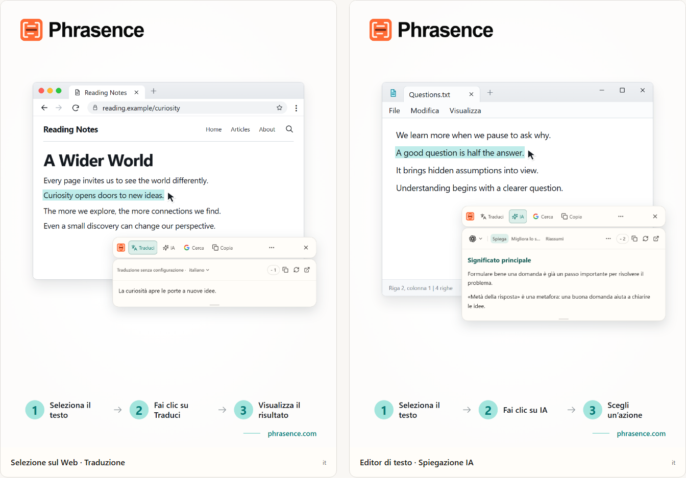

# Phrasence | Traduttore e assistente di testo IA per desktop

[English](README.md) | [Español](README.es.md) | [Português (Brasil)](README.pt-BR.md) | [Português (Portugal)](README.pt-PT.md) | [Français](README.fr.md) | [Deutsch](README.de.md) | [Italiano](README.it.md) | [Nederlands](README.nl.md)

[Русский](README.ru.md) | [Polski](README.pl.md) | [Türkçe](README.tr.md) | [Українська](README.uk.md) | [日本語](README.ja.md) | [한국어](README.ko.md) | [Bahasa Indonesia](README.id.md) | [Tiếng Việt](README.vi.md)

[ไทย](README.th.md) | [Bahasa Melayu](README.ms.md) | [हिन्दी](README.hi.md) | [বাংলা](README.bn.md) | [简体中文](README.zh-CN.md) | [繁體中文](README.zh-TW.md)

[Sito ufficiale](https://phrasence.com/) · [Scarica](https://phrasence.com/it/download) · [Guida utente](https://phrasence.com/it/docs/getting-started)

## Che cos’è Phrasence

Con Phrasence, seleziona del testo in un browser, documento o editor, poi scegli se tradurlo, spiegarlo, riassumerlo o rielaborarlo. Gli strumenti restano accanto alla selezione per continuare a leggere e scrivere senza perdere il filo.

Phrasence mette le azioni più comuni accanto alla selezione. Sei tu a decidere cosa succede dopo.

**Seleziona il testo → Apri la barra → Scegli il passo successivo**



_Illustrazione dell’interfaccia: traduzione del testo selezionato e spiegazione IA. Il testo e i crediti mostrati sono esempi. L’uso effettivo segue le regole attuali dell’app._

## A chi è rivolto

- **Chi legge in un’altra lingua**: Traduci una frase da una pagina o da un documento senza copiarla in un'altra scheda.
- **Studenti e ricercatori**: Spiega un termine, analizza una frase lunga o riassumi un passaggio difficile senza perdere il contesto di lettura.
- **Sviluppatori e lettori di documentazione tecnica**: Aggiungi il contesto necessario a un termine tecnico, una frase complessa, un passaggio accademico o un frammento di codice senza perdere il filo.
- **Chi scrive testi o lavora in ufficio**: Seleziona una parte della bozza e chiedi all'IA di riformularla, rendere più conciso il concetto o regolare il tono.

## Funzioni principali

- **Traduzione del testo selezionato**: Scegli un servizio di traduzione disponibile e la lingua di destinazione, visualizza il risultato accanto all'app attuale, quindi copialo o generalo di nuovo.
- **Spiegazione, riassunto e prompt personalizzati con IA**: Spiegare, riassumere, migliorare, estrarre i punti chiave o correggere il testo selezionato. Puoi anche creare azioni come «Riscrivi come e-mail» o «Genera risposta».
- **Area di lavoro completa**: Per i testi più lunghi, modifica manualmente l'originale e passa con facilità dai risultati della traduzione a quelli dell'IA.
- **Cerca o copia**: Copia direttamente il testo selezionato oppure invialo al motore di ricerca che preferisci e continua nel browser di sistema.
- **Cronologia locale**: Riapri traduzioni e risultati IA precedenti. La cronologia resta su questo dispositivo e puoi disattivarla o cancellarla in qualsiasi momento.
- **Si adatta al tuo desktop**: Orizzontale o verticale, chiaro o scuro, in primo piano o libero: adatta Phrasence allo schermo e alle tue abitudini.

### Servizi di traduzione

**Impostazioni → Servizi di traduzione**

Come scegliere: Sono disponibili tre opzioni: traduzione senza configurazione, modello locale e provider di traduzione. Scegline una e fai clic su «Usa»; l’area di lavoro e la barra rapida la useranno per tradurre.

- Traduzione senza configurazione: Non richiede configurazione. Accedi e fai clic su «Usa». Ogni traduzione consuma crediti calcolati in base al numero di caratteri del testo originale; fa fede l’addebito effettivo.
- Modello di traduzione locale: Scaricalo prima del primo utilizzo. In seguito potrai tradurre offline senza consumare crediti; il testo viene elaborato solo su questo computer.
- Provider di traduzione: Se hai già una chiave API Baidu, Microsoft, DeepL o Google, inseriscila qui. Resta su questo computer; prezzi e quote gratuite sono stabiliti dal provider.

Il modello locale deve supportare le lingue che ti servono. Il download e gli aggiornamenti richiedono una connessione. La traduzione con un modello locale o con la tua API non consuma crediti Phrasence. Il fornitore dell’API può applicare costi propri. Salva i dati di connessione richiesti e verifica la connessione.

Le azioni di traduzione e IA dipendono dal servizio configurato, dalla connessione di rete, dai crediti disponibili e dallo stato attuale della versione.

[Prezzi](https://phrasence.com/it/pricing)

## Guida all’uso

### 1. Scaricare e installare

Apri la [pagina dei download](https://phrasence.com/it/download). Scegli la versione adatta al sistema operativo e al processore.

Se non c’è un pulsante per il download, il relativo programma di installazione non è ancora disponibile. Non scaricare Phrasence da siti non ufficiali.

### 2. Completare la prima configurazione

Avvia Phrasence e apri **Impostazioni**. Controlla questi elementi nell’ordine indicato:

1. In **Impostazioni di base**, scegli la lingua dell’interfaccia, il tema e il layout predefinito.
2. In **Azioni rapide**, attiva almeno un metodo di selezione del testo.
3. In **Servizi di traduzione**, controlla quali servizi sono disponibili.
4. **Strumenti di IA**: Scegli la lingua del risultato e le azioni che vuoi usare.
5. Se il sistema richiede un’autorizzazione, segui l’avviso per aprire le impostazioni di sistema.

**Provider di traduzione → Salva configurazione → Verifica connessione**

### 3. Selezionare il testo e aprire la barra

#### Mostra automaticamente quando selezioni del testo

1. Attiva **Mostra automaticamente quando selezioni del testo**.
2. Seleziona il testo in un’altra app.
3. Quando Phrasence riceve il testo, la barra appare vicino alla selezione.
4. Scegli Traduci, IA, Copia o Cerca.

#### Mostra con una scorciatoia

1. Attiva **Mostra con una scorciatoia**.
2. Premi la scorciatoia attuale della barra.
3. La barra appare prima vicino al puntatore.
4. Seleziona il testo da elaborare.
5. Quando Phrasence riceve il testo, le azioni diventano disponibili.

**Impostazioni → Azioni rapide → Scorciatoia attuale**

Quando la barra è visibile, premi Esc per nasconderla in qualsiasi momento, proprio come con il pulsante di chiusura.

### 4. Scegliere un’azione

- **Traduci**: usa il servizio di traduzione e la lingua di destinazione attuali.
- **IA**: spiega, migliora, riassume o esegue un’altra azione configurata. Richiede l’accesso e crediti disponibili.
- **Cerca**: apre il motore di ricerca scelto nel browser di sistema.
- **Copia**: inserisce il testo attuale negli appunti.
- **Altro**: apre l’area di lavoro, la cronologia, le impostazioni e i controlli della selezione.
- **Chiudi**: nasconde la barra. Puoi anche premere `Esc`.

Costo: Modificare le impostazioni, riordinare e creare azioni non consuma crediti. Per eseguire un’azione devi accedere e vengono detratti i crediti mostrati per il modello scelto.

### 5. Continuare nell’area di lavoro

**Altro → Apri l'area di lavoro**

La barra rapida serve a elaborare una selezione accanto all'app che stai usando. L'area di lavoro completa offre spazio per modificare o gestire testi più lunghi. Entrambe proseguono con lo stesso risultato corrente, quindi non devi ripetere la richiesta.

Nella scheda di traduzione dell’area di lavoro, modificare un testo non vuoto può avviare una traduzione automatica. Le azioni IA richiedono comunque una scelta esplicita. Il salvataggio della cronologia dipende dalle tue impostazioni e dalle regole del servizio scelto.

### 6. Salvare un’azione IA personalizzata

**Impostazioni → Strumenti di IA → Nuova azione**

Assegna un nome e un’istruzione all’azione. Salvala e poi sceglila nell’elenco delle azioni IA. Per leggere un testo difficile, puoi salvare questa istruzione di esempio:

Configurazione: «Attiva» stabilisce se un’azione è utilizzabile. L’opzione «Barra degli strumenti» stabilisce se appare nella barra rapida. Trascina le azioni per riordinarle.

```text
Spiega l’idea principale del testo selezionato ed elenca i punti chiave.
Conserva nomi, numeri e condizioni del testo originale.
Indica chiaramente ogni incertezza. Non aggiungere fatti privi di riscontro.
```

L’istruzione è un esempio. Confronta traduzioni e risposte IA con l’originale, soprattutto nomi, numeri, date e condizioni.

## Domande frequenti

### Cosa fare se la barra non compare?

Controlla che Phrasence sia aperto e che almeno un metodo di apertura sia attivo in Azioni rapide. Verifica i permessi di sistema e che l’app di origine consenta di selezionare il testo. Se la selezione non può essere letta, digita o incolla il testo nell’area di lavoro.

### Perché viene chiesto di copiare o incollare?

Alcune app mostrano una selezione senza rendere disponibile il testo. Se il messaggio chiede di copiare, mantieni attiva l’app di origine e premi `Ctrl+C`, oppure `⌘C` su macOS. Se chiede di incollare manualmente, apri l’area indicata e premi `Ctrl+V`, oppure `⌘V` su macOS. La copia manuale o automatica può sostituire il contenuto degli appunti. Puoi disattivare la copia automatica in Impostazioni → Azioni rapide.

### Serve un account per usare Phrasence?

Non per le funzioni di base, che sono disponibili senza accesso. Gli strumenti IA, i vantaggi del piano e le funzioni dell'account richiedono l'accesso quando necessario.

Costo: Modificare le impostazioni, riordinare e creare azioni non consuma crediti. Per eseguire un’azione devi accedere e vengono detratti i crediti mostrati per il modello scelto.

## Dati e privacy

- La selezione del testo prepara soltanto il contesto: non invia richieste, non consuma crediti e non aggiunge risultati completati alla cronologia.
- Dove viene inviato il testo: Con la traduzione pronta all’uso, passa dal servizio Phrasence al motore attuale. Con la tua chiave API, il computer lo invia direttamente al provider. Con il modello locale, non lascia il computer.
- Dove viene inviato il testo: Il testo selezionato e le istruzioni vengono inviati tramite Phrasence al servizio IA scelto. Il registro non conserva il testo originale; registra solo modello e crediti consumati.
- Quando è attiva, la cronologia viene salvata solo su questo dispositivo e non viene mai sincronizzata con il cloud. Puoi disattivarla o cancellarla quando vuoi.

Nella scheda di traduzione dell’area di lavoro, modificare un testo non vuoto può avviare una traduzione automatica. Le azioni IA richiedono comunque una scelta esplicita. Il salvataggio della cronologia dipende dalle tue impostazioni e dalle regole del servizio scelto.

[Privacy e dati](https://phrasence.com/it/docs/privacy-security) · [Informativa sulla privacy (EN)](https://phrasence.com/privacy-policy)

## Sito ufficiale e assistenza

- [Sito ufficiale: phrasence.com](https://phrasence.com/)
- [Scarica, installa e avvia](https://phrasence.com/it/docs/getting-started)
- [Risoluzione dei problemi](https://phrasence.com/it/docs/troubleshooting)
- [Contattaci su Telegram](https://t.me/phrasence)

Per chiedere aiuto o segnalare un errore, accedi al sito e apri Aiuto e feedback nelle impostazioni. Indica il sistema operativo, la versione dell’app, il servizio scelto e i passaggi per riprodurre il problema.
