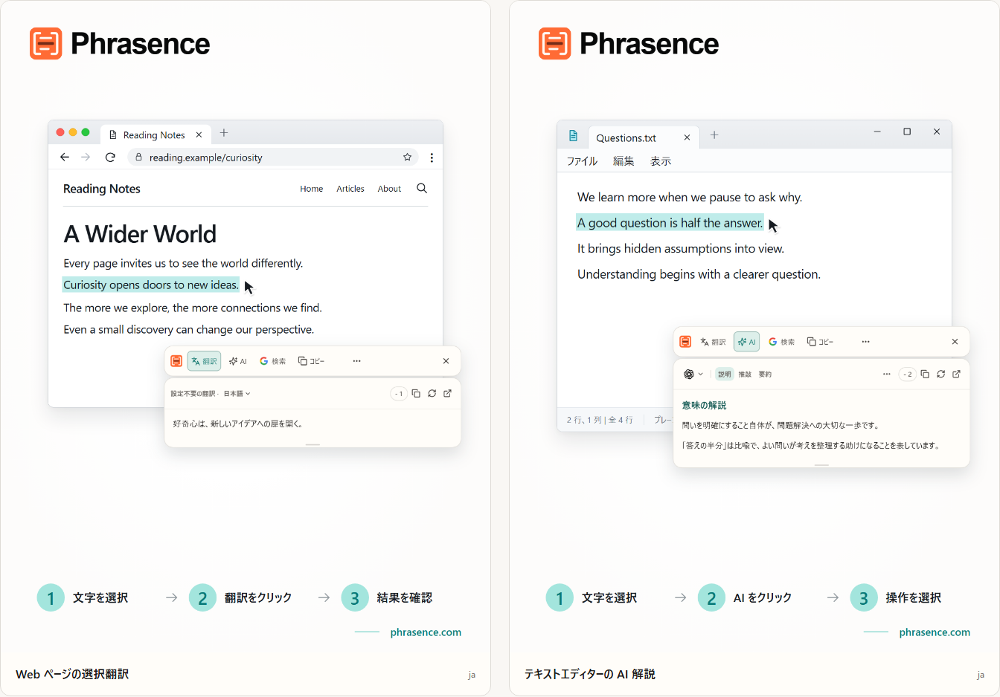

# Phrasence｜選択テキスト翻訳・AIテキストアシスタント

[English](README.md) | [Español](README.es.md) | [Português (Brasil)](README.pt-BR.md) | [Português (Portugal)](README.pt-PT.md) | [Français](README.fr.md) | [Deutsch](README.de.md) | [Italiano](README.it.md) | [Nederlands](README.nl.md)

[Русский](README.ru.md) | [Polski](README.pl.md) | [Türkçe](README.tr.md) | [Українська](README.uk.md) | [日本語](README.ja.md) | [한국어](README.ko.md) | [Bahasa Indonesia](README.id.md) | [Tiếng Việt](README.vi.md)

[ไทย](README.th.md) | [Bahasa Melayu](README.ms.md) | [हिन्दी](README.hi.md) | [বাংলা](README.bn.md) | [简体中文](README.zh-CN.md) | [繁體中文](README.zh-TW.md)

[公式サイト](https://phrasence.com/) · [ダウンロード](https://phrasence.com/ja/download) · [使い方ガイド](https://phrasence.com/ja/docs/getting-started)

## Phrasenceとは

Phrasence なら、ブラウザー、文書、エディターでテキストを選び、翻訳・解説・要約・文章の推敲を選べます。選択範囲のそばにあるツールで、読む・書く流れを保てます。

Phrasence は、普段の読み書きに使うツールに寄り添います。テキストを選び、ツールバーを開いて、必要な操作を選ぶだけです。

**テキストを選ぶ → ツールバーを呼び出す → 次の操作を選ぶ**



_画面イメージ：選択したテキストの翻訳とAIによる解説。表示されている文章とクレジット数は例です。実際の利用には、アプリ内の現在のルールが適用されます。_

## こんな方におすすめ

- **外国語の文章を読む方**：ページや文書の一文を選ぶだけで翻訳を確認。別のタブへコピーする手間がありません。
- **学生・研究者**：専門用語や長い一文、複雑な段落を、その場を離れずに説明・要約できます。
- **開発者・技術資料を読む方**：専門用語、複雑な文、論文の一節、コードに必要な背景を補い、読み進めやすくします。
- **文章を書く方・事務作業をする方**：下書きの一部を選び、表現の変更、要点の整理、トーンの調整を AI に依頼できます。

## 主な機能

- **選択テキスト翻訳**：利用できる翻訳サービスと訳先言語を選び、使用中のアプリのそばで結果を確認。コピーや再生成もできます。
- **AIによる解説・要約・カスタムプロンプト**：選択したテキストの説明、要約、推敲、要点抽出、校正ができます。「メールに書き換える」など独自の操作も作成できます。
- **ワークスペース**：長い文章は原文を手動で編集しながら、翻訳結果と AI の回答を落ち着いて確認できます。
- **検索とコピー**：選択したテキストをそのままコピーするか、検索エンジンへ送り、システムブラウザーで続きを調べられます。
- **ローカル履歴**：以前の翻訳や AI の結果を開き直せます。履歴はこのデバイスに保存され、いつでも無効化・削除できます。
- **デスクトップにフィット**：横型・縦型、ライト・ダーク、常に手前に表示など、画面と使い方に合わせて調整できます。

### 翻訳サービス

**設定 → 翻訳サービス**

選び方：「設定不要の翻訳」「ローカル翻訳モデル」「翻訳プロバイダー」の3つがあります。1つ選んで「使用」をクリックすると、ワークベンチとクイックツールバーで使われます。

- 設定不要の翻訳：設定は必要ありません。ログインして「使用」をクリックすると利用できます。翻訳するたびにクレジットを消費し、原文の文字数で計算されます。実際の差し引き数が確定値です。
- ローカル翻訳モデル：初回利用前にモデルをダウンロードします。その後はクレジットを使わずオフラインで翻訳でき、テキストはこのコンピューターだけで処理されます。
- 翻訳プロバイダー：Baidu、Microsoft、DeepL、Google の API キーをすでに持っている場合は、ここに入力します。キーはこのコンピューターだけに保存され、料金と無料枠は各社が決めます。

ローカルモデルは、使いたい言語に対応している必要があります。モデルのダウンロードや更新には通信が必要です。ローカルモデルや自分のAPIを使う翻訳では、Phrasenceのクレジットは使いません。APIの提供元から別途料金が発生する場合があります。必要な接続情報を保存し、接続テストを行ってください。

翻訳と AI 操作は、設定したサービス、ネットワーク、利用可能なクレジット、公開状況に応じて利用できます。

[料金](https://phrasence.com/ja/pricing)

## 使い方

### 1. ダウンロードしてインストールする

[ダウンロードページ](https://phrasence.com/ja/download)を開きます。OS とプロセッサーに合うバージョンを選んでください。

ダウンロードボタンがない場合、そのインストーラーはまだ公開されていません。非公式のサイトからダウンロードしないでください。

### 2. 初回設定を行う

Phrasence を起動し、**設定**を開きます。次の項目を順番に確認してください。

1. **基本設定**で、表示言語、テーマ、既定のレイアウトを選びます。
2. **クイック操作**で、テキスト選択方法を 1 つ以上有効にします。
3. **翻訳サービス**で、現在利用できるサービスを確認します。
4. **AI ツール**：出力言語と使いたい操作を選びます。
5. OS から権限を求められた場合は、案内に従ってシステム設定を開きます。

**翻訳プロバイダー → 設定を保存 → 接続テスト**

### 3. テキストを選んでツールバーを開く

#### 文字選択後に自動表示

1. **文字選択後に自動表示**を有効にします。
2. 別のアプリでテキストを選択します。
3. Phrasence が文字を読み取ると、選択範囲の近くにツールバーが表示されます。
4. 翻訳、AI、コピー、検索から操作を選びます。

#### ショートカットで表示

1. **ショートカットで表示**を有効にします。
2. 現在のツールバー用ショートカットを押します。
3. ツールバーが先にマウスポインターの近くへ表示されます。
4. 処理するテキストを選択します。
5. Phrasence が文字を読み取ると、ツールバーの操作が使えるようになります。

**設定 → クイック操作 → 現在のショートカット**

ツールバーの表示中は、Esc を押すといつでも閉じるボタンと同じように非表示にできます。

### 4. 操作を選ぶ

- **翻訳**：現在の翻訳サービスと翻訳先の言語を使います。
- **AI**：解説、文章の調整、要約などを行います。ログインと利用可能なクレジットが必要です。
- **検索**：選択した検索エンジンをシステムブラウザーで開きます。
- **コピー**：現在の文字をクリップボードへ書き込みます。
- **その他**：ワークスペース、履歴、設定、選択方法の切り替えを開きます。
- **閉じる**：ツールバーを隠します。`Esc` でも閉じられます。

料金：設定の編集、並べ替え、操作の作成ではクレジットを使いません。実行にはログインが必要で、選択したモデルに表示されたクレジットが差し引かれます。

### 5. ワークスペースで作業を続ける

**その他 → ワークスペースを開く**

クイックツールバーは、使用中のアプリのそばで選択したテキストをすぐに処理するためのものです。ワークスペースは、手動編集や長い文章の処理に向いています。どちらも同じ現在の結果を引き継ぐため、もう一度リクエストする必要はありません。

ワークスペースの翻訳タブでは、空でない入力内容を変更すると、自動で翻訳が始まる場合があります。AI操作は自分で選んで実行します。履歴を保存できるかどうかは、設定と選択したサービスのルールによります。

### 6. 独自のAI操作を保存する

**設定 → AI ツール → 操作を追加**

操作の名前と指示を入力し、保存します。その後、AI操作の一覧から選んで使います。難しい文章を読むときは、たとえば次の指示を保存できます。

設定方法：「有効」は操作を使えるかどうかを決めます。「ツールバー」はクイックツールバーに表示するかを決めます。ドラッグで順序を変更できます。

```text
選択した文章の主旨を説明し、要点を箇条書きにしてください。
原文の名前、数値、条件を保ってください。
不確かな点は明記し、根拠のない情報を加えないでください。
```

この指示は一例です。翻訳やAIの回答は原文と照らし合わせ、特に名前、数値、日付、条件を確認してください。

## よくある質問

### ツールバーが表示されないときは？

Phrasenceが起動しているか確認します。クイック操作で、少なくとも1つの表示方法を有効にしてください。OSの権限と、元のアプリでテキストを選択できるかも確認します。選択範囲を読み取れない場合は、ワークスペースに入力するか貼り付けてください。

### コピーや貼り付けを求められるのはなぜ？

選択範囲が見えていても、元のアプリから文字を取得できない場合があります。コピーを求められたら、元のアプリを操作中のままにして `Ctrl+C`、macOSでは `⌘C` を押します。手動の貼り付けを求められたら、指定の入力欄を開いて `Ctrl+V`、macOSでは `⌘V` を押してください。手動・自動のコピーで、クリップボードの内容が置き換わることがあります。自動コピーは「設定 → クイック操作」で無効にできます。

### 利用にはログインが必要ですか？

基本機能はログインなしで利用できます。AI ツール、プランの特典、アカウント機能では、必要なときにログインをご案内します。

料金：設定の編集、並べ替え、操作の作成ではクレジットを使いません。実行にはログインが必要で、選択したモデルに表示されたクレジットが差し引かれます。

## データとプライバシー

- テキストを選択しただけでは、リクエストの送信、クレジットの使用、完了履歴への保存は行われません。
- テキストの送信先：設定不要の翻訳では Phrasence のサービスを経由して現在の翻訳エンジンへ送られます。自分の API キーではプロバイダーへ直接送られます。ローカルモデルではコンピューター外へ送られません。
- テキストの送信先：選択したテキストと操作内容は Phrasence を通じて選択した AI サービスへ送られます。課金記録に原文は保存されず、モデルと使用クレジットだけが記録されます。
- 有効にした履歴はこのデバイスにだけ保存され、クラウドには同期されません。いつでも無効化・全削除できます。

ワークスペースの翻訳タブでは、空でない入力内容を変更すると、自動で翻訳が始まる場合があります。AI操作は自分で選んで実行します。履歴を保存できるかどうかは、設定と選択したサービスのルールによります。

[プライバシーとデータ](https://phrasence.com/ja/docs/privacy-security) · [プライバシーポリシー](https://phrasence.com/ja/privacy-policy)

## 公式サイトとサポート

- [公式サイト：phrasence.com](https://phrasence.com/)
- [ダウンロード、インストール、初回起動](https://phrasence.com/ja/docs/getting-started)
- [トラブルシューティング](https://phrasence.com/ja/docs/troubleshooting)
- [Telegramで問い合わせる](https://t.me/phrasence)

質問や不具合の報告は、公式サイトにログインし、設定からヘルプ・フィードバックを開いて送信できます。OS、アプリのバージョン、選択したサービス、問題が起きる手順を添えてください。
