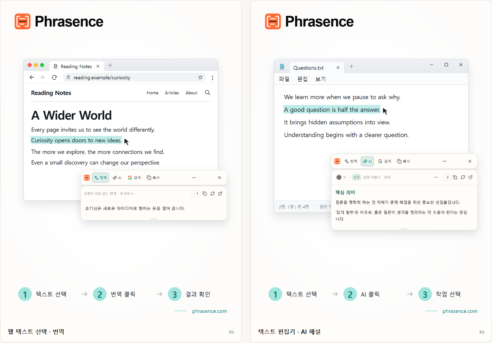

# Phrasence | 선택한 텍스트를 위한 데스크톱 AI 번역·문서 도우미

[English](README.md) | [Español](README.es.md) | [Português (Brasil)](README.pt-BR.md) | [Português (Portugal)](README.pt-PT.md) | [Français](README.fr.md) | [Deutsch](README.de.md) | [Italiano](README.it.md) | [Nederlands](README.nl.md)

[Русский](README.ru.md) | [Polski](README.pl.md) | [Türkçe](README.tr.md) | [Українська](README.uk.md) | [日本語](README.ja.md) | [한국어](README.ko.md) | [Bahasa Indonesia](README.id.md) | [Tiếng Việt](README.vi.md)

[ไทย](README.th.md) | [Bahasa Melayu](README.ms.md) | [हिन्दी](README.hi.md) | [বাংলা](README.bn.md) | [简体中文](README.zh-CN.md) | [繁體中文](README.zh-TW.md)

[공식 웹사이트](https://phrasence.com/) · [다운로드](https://phrasence.com/ko/download) · [사용 가이드](https://phrasence.com/ko/docs/getting-started)

## Phrasence 소개

Phrasence로 브라우저, 문서 또는 편집기에서 텍스트를 선택한 뒤 번역, 설명, 요약 또는 다듬기를 선택하세요. 도구가 선택한 텍스트 옆에 있어 읽기와 쓰기의 흐름을 이어갈 수 있습니다.

Phrasence가 자주 쓰는 텍스트 작업을 선택 영역 옆에 놓아 줍니다. 다음에 무엇을 할지는 사용자가 결정합니다.

**텍스트 선택 → 도구 모음 열기 → 다음 작업 선택**



_화면 예시: 선택한 텍스트의 번역과 AI 설명입니다. 표시된 텍스트와 크레딧 수치는 예시이며, 실제 사용에는 앱의 현재 규칙이 적용됩니다._

## 이런 분께 적합합니다

- **다른 언어로 된 글을 읽는 분**: 웹페이지나 문서의 문장을 다른 탭으로 복사하지 않고 바로 번역하세요.
- **학생과 연구자**: 읽던 맥락을 유지한 채 용어를 설명하고, 긴 문장을 풀어 보고, 복잡한 문단을 요약하세요.
- **개발자와 기술 문서를 읽는 분**: 전문 용어, 복잡한 문장, 논문 일부 또는 코드를 읽던 흐름을 놓치지 않고 이해하는 데 필요한 맥락을 더하세요.
- **글을 쓰거나 사무 업무를 하는 분**: 초안의 일부를 선택해 AI로 표현을 바꾸고, 핵심을 간결하게 하거나, 어조를 조절하세요.

## 주요 기능

- **선택한 텍스트 번역**: 사용 가능한 번역 서비스와 대상 언어를 고르고 현재 앱 옆에서 결과를 확인한 뒤 복사하거나 다시 생성하세요.
- **AI 설명, 요약 및 사용자 지정 프롬프트**: 선택한 텍스트를 설명, 요약, 다듬기, 핵심 추출 또는 교정할 수 있습니다. ‘이메일로 다시 쓰기’ 같은 사용자 작업도 만들 수 있습니다.
- **전체 작업 공간**: 긴 텍스트를 처리할 때는 원문을 직접 편집하고 번역 결과와 AI 결과 사이를 편하게 오갈 수 있습니다.
- **검색 또는 복사**: 선택한 텍스트를 바로 복사하거나 원하는 검색 엔진으로 보내 시스템 브라우저에서 계속 찾아보세요.
- **로컬 기록**: 이전 번역과 AI 결과를 다시 여세요. 기록은 이 기기에만 남으며 언제든 끄거나 비울 수 있습니다.
- **내 데스크톱에 맞는 구성**: 가로 또는 세로, 밝게 또는 어둡게, 항상 위에 고정하거나 자유롭게. 화면과 작업 습관에 맞춰 Phrasence를 구성하세요.

### 번역 서비스

**설정 → 번역 서비스**

선택 방법: 설정이 필요 없는 번역, 로컬 번역 모델, 번역 제공업체의 세 가지가 있습니다. 하나를 선택하고 ‘사용’을 누르면 작업 공간과 빠른 도구 모음에서 해당 방식을 사용합니다.

- 설정이 필요 없는 번역: 별도 설정이 필요 없습니다. 로그인한 뒤 ‘사용’을 누르면 됩니다. 번역할 때마다 크레딧이 사용되며 원문 글자 수로 계산됩니다. 실제 차감량이 최종값입니다.
- 로컬 번역 모델: 처음 사용하기 전에 모델을 다운로드합니다. 이후 크레딧 없이 오프라인 번역이 가능하며 텍스트는 이 컴퓨터에서만 처리됩니다.
- 번역 제공업체: Baidu, Microsoft, DeepL 또는 Google API 키가 있다면 여기에 입력합니다. 키는 이 컴퓨터에만 저장되며 요금과 무료 한도는 업체가 정합니다.

로컬 모델은 사용할 언어를 지원해야 합니다. 모델을 다운로드하거나 업데이트하려면 인터넷 연결이 필요합니다. 로컬 모델이나 본인 API로 번역할 때는 Phrasence 크레딧을 사용하지 않습니다. API 제공업체는 별도 요금을 청구할 수 있습니다. 필요한 연결 정보를 저장하고 연결을 테스트하세요.

번역과 AI 작업의 사용 가능 여부는 설정된 서비스, 네트워크 연결, 사용 가능한 크레딧 및 현재 배포 상태에 따라 달라집니다.

[요금](https://phrasence.com/ko/pricing)

## 사용 방법

### 1. 다운로드 및 설치

[다운로드 페이지](https://phrasence.com/ko/download)를 여세요. 운영 체제와 프로세서에 맞는 버전을 선택하세요.

다운로드 버튼이 없다면 해당 설치 파일이 아직 공개되지 않은 것입니다. 비공식 사이트에서 Phrasence를 받지 마세요.

### 2. 처음 설정하기

Phrasence를 실행하고 **설정**을 여세요. 다음 항목을 순서대로 확인하세요.

1. **기본 설정**에서 인터페이스 언어, 테마와 기본 레이아웃을 선택하세요.
2. **빠른 작업**에서 텍스트 선택 방법을 하나 이상 켜세요.
3. **번역 서비스**에서 현재 사용할 수 있는 서비스를 확인하세요.
4. **AI 도구**: 결과 언어와 사용할 작업을 선택하세요.
5. 시스템에서 권한을 요청하면 안내에 따라 시스템 설정을 여세요.

**번역 제공업체 → 설정 저장 → 연결 테스트**

### 3. 텍스트를 선택하고 도구 모음 열기

#### 텍스트를 선택하면 자동으로 표시

1. **텍스트를 선택하면 자동으로 표시**를 켜세요.
2. 다른 앱에서 텍스트를 선택하세요.
3. Phrasence가 텍스트를 받으면 선택 영역 가까이에 도구 모음이 나타납니다.
4. 번역, AI, 복사 또는 검색을 선택하세요.

#### 단축키로 표시

1. **단축키로 표시**를 켜세요.
2. 현재 도구 모음 단축키를 누르세요.
3. 도구 모음이 먼저 마우스 포인터 가까이에 나타납니다.
4. 처리할 텍스트를 선택하세요.
5. Phrasence가 텍스트를 받으면 작업이 활성화됩니다.

**설정 → 빠른 작업 → 현재 단축키**

도구 모음이 표시된 상태에서 Esc를 누르면 닫기 버튼을 누른 것처럼 언제든 숨길 수 있습니다.

### 4. 작업 선택하기

- **번역**: 현재 번역 서비스와 대상 언어를 사용합니다.
- **AI**: 설명, 다듬기, 요약 또는 설정된 다른 작업을 실행합니다. 로그인과 사용 가능한 크레딧이 필요합니다.
- **검색**: 선택한 검색 엔진을 시스템 브라우저에서 엽니다.
- **복사**: 현재 텍스트를 클립보드에 씁니다.
- **더보기**: 작업 공간, 기록, 설정과 선택 방법 제어를 엽니다.
- **닫기**: 도구 모음을 숨깁니다. `Esc`를 눌러도 됩니다.

비용: 설정 편집, 순서 변경, 작업 만들기에는 크레딧이 들지 않습니다. 실행하려면 로그인해야 하며 선택한 모델에 표시된 크레딧이 차감됩니다.

### 5. 작업 공간에서 계속하기

**더 보기 → 작업 화면 열기**

빠른 도구 모음은 현재 사용 중인 앱 옆에서 선택한 텍스트를 빠르게 처리할 때 적합합니다. 전체 작업 공간은 텍스트를 직접 편집하거나 긴 내용을 다룰 공간을 제공합니다. 두 화면은 같은 현재 결과를 이어서 보여 주므로 요청을 다시 실행할 필요가 없습니다.

작업 공간의 번역 탭에서는 비어 있지 않은 입력 내용을 바꾸면 번역이 자동으로 시작될 수 있습니다. AI 작업은 직접 선택해야 실행됩니다. 기록 저장 여부는 설정과 선택한 서비스의 규칙에 따라 달라집니다.

### 6. 사용자 지정 AI 작업 저장하기

**설정 → AI 도구 → 새 작업**

작업 이름과 지시문을 입력한 다음 저장하세요. 이후 AI 작업 목록에서 선택해 사용할 수 있습니다. 어려운 글을 읽을 때는 다음과 같은 지시문을 저장할 수 있습니다.

설정 방법: ‘사용’은 작업을 쓸 수 있는지 정합니다. ‘도구 모음’ 스위치는 빠른 도구 모음에 표시할지 정합니다. 드래그해 순서를 바꿀 수 있습니다.

```text
선택한 글의 중심 내용을 설명하고 핵심 사항을 나열해 주세요.
원문의 이름, 숫자, 조건을 유지해 주세요.
불확실한 부분을 분명히 밝히고 근거 없는 정보를 추가하지 마세요.
```

이 지시문은 예시입니다. 번역과 AI 답변을 원문과 비교하고, 특히 이름, 숫자, 날짜, 조건을 확인하세요.

## 자주 묻는 질문

### 도구 모음이 나타나지 않으면 어떻게 하나요?

Phrasence가 실행 중인지 확인하세요. 빠른 작업에서 열기 방식이 하나 이상 켜져 있어야 합니다. 시스템 권한과 원본 앱에서 텍스트를 선택할 수 있는지도 확인하세요. 선택한 내용을 읽을 수 없다면 작업 공간에 직접 입력하거나 붙여 넣으세요.

### 왜 복사하거나 붙여 넣으라고 하나요?

일부 앱은 선택 영역을 표시해도 텍스트를 제공하지 않습니다. 복사하라는 메시지가 나오면 원본 앱을 활성 상태로 두고 `Ctrl+C`, macOS에서는 `⌘C`를 누르세요. 수동으로 붙여 넣으라는 메시지가 나오면 안내된 입력란을 열고 `Ctrl+V`, macOS에서는 `⌘V`를 누르세요. 수동 또는 자동 복사는 클립보드 내용을 바꿀 수 있습니다. 자동 복사는 설정 → 빠른 작업에서 끌 수 있습니다.

### Phrasence를 사용하려면 로그인해야 하나요?

기본 기능은 로그인하지 않아도 사용할 수 있습니다. AI 도구, 요금제 혜택 및 계정 관련 기능은 필요할 때 로그인을 요청합니다.

비용: 설정 편집, 순서 변경, 작업 만들기에는 크레딧이 들지 않습니다. 실행하려면 로그인해야 하며 선택한 모델에 표시된 크레딧이 차감됩니다.

## 데이터와 개인정보

- 텍스트를 선택하는 것만으로는 현재 맥락만 준비됩니다. 요청을 보내거나 크레딧을 사용하거나 완료 기록을 추가하지 않습니다.
- 텍스트 전송 위치: 설정 없는 번역은 Phrasence 서비스를 거쳐 현재 번역 엔진으로 전송됩니다. 개인 API 키를 쓰면 컴퓨터에서 업체로 직접 전송됩니다. 로컬 모델에서는 컴퓨터 밖으로 나가지 않습니다.
- 텍스트 전송 위치: 선택한 텍스트와 작업 요청은 Phrasence를 통해 선택한 AI 서비스로 전송됩니다. 결제 기록에는 원문이 저장되지 않고 모델과 사용 크레딧만 기록됩니다.
- 기록 기능을 켜도 내용은 이 기기에만 저장되며 클라우드와 동기화되지 않습니다. 언제든 기록을 끄거나 모두 지울 수 있습니다.

작업 공간의 번역 탭에서는 비어 있지 않은 입력 내용을 바꾸면 번역이 자동으로 시작될 수 있습니다. AI 작업은 직접 선택해야 실행됩니다. 기록 저장 여부는 설정과 선택한 서비스의 규칙에 따라 달라집니다.

[개인정보 보호 및 데이터](https://phrasence.com/ko/docs/privacy-security) · [개인정보 처리방침 (EN)](https://phrasence.com/privacy-policy)

## 공식 웹사이트와 도움말

- [공식 웹사이트: phrasence.com](https://phrasence.com/)
- [다운로드, 설치 및 첫 실행](https://phrasence.com/ko/docs/getting-started)
- [문제 해결](https://phrasence.com/ko/docs/troubleshooting)
- [Telegram으로 문의하기](https://t.me/phrasence)

도움이 필요하거나 오류를 신고하려면 웹사이트에 로그인한 뒤 설정에서 도움말 및 피드백을 여세요. 운영체제, 앱 버전, 선택한 서비스와 문제를 재현하는 단계를 함께 적어 주세요.
