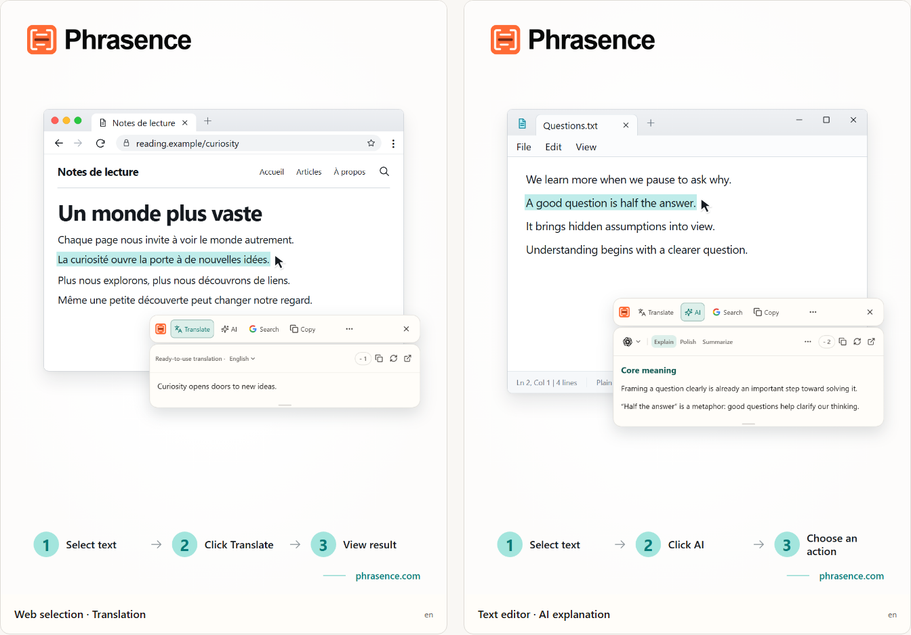

# Phrasence Desktop Translation and AI Text Assistant

[English](README.md) | [Español](README.es.md) | [Português (Brasil)](README.pt-BR.md) | [Português (Portugal)](README.pt-PT.md) | [Français](README.fr.md) | [Deutsch](README.de.md) | [Italiano](README.it.md) | [Nederlands](README.nl.md)

[Русский](README.ru.md) | [Polski](README.pl.md) | [Türkçe](README.tr.md) | [Українська](README.uk.md) | [日本語](README.ja.md) | [한국어](README.ko.md) | [Bahasa Indonesia](README.id.md) | [Tiếng Việt](README.vi.md)

[ไทย](README.th.md) | [Bahasa Melayu](README.ms.md) | [हिन्दी](README.hi.md) | [বাংলা](README.bn.md) | [简体中文](README.zh-CN.md) | [繁體中文](README.zh-TW.md)

[Official website](https://phrasence.com/) · [Download the desktop app](https://phrasence.com/download) · [Official user guide](https://phrasence.com/docs/getting-started)

## About Phrasence

Phrasence is a desktop tool for translation and AI text tasks across apps. When reading a page, document, email, or code passage, select the text and use the nearby toolbar to translate, explain, summarize, polish, copy, or search it.

There are two ways to work with text:

- **Quick toolbar:** handle a selection beside your current app. Use it to check a sentence, understand a term, or improve a short piece of writing.
- **Full workspace:** type or paste text, edit the source, and compare it with the result. Use it when you need to work with longer content.

The basic flow is: **Select text → Open the toolbar → Choose an action → Read or copy the result → Continue in the workspace if needed**.



_Interface illustration: translation beside selected text and an AI explanation. The text and credit values shown are examples; actual usage follows the current in-app rules._

## Who it is for

| Reader                           | Common task                                            | How Phrasence can help                                                   |
| -------------------------------- | ------------------------------------------------------ | ------------------------------------------------------------------------ |
| People reading another language  | Read articles, email, and documents                    | Translate a sentence or paragraph while keeping the original in view     |
| Students and researchers         | Read textbooks, papers, and specialist material        | Explain terms, unpack long sentences, and summarize the selected passage |
| Developers and technical readers | Read technical guides, instructions, and code passages | Translate or explain the text, then search for related information       |
| Writers and office workers       | Edit email, notes, and drafts                          | Polish, proofread, or rephrase a selected paragraph                      |

## Main features

| Feature                 | What it does                                                                               |
| ----------------------- | ------------------------------------------------------------------------------------------ |
| Translate selected text | Use an available service and target language to see a translation beside your current app  |
| AI text actions         | Explain, polish, summarize, list key points, proofread, or use a custom action             |
| Full workspace          | Type or paste text, edit the source, and compare translation and AI results                |
| Copy and web search     | Copy the text or open your chosen search engine in the system browser                      |
| Local history           | Review and clear results on this device when your settings and the service allow recording |
| Appearance and layout   | Switch horizontal or vertical layouts and light or dark themes, or keep the window on top  |

### Three translation options

Open **Settings → Translation Services** to choose a method. Available services depend on your installed version and their current status.

| Option                                  | When to choose it                                      | Setup and cost                                                                                                                                                      |
| --------------------------------------- | ------------------------------------------------------ | ------------------------------------------------------------------------------------------------------------------------------------------------------------------- |
| Ready-to-use translation                | You want to use an online service directly             | No personal provider key is needed. Complete any sign-in and usage requirements shown in the app. Online translation uses Phrasence credits under the current rules |
| Local translation model                 | You want to translate offline after installing a model | Model downloads and updates need a network connection. The model must support your languages. Translation uses no Phrasence credits                                 |
| Translation providers with your own API | You already have a provider account or service key     | Enter the details required by the provider. No Phrasence credits are used, but the provider may charge separately                                                   |

AI actions and translation services have separate settings. Check the model, output language, and displayed cost before use. See the official [pricing page](https://phrasence.com/pricing) for plan information.

## How to use Phrasence

### 1. Download and install

Open the [official download page](https://phrasence.com/download). Choose the installer for your operating system and processor, then follow the installation prompts.

Check that page for current system requirements and available platforms. A platform without a download button does not yet have an available installer.

### 2. Complete the first setup

Launch Phrasence, open **Settings**, and check these items:

1. **General:** choose the interface language, theme, and default layout.
2. **Quick Actions:** enable Open after selecting text or Open with the shortcut. Keep at least one method enabled.
3. **Translation Services:** choose an available service. Download a local model first, or save and test the required connection details for your own API.
4. **AI tools:** choose an output language and the actions you want to use.

If the system asks for permission, use the Settings page's link to open system settings. Grant the required access, then try again.

### 3. Select text and open the toolbar

| Method                    | What to do                                                                 |
| ------------------------- | -------------------------------------------------------------------------- |
| Open after selecting text | Select text in another app and wait for the toolbar near the selection     |
| Open with the shortcut    | Press the shortcut shown in settings, then select the text you want to use |

You can enable both methods or use just one. View or change the shortcut under **Settings → Quick Actions**.

Check that the toolbar has received the current selection before choosing an action. Press `Esc` to hide it.

### 4. Choose an action

- **Translate:** choose the service and target language, then run the translation and read the result.
- **AI:** sign in when prompted. Choose Explain, Polish, Summarize, Key points, Proofread, or a custom action. Check the model, output language, and cost before running it.
- **Copy:** put the current text on the clipboard.
- **Web search:** choose a search engine and continue in your system browser.

For your first translation, try selecting this example sentence:

> The meeting has moved to Thursday. Please send your comments by Wednesday.

Compare the result with the source. Check days, names, and numbers. Review AI results against the original too, especially conditions, exceptions, and promises.

### 5. Continue in the workspace

To edit the source or work with longer text, choose **More → Open workspace** in the toolbar. You can continue with the current result or type or paste new text.

Check which tab is active. Changing a non-empty input on the translation page may start a translation automatically. AI actions still need an explicit choice.

Open History when you want to revisit a result. Saving new records depends on your history settings and the selected service's rules.

### 6. Save a custom AI action

Open **Settings → AI tools** and create a custom action. Give it a name and an instruction. After saving it, choose it from the AI action list.

For example, save this instruction for reading difficult material:

```text
Explain the main idea of the selected text and list its key points.
Keep the names, numbers, and conditions from the source.
State uncertainty clearly. Do not add unsupported facts.
```

This is an example prompt. Check its output against the source after use.

## Common questions

### What if the toolbar does not appear

Check that Phrasence is running and that at least one opening method is enabled in Quick Actions. Then check that the source app lets you select text and that the required system permissions are enabled.

If the app or desktop environment cannot provide the selection, type or paste the text into the workspace.

### Why does it ask me to copy or paste

Some apps show a selection without making its text available. Follow the prompt you see:

| What you see                     | What to do                                                           |
| -------------------------------- | -------------------------------------------------------------------- |
| A prompt to copy the selection   | Keep the source app active and press `Ctrl+C`, or `⌘C` on macOS      |
| A manual-paste prompt            | Open the indicated paste area, then press `Ctrl+V`, or `⌘V` on macOS |
| A prompt to open system settings | Grant the required permission, then select the text again            |

Automatic or manual copy can replace your clipboard contents. Turn automatic copy off under **Settings → Quick Actions** if needed.

### Which features need sign-in or payment

Local settings, copy, and web search are basic actions you can use without signing in. AI actions require sign-in and must meet the current credit and service requirements. Translation setup and cost depend on the option you choose. Check the service status and the details shown before running an action.

## Data and privacy

- Selecting text in the quick toolbar does not by itself send a translation or AI request. Choosing an online action lets the relevant service process the text for that action.
- An installed local model can translate its supported languages offline. Online translation, AI, and search use the relevant services to process the text.
- History stays on this device according to your settings and the service's rules. You can stop recording new actions or clear saved items.
- The workspace translation page may translate automatically after the input changes. Check the current service and target language before use.

Read the [privacy and data guide](https://phrasence.com/docs/privacy-security) for more detail. The website's [Privacy Policy](https://phrasence.com/privacy-policy) provides the formal terms.

## Official website and support

- [Official website: phrasence.com](https://phrasence.com/)
- [Install and get started](https://phrasence.com/docs/getting-started)
- [Troubleshooting](https://phrasence.com/docs/troubleshooting)
- [Contact us on Telegram](https://t.me/phrasence)

For product help or a bug report, sign in on the website and open Help & Feedback in settings. Include your operating system, app version, selected service, and steps to reproduce the issue.
