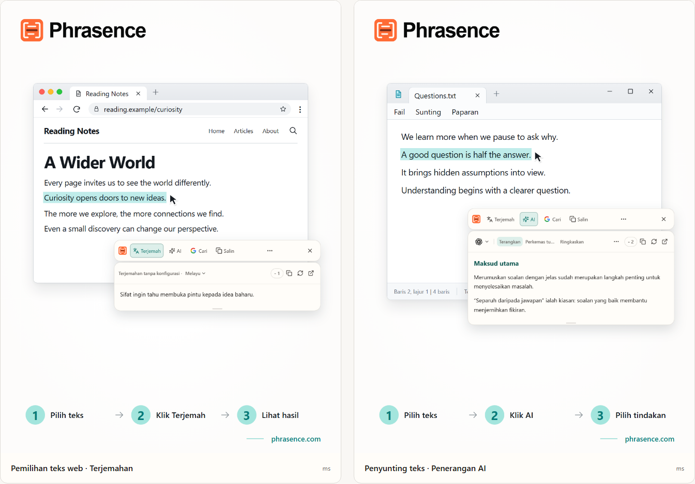

# Phrasence | Penterjemah dan pembantu teks AI untuk desktop

[English](README.md) | [Español](README.es.md) | [Português (Brasil)](README.pt-BR.md) | [Português (Portugal)](README.pt-PT.md) | [Français](README.fr.md) | [Deutsch](README.de.md) | [Italiano](README.it.md) | [Nederlands](README.nl.md)

[Русский](README.ru.md) | [Polski](README.pl.md) | [Türkçe](README.tr.md) | [Українська](README.uk.md) | [日本語](README.ja.md) | [한국어](README.ko.md) | [Bahasa Indonesia](README.id.md) | [Tiếng Việt](README.vi.md)

[ไทย](README.th.md) | [Bahasa Melayu](README.ms.md) | [हिन्दी](README.hi.md) | [বাংলা](README.bn.md) | [简体中文](README.zh-CN.md) | [繁體中文](README.zh-TW.md)

[Laman web rasmi](https://phrasence.com/) · [Muat turun](https://phrasence.com/ms/download) · [Panduan pengguna](https://phrasence.com/ms/docs/getting-started)

## Tentang Phrasence

Dengan Phrasence, pilih teks dalam pelayar, dokumen atau editor, kemudian pilih untuk menterjemah, menerangkan, meringkaskan atau memperkemasnya. Alat kekal di sisi pilihan teks supaya anda boleh terus membaca dan menulis.

Phrasence meletakkan tindakan teks yang lazim digunakan di sebelah pilihan. Anda menentukan langkah seterusnya.

**Pilih teks → Paparkan bar alat → Pilih tindakan seterusnya**



_Ilustrasi antara muka: terjemahan teks yang dipilih dan penerangan AI. Teks dan nilai kredit yang dipaparkan ialah contoh. Penggunaan sebenar tertakluk pada peraturan semasa dalam aplikasi._

## Sesuai untuk siapa

- **Pembaca kandungan dalam bahasa lain**: Terjemah ayat pada halaman atau dalam dokumen tanpa menyalinnya ke tab lain.
- **Pelajar dan penyelidik**: Terangkan istilah, huraikan ayat panjang atau ringkaskan petikan sukar sambil mengekalkan konteks bacaan.
- **Pembangun dan pembaca dokumentasi teknikal**: Dapatkan konteks yang diperlukan bagi istilah teknikal, ayat rumit, petikan penyelidikan atau cebisan kod tanpa kehilangan kedudukan bacaan.
- **Penulis dan pekerja pejabat**: Pilih sebahagian draf dan minta AI mengungkapkannya semula, memadatkan perkara utama atau melaraskan nada.

## Ciri utama

- **Terjemahan teks yang dipilih**: Pilih perkhidmatan terjemahan yang tersedia dan bahasa sasaran, lihat hasil di sebelah aplikasi semasa, kemudian salin atau hasilkannya semula.
- **AI dengan penjelasan, ringkasan dan prompt tersuai**: Menerangkan, meringkaskan, mengemas bahasa, mengambil isi penting atau membetulkan teks dipilih. Anda juga boleh mencipta tindakan seperti “Tulis semula sebagai e-mel”.
- **Ruang kerja penuh**: Bagi teks yang lebih panjang, sunting teks asal sendiri dan beralih dengan mudah antara hasil terjemahan dengan AI.
- **Cari atau salin**: Salin terus teks yang dipilih atau hantarkannya ke enjin carian pilihan anda dan teruskan dalam pelayar sistem.
- **Sejarah setempat**: Buka semula terjemahan dan hasil AI terdahulu. Sejarah kekal pada peranti ini dan boleh dimatikan atau dipadamkan pada bila-bila masa.
- **Sesuai dengan desktop anda**: Mendatar atau menegak, cerah atau gelap, sentiasa di atas atau bebas—sesuaikan Phrasence dengan skrin dan cara anda bekerja.

### Perkhidmatan terjemahan

**Tetapan → Perkhidmatan terjemahan**

Cara memilih: Terdapat tiga pilihan—terjemahan tanpa konfigurasi, model setempat dan penyedia terjemahan. Pilih satu dan klik “Guna”; ruang kerja dan bar alat pantas akan menggunakannya untuk menterjemah.

- Terjemahan tanpa konfigurasi: Tidak memerlukan konfigurasi. Log masuk dan klik “Guna”. Setiap terjemahan menggunakan kredit yang dikira mengikut bilangan aksara teks sumber; jumlah sebenar yang ditolak ialah jumlah akhir.
- Model terjemahan setempat: Muat turun model sebelum penggunaan pertama. Selepas itu anda boleh menterjemah di luar talian tanpa kredit; teks hanya diproses pada komputer ini.
- Penyedia terjemahan: Jika anda sudah mempunyai kunci API Baidu, Microsoft, DeepL atau Google, masukkan di sini. Kunci kekal pada komputer ini; caj dan kuota percuma ditentukan oleh penyedia.

Model setempat mesti menyokong bahasa yang anda perlukan. Muat turun dan kemas kini model memerlukan sambungan internet. Terjemahan dengan model setempat atau API sendiri tidak menggunakan kredit Phrasence. Penyedia API mungkin mengenakan caj berasingan. Simpan butiran sambungan yang diminta dan uji sambungan.

Tindakan terjemahan dan AI bergantung pada penyedia yang dikonfigurasikan, akses rangkaian, kredit tersedia dan status keluaran semasa.

[Harga](https://phrasence.com/ms/pricing)

## Panduan penggunaan

### 1. Muat turun dan pasang

Buka [halaman muat turun](https://phrasence.com/ms/download). Pilih versi yang sesuai dengan sistem pengendalian dan pemproses anda.

Jika tiada butang muat turun, pemasang tersebut belum tersedia. Jangan muat turun Phrasence daripada laman tidak rasmi.

### 2. Lengkapkan persediaan awal

Buka Phrasence dan pergi ke **Tetapan**. Semak perkara berikut mengikut turutan:

1. Di **Tetapan asas**, pilih bahasa antara muka, tema dan susun atur lalai.
2. Di **Tindakan pantas**, hidupkan sekurang-kurangnya satu cara memilih teks.
3. Di **Perkhidmatan terjemahan**, lihat perkhidmatan yang tersedia.
4. **Alat AI**: Pilih bahasa hasil dan tindakan yang ingin digunakan.
5. Jika sistem meminta kebenaran, ikut mesej untuk membuka tetapan sistem.

**Penyedia terjemahan → Simpan konfigurasi → Uji sambungan**

### 3. Pilih teks dan buka bar alat

#### Tunjukkan secara automatik apabila teks dipilih

1. Hidupkan **Tunjukkan secara automatik apabila teks dipilih**.
2. Pilih teks dalam aplikasi lain.
3. Apabila Phrasence menerima teks, bar alat muncul berhampiran pilihan.
4. Pilih Terjemah, AI, Salin atau Cari.

#### Tunjukkan dengan pintasan

1. Hidupkan **Tunjukkan dengan pintasan**.
2. Tekan pintasan semasa untuk bar alat.
3. Bar alat muncul dahulu berhampiran penuding tetikus.
4. Pilih teks yang hendak diproses.
5. Apabila Phrasence menerima teks, tindakan akan tersedia.

**Tetapan → Tindakan pantas → Pintasan semasa**

Apabila bar alat kelihatan, tekan Esc pada bila-bila masa untuk menyembunyikannya. Kesannya sama seperti butang tutup.

### 4. Pilih tindakan

- **Terjemah**: menggunakan perkhidmatan terjemahan dan bahasa sasaran semasa.
- **AI**: menerangkan, menambah baik, meringkaskan atau menjalankan tindakan lain yang telah ditetapkan. Log masuk dan kredit tersedia diperlukan.
- **Cari**: membuka enjin carian pilihan dalam pelayar sistem.
- **Salin**: menulis teks semasa ke papan klip.
- **Lain-lain**: membuka ruang kerja, sejarah, tetapan dan kawalan cara pemilihan.
- **Tutup**: menyembunyikan bar alat. Anda juga boleh menekan `Esc`.

Kos: Mengedit tetapan, menyusun dan mencipta tindakan tidak menggunakan kredit. Untuk menjalankan tindakan, anda perlu log masuk dan kredit yang dipaparkan untuk model pilihan akan ditolak.

### 5. Teruskan dalam ruang kerja

**Lagi → Buka ruang kerja**

Bar alat pantas digunakan untuk memproses pilihan di sebelah aplikasi yang sedang digunakan. Ruang kerja penuh menyediakan tempat untuk menyunting atau mengurus teks yang lebih panjang. Kedua-duanya meneruskan hasil semasa yang sama, jadi anda tidak perlu menjalankan permintaan sekali lagi.

Dalam tab terjemahan ruang kerja, perubahan pada input yang tidak kosong boleh memulakan terjemahan secara automatik. Tindakan AI masih perlu dipilih sendiri. Penyimpanan sejarah bergantung pada tetapan anda dan peraturan perkhidmatan yang dipilih.

### 6. Simpan tindakan AI tersuai

**Tetapan → Alat AI → Tindakan baharu**

Berikan nama dan arahan kepada tindakan. Simpan, kemudian pilih tindakan itu dalam senarai tindakan AI. Sebagai contoh, anda boleh menyimpan arahan berikut untuk membaca teks yang sukar:

Tetapan: “Didayakan” menentukan sama ada tindakan boleh digunakan. Suis “Bar alat” menentukan sama ada tindakan muncul pada bar pantas. Seret tindakan untuk menyusun semula.

```text
Terangkan idea utama teks yang dipilih dan senaraikan perkara penting.
Kekalkan nama, nombor dan syarat daripada teks asal.
Nyatakan ketidakpastian dengan jelas. Jangan tambah fakta tanpa asas.
```

Arahan ini ialah contoh. Bandingkan terjemahan dan jawapan AI dengan teks asal, terutamanya nama, nombor, tarikh dan syarat.

## Soalan lazim

### Apa perlu dibuat jika bar alat tidak muncul?

Pastikan Phrasence sedang berjalan dan sekurang-kurangnya satu cara pembukaan diaktifkan dalam Tindakan pantas. Semak kebenaran sistem dan sama ada aplikasi asal membenarkan pemilihan teks. Jika pilihan tidak dapat dibaca, taip atau tampal teks dalam ruang kerja.

### Mengapa saya diminta menyalin atau menampal teks?

Sesetengah aplikasi menunjukkan pilihan tetapi tidak menyediakan teksnya. Jika diminta menyalin, biarkan aplikasi asal aktif dan tekan `Ctrl+C`, atau `⌘C` pada macOS. Jika diminta menampal secara manual, buka ruang yang ditunjukkan dan tekan `Ctrl+V`, atau `⌘V` pada macOS. Salinan manual atau automatik boleh menggantikan kandungan papan klip. Anda boleh mematikan salinan automatik dalam Tetapan → Tindakan pantas.

### Adakah saya memerlukan akaun untuk menggunakan Phrasence?

Tidak bagi ciri asas, yang boleh digunakan tanpa log masuk. Alat AI, manfaat pelan dan ciri akaun akan meminta anda log masuk apabila diperlukan.

Kos: Mengedit tetapan, menyusun dan mencipta tindakan tidak menggunakan kredit. Untuk menjalankan tindakan, anda perlu log masuk dan kredit yang dipaparkan untuk model pilihan akan ditolak.

## Data dan privasi

- Memilih teks hanya menyediakan konteks. Tindakan ini tidak menghantar permintaan, menggunakan kredit atau menambahkan hasil yang selesai pada sejarah.
- Teks dihantar ke mana: Untuk terjemahan sedia digunakan, teks dihantar ke perkhidmatan Phrasence lalu ke enjin semasa. Dengan kunci sendiri, komputer menghantarnya terus kepada penyedia. Dengan model setempat, teks kekal pada komputer.
- Teks dihantar ke mana: Teks dipilih dan arahan dihantar melalui Phrasence kepada perkhidmatan AI pilihan. Rekod caj tidak menyimpan teks sumber; hanya model dan kredit digunakan.
- Apabila dihidupkan, sejarah hanya disimpan pada peranti ini dan tidak pernah disegerakkan ke awan. Anda boleh mematikan atau memadamkannya pada bila-bila masa.

Dalam tab terjemahan ruang kerja, perubahan pada input yang tidak kosong boleh memulakan terjemahan secara automatik. Tindakan AI masih perlu dipilih sendiri. Penyimpanan sejarah bergantung pada tetapan anda dan peraturan perkhidmatan yang dipilih.

[Privasi dan data](https://phrasence.com/ms/docs/privacy-security) · [Dasar Privasi (EN)](https://phrasence.com/privacy-policy)

## Laman rasmi dan bantuan

- [Laman web rasmi: phrasence.com](https://phrasence.com/)
- [Muat turun, pasang dan buka buat kali pertama](https://phrasence.com/ms/docs/getting-started)
- [Penyelesaian masalah](https://phrasence.com/ms/docs/troubleshooting)
- [Hubungi kami melalui Telegram](https://t.me/phrasence)

Untuk meminta bantuan atau melaporkan ralat, log masuk ke laman web dan buka Bantuan dan maklum balas dalam tetapan. Sertakan sistem pengendalian, versi aplikasi, perkhidmatan yang dipilih dan langkah untuk mengulangi masalah.
