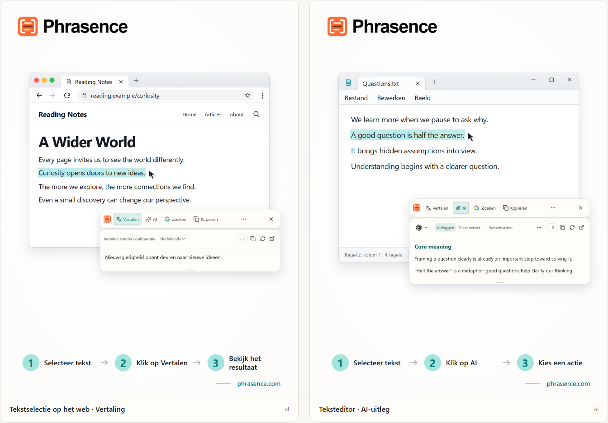

# Phrasence | AI-vertaler en tekstassistent voor je desktop

[English](README.md) | [Español](README.es.md) | [Português (Brasil)](README.pt-BR.md) | [Português (Portugal)](README.pt-PT.md) | [Français](README.fr.md) | [Deutsch](README.de.md) | [Italiano](README.it.md) | [Nederlands](README.nl.md)

[Русский](README.ru.md) | [Polski](README.pl.md) | [Türkçe](README.tr.md) | [Українська](README.uk.md) | [日本語](README.ja.md) | [한국어](README.ko.md) | [Bahasa Indonesia](README.id.md) | [Tiếng Việt](README.vi.md)

[ไทย](README.th.md) | [Bahasa Melayu](README.ms.md) | [हिन्दी](README.hi.md) | [বাংলা](README.bn.md) | [简体中文](README.zh-CN.md) | [繁體中文](README.zh-TW.md)

[Officiële website](https://phrasence.com/) · [Downloaden](https://phrasence.com/nl/download) · [Gebruikershandleiding](https://phrasence.com/nl/docs/getting-started)

## Over Phrasence

Met Phrasence selecteer je tekst in een browser, document of editor en kies je voor vertalen, uitleggen, samenvatten of herschrijven. De tools blijven naast je selectie, zodat je kunt blijven lezen en schrijven.

Phrasence zet veelgebruikte tekstacties naast je selectie. Jij bepaalt wat er daarna gebeurt.

**Selecteer de tekst → Open de werkbalk → Kies de volgende stap**



_Illustratie van de interface: vertaling van geselecteerde tekst en AI-uitleg. De tekst en creditbedragen zijn voorbeelden. Voor het werkelijke gebruik gelden de actuele regels in de app._

## Voor wie is het

- **Mensen die in een andere taal lezen**: Vertaal een zin op een pagina of in een document zonder hem naar een ander tabblad te kopiëren.
- **Studenten en onderzoekers**: Laat een term uitleggen, ontleed een lange zin of vat een moeilijke passage samen terwijl je leescontext behouden blijft.
- **Ontwikkelaars en lezers van technische documentatie**: Krijg de nodige context bij een vakterm, ingewikkelde zin, onderzoekspassage of codefragment zonder kwijt te raken waar je was.
- **Mensen die teksten schrijven of op kantoor werken**: Selecteer een deel van je concept en laat AI het anders formuleren, de kern aanscherpen of de toon aanpassen.

## Belangrijkste functies

- **Vertaling van geselecteerde tekst**: Kies een beschikbare vertaaldienst en doeltaal, bekijk het resultaat naast je huidige app en kopieer of genereer het vervolgens opnieuw.
- **Uitleggen, samenvatten en aangepaste prompts met AI**: Geselecteerde tekst uitleggen, samenvatten, verbeteren, kernpunten eruit halen of corrigeren. Je kunt ook acties maken zoals ‘Als e-mail herschrijven’ of ‘Antwoord genereren’.
- **Volledige werkruimte**: Bewerk bij langere teksten het origineel met de hand en schakel gemakkelijk tussen vertaal- en AI-resultaten.
- **Zoeken of kopiëren**: Kopieer de geselecteerde tekst rechtstreeks of stuur hem naar je favoriete zoekmachine en ga verder in je systeembrowser.
- **Lokale geschiedenis**: Open eerdere vertalingen en AI-resultaten opnieuw. De geschiedenis blijft op dit apparaat en kan op elk moment worden uitgeschakeld of gewist.
- **Past bij jouw desktop**: Horizontaal of verticaal, licht of donker, vastgezet of flexibel: stem Phrasence af op je scherm en werkwijze.

### Vertaalservices

**Instellingen → Vertaalservices**

Kiezen: Er zijn drie opties: vertalen zonder configuratie, lokaal vertaalmodel en vertaalaanbieders. Kies er één en klik op ‘Gebruiken’; de werkruimte en snelwerkbalk gebruiken deze daarna voor vertalen.

- Vertalen zonder configuratie: Er is geen configuratie nodig. Meld je aan en klik op ‘Gebruiken’. Elke vertaling gebruikt credits op basis van het aantal tekens in de brontekst; het werkelijk afgeschreven aantal is definitief.
- Lokaal vertaalmodel: Download het model vóór het eerste gebruik. Daarna kun je offline en zonder credits vertalen; tekst wordt alleen op deze computer verwerkt.
- Vertaalaanbieders: Heb je al een API-sleutel van Baidu, Microsoft, DeepL of Google, vul die dan hier in. De sleutel blijft op deze computer; de aanbieder bepaalt prijzen en gratis quota.

Het lokale model moet jouw talen ondersteunen. Voor downloaden en bijwerken is een internetverbinding nodig. Vertalen met een lokaal model of je eigen API kost geen Phrasence-credits. De API-aanbieder kan wel eigen kosten rekenen. Sla de gevraagde verbindingsgegevens op en test de verbinding.

Vertalingen en AI-acties zijn afhankelijk van de ingestelde aanbieder, de netwerkverbinding, beschikbare credits en de huidige releasestatus.

[Prijzen](https://phrasence.com/nl/pricing)

## Aan de slag

### 1. Downloaden en installeren

Open de [downloadpagina](https://phrasence.com/nl/download). Kies de versie voor je besturingssysteem en processor.

Staat er geen downloadknop? Dan is het bijbehorende installatiebestand nog niet beschikbaar. Download Phrasence niet van een onofficiële website.

### 2. De eerste instellingen kiezen

Start Phrasence en open **Instellingen**. Controleer deze onderdelen in de aangegeven volgorde:

1. Kies bij **Basisinstellingen** de taal van de interface, het thema en de standaardindeling.
2. Schakel bij **Snelle acties** ten minste één manier van tekstselectie in.
3. Bekijk bij **Vertaalservices** welke services beschikbaar zijn.
4. **AI-tools**: Kies de uitvoertaal en de acties die je wilt gebruiken.
5. Vraagt het systeem om toestemming? Volg dan de melding om de systeeminstellingen te openen.

**Vertaalaanbieders → Configuratie opslaan → Verbinding testen**

### 3. Tekst selecteren en de werkbalk openen

#### Automatisch openen na tekstselectie

1. Schakel **Automatisch openen na tekstselectie** in.
2. Selecteer tekst in een andere app.
3. Zodra Phrasence de tekst ontvangt, verschijnt de werkbalk naast de selectie.
4. Kies Vertalen, AI, Kopiëren of Zoeken.

#### Openen met een sneltoets

1. Schakel **Openen met een sneltoets** in.
2. Druk op de huidige sneltoets voor de werkbalk.
3. De werkbalk verschijnt eerst naast de muisaanwijzer.
4. Selecteer de tekst die je wilt verwerken.
5. Zodra Phrasence de tekst ontvangt, worden de acties beschikbaar.

**Instellingen → Snelle acties → Huidige sneltoets**

Wanneer de werkbalk zichtbaar is, kun je hem altijd met Esc verbergen. Dit werkt hetzelfde als de sluitknop.

### 4. Een actie kiezen

- **Vertalen**: gebruikt de huidige vertaalservice en doeltaal.
- **AI**: legt uit, verbetert, vat samen of voert een andere ingestelde actie uit. Aanmelding en beschikbare credits zijn vereist.
- **Zoeken**: opent de gekozen zoekmachine in de systeembrowser.
- **Kopiëren**: plaatst de huidige tekst op het klembord.
- **Meer**: opent de werkruimte, geschiedenis, instellingen en selectieregelaars.
- **Sluiten**: verbergt de werkbalk. Je kunt ook op `Esc` drukken.

Kosten: Instellingen wijzigen, ordenen en acties maken kost geen credits. Voor uitvoering moet je zijn aangemeld en worden de bij het gekozen model getoonde credits afgeschreven.

### 5. Verdergaan in de werkruimte

**Meer → Werkruimte openen**

De snelle werkbalk is bedoeld om een selectie naast de gebruikte app te verwerken. De volledige werkruimte biedt plaats om tekst te bewerken of langere inhoud te behandelen. Beide gaan door met hetzelfde huidige resultaat, dus je hoeft het verzoek niet opnieuw uit te voeren.

Op het vertaaltabblad van de werkruimte kan een wijziging in een niet-lege invoer automatisch een vertaling starten. AI-acties moet je nog steeds zelf kiezen. Of de geschiedenis wordt opgeslagen, hangt af van je instellingen en de regels van de gekozen dienst.

### 6. Een eigen AI-actie opslaan

**Instellingen → AI-tools → Nieuwe actie**

Geef de actie een naam en een instructie. Sla de actie op en kies deze daarna in de lijst met AI-acties. Voor een moeilijke tekst kun je bijvoorbeeld deze instructie opslaan:

Instellen: ‘Ingeschakeld’ bepaalt of een actie kan worden gebruikt. De schakelaar ‘Werkbalk’ bepaalt of deze in de snelwerkbalk staat. Sleep acties om de volgorde te wijzigen.

```text
Leg de hoofdgedachte van de geselecteerde tekst uit en som de kernpunten op.
Behoud namen, getallen en voorwaarden uit de brontekst.
Geef onzekerheden duidelijk aan. Voeg geen onbewezen feiten toe.
```

De instructie is een voorbeeld. Vergelijk vertalingen en AI-antwoorden met het origineel. Let vooral op namen, getallen, datums en voorwaarden.

## Veelgestelde vragen

### Wat als de werkbalk niet verschijnt?

Controleer of Phrasence actief is en of er bij Snelle acties minstens één openingsmethode is ingeschakeld. Controleer ook de systeemrechten en of je in de bronapp tekst kunt selecteren. Kan de selectie niet worden gelezen, typ of plak de tekst dan in de werkruimte.

### Waarom moet ik kopiëren of plakken?

Sommige apps tonen een selectie zonder de tekst beschikbaar te stellen. Vraagt de melding om kopiëren, houd de bronapp dan actief en druk op `Ctrl+C`, of `⌘C` op macOS. Vraagt de melding om handmatig plakken, open dan het aangegeven invoerveld en druk op `Ctrl+V`, of `⌘V` op macOS. Handmatig of automatisch kopiëren kan de inhoud van het klembord vervangen. Je kunt automatisch kopiëren uitschakelen onder Instellingen → Snelle acties.

### Heb ik een account nodig om Phrasence te gebruiken?

Niet voor de basisfuncties; die werken zonder aanmelding. AI-hulpmiddelen, voordelen van je abonnement en accountfuncties vragen je om aan te melden wanneer dat nodig is.

Kosten: Instellingen wijzigen, ordenen en acties maken kost geen credits. Voor uitvoering moet je zijn aangemeld en worden de bij het gekozen model getoonde credits afgeschreven.

## Gegevens en privacy

- Tekst selecteren bereidt alleen de context voor. Het verstuurt geen verzoek, verbruikt geen credits en voegt geen voltooid item toe aan de geschiedenis.
- Waar tekst naartoe gaat: Bij direct bruikbare vertaling gaat tekst naar de Phrasence-service en daarna naar de huidige machine. Met je eigen API-sleutel stuurt deze computer tekst rechtstreeks naar de aanbieder. Met het lokale model blijft tekst op deze computer.
- Waar tekst naartoe gaat: Geselecteerde tekst en instructies worden via Phrasence naar de gekozen AI-service gestuurd. De facturatieregistratie bewaart niet de brontekst, alleen het model en de gebruikte credits.
- Wanneer geschiedenis is ingeschakeld, wordt die alleen op dit apparaat opgeslagen en nooit met de cloud gesynchroniseerd. Schakel de functie uit of wis de inhoud wanneer je wilt.

Op het vertaaltabblad van de werkruimte kan een wijziging in een niet-lege invoer automatisch een vertaling starten. AI-acties moet je nog steeds zelf kiezen. Of de geschiedenis wordt opgeslagen, hangt af van je instellingen en de regels van de gekozen dienst.

[Privacy en gegevens](https://phrasence.com/nl/docs/privacy-security) · [Privacybeleid (EN)](https://phrasence.com/privacy-policy)

## Officiële website en hulp

- [Officiële website: phrasence.com](https://phrasence.com/)
- [Downloaden, installeren en voor het eerst starten](https://phrasence.com/nl/docs/getting-started)
- [Problemen oplossen](https://phrasence.com/nl/docs/troubleshooting)
- [Contact via Telegram](https://t.me/phrasence)

Meld je voor hulp of een foutmelding aan op de website en open Hulp en feedback in de instellingen. Vermeld je besturingssysteem, appversie, gekozen dienst en de stappen waarmee het probleem kan worden herhaald.
