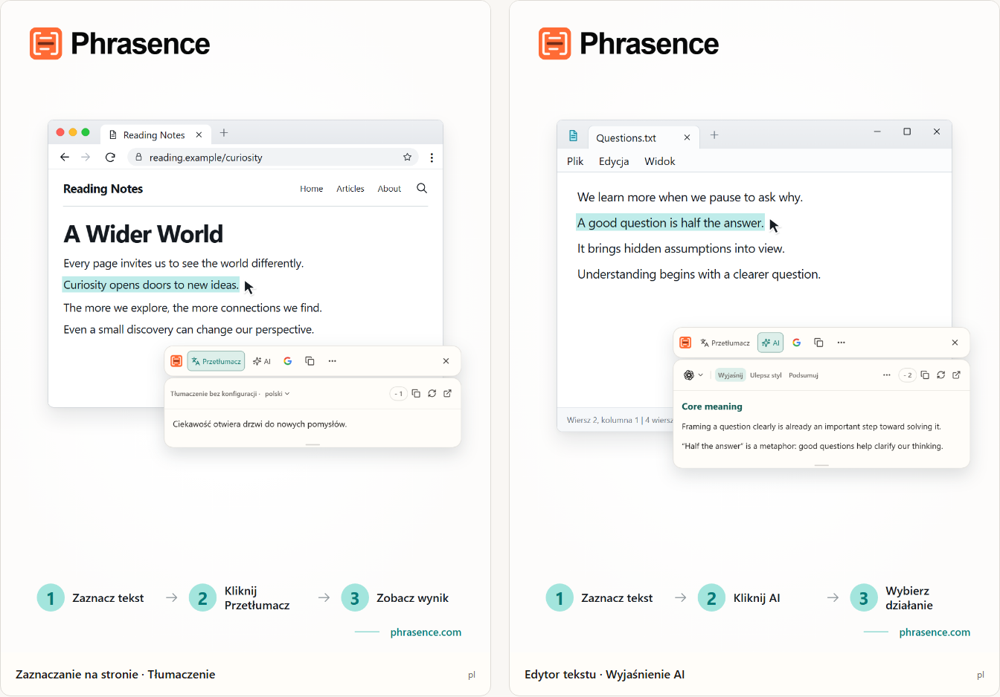

# Phrasence | Tłumacz i asystent tekstowy AI na komputer

[English](README.md) | [Español](README.es.md) | [Português (Brasil)](README.pt-BR.md) | [Português (Portugal)](README.pt-PT.md) | [Français](README.fr.md) | [Deutsch](README.de.md) | [Italiano](README.it.md) | [Nederlands](README.nl.md)

[Русский](README.ru.md) | [Polski](README.pl.md) | [Türkçe](README.tr.md) | [Українська](README.uk.md) | [日本語](README.ja.md) | [한국어](README.ko.md) | [Bahasa Indonesia](README.id.md) | [Tiếng Việt](README.vi.md)

[ไทย](README.th.md) | [Bahasa Melayu](README.ms.md) | [हिन्दी](README.hi.md) | [বাংলা](README.bn.md) | [简体中文](README.zh-CN.md) | [繁體中文](README.zh-TW.md)

[Oficjalna strona](https://phrasence.com/) · [Pobierz](https://phrasence.com/pl/download) · [Podręcznik użytkownika](https://phrasence.com/pl/docs/getting-started)

## Czym jest Phrasence

Z Phrasence zaznacz tekst w przeglądarce, dokumencie lub edytorze, a następnie wybierz tłumaczenie, wyjaśnienie, podsumowanie lub redakcję. Narzędzia pozostają obok zaznaczenia, aby czytanie i pisanie przebiegało płynnie.

Phrasence umieszcza najczęstsze działania obok zaznaczenia. To Ty decydujesz, co wydarzy się dalej.

**Zaznacz tekst → Wyświetl pasek → Wybierz następne działanie**



_Ilustracja interfejsu: tłumaczenie zaznaczonego tekstu i objaśnienie AI. Tekst i liczby kredytów są przykładami. Rzeczywiste użycie podlega aktualnym zasadom w aplikacji._

## Dla kogo

- **Osoby czytające w innym języku**: Przetłumacz zdanie na stronie lub w dokumencie bez kopiowania go do innej karty.
- **Studenci i badacze**: Wyjaśnij termin, rozłóż na części długie zdanie lub podsumuj trudny fragment, zachowując kontekst lektury.
- **Programiści i czytelnicy dokumentacji technicznej**: Uzyskaj potrzebny kontekst dla terminu specjalistycznego, złożonego zdania, fragmentu publikacji lub kodu, nie tracąc miejsca w tekście.
- **Osoby piszące teksty i pracujące w biurze**: Zaznacz część wersji roboczej i poproś AI o inną formę, skrócenie myśli lub dostosowanie tonu.

## Najważniejsze funkcje

- **Tłumaczenie zaznaczonego tekstu**: Wybierz dostępny serwis tłumaczeniowy i język docelowy, sprawdź wynik obok bieżącej aplikacji, a następnie skopiuj go lub wygeneruj ponownie.
- **Wyjaśnianie, podsumowanie i niestandardowe polecenia z AI**: Objaśnianie, podsumowywanie, ulepszanie, wyodrębnianie najważniejszych punktów i poprawianie zaznaczonego tekstu. Możesz też tworzyć działania, np. „Przepisz jako e-mail”.
- **Pełny obszar roboczy**: Przy dłuższym tekście edytuj oryginał ręcznie i wygodnie przełączaj się między tłumaczeniem a wynikami AI.
- **Wyszukaj lub skopiuj**: Skopiuj zaznaczony tekst albo wyślij go do ulubionej wyszukiwarki i kontynuuj w przeglądarce systemowej.
- **Historia lokalna**: Otwieraj ponownie wcześniejsze tłumaczenia i wyniki AI. Historia pozostaje na tym urządzeniu i w każdej chwili można ją wyłączyć lub wyczyścić.
- **Dopasowuje się do Twojego pulpitu**: Poziomo lub pionowo, jasno lub ciemno, zawsze na wierzchu albo swobodnie — dostosuj Phrasence do swojego ekranu i sposobu pracy.

### Usługi tłumaczeniowe

**Ustawienia → Usługi tłumaczeniowe**

Jak wybrać: Dostępne są trzy opcje: tłumaczenie bez konfiguracji, lokalny model i dostawcy tłumaczeń. Wybierz jedną i kliknij „Użyj”; obszar roboczy i szybki pasek będą jej używać do tłumaczenia.

- Tłumaczenie bez konfiguracji: Nie wymaga konfiguracji. Zaloguj się i kliknij „Użyj”. Każde tłumaczenie zużywa punkty obliczane według liczby znaków tekstu źródłowego; obowiązuje faktycznie pobrana liczba.
- Lokalny model tłumaczeniowy: Pobierz model przed pierwszym użyciem. Potem możesz tłumaczyć offline bez zużywania punktów; tekst jest przetwarzany tylko na tym komputerze.
- Dostawcy tłumaczeń: Jeśli masz klucz API Baidu, Microsoft, DeepL lub Google, wpisz go tutaj. Klucz pozostaje na tym komputerze; ceny i bezpłatne limity ustala dostawca.

Model lokalny musi obsługiwać potrzebne języki. Pobieranie i aktualizowanie modelu wymaga połączenia z internetem. Tłumaczenie za pomocą modelu lokalnego lub własnego API nie zużywa kredytów Phrasence. Dostawca API może naliczać własne opłaty. Zapisz wymagane dane połączenia i przetestuj je.

Dostępność tłumaczeń i działań AI zależy od skonfigurowanego dostawcy, połączenia z siecią, dostępnych punktów i obecnego stanu wydania.

[Cennik](https://phrasence.com/pl/pricing)

## Jak korzystać

### 1. Pobierz i zainstaluj

Otwórz [stronę pobierania](https://phrasence.com/pl/download). Wybierz wersję odpowiednią do systemu operacyjnego i procesora.

Jeśli nie ma przycisku pobierania, dany instalator nie jest jeszcze dostępny. Nie pobieraj Phrasence z nieoficjalnych stron.

### 2. Wprowadź ustawienia początkowe

Uruchom Phrasence i otwórz **Ustawienia**. Sprawdź kolejno:

1. W sekcji **Ustawienia podstawowe** wybierz język interfejsu, motyw i domyślny układ.
2. W sekcji **Szybkie działania** włącz co najmniej jeden sposób zaznaczania tekstu.
3. W sekcji **Usługi tłumaczeniowe** sprawdź dostępne usługi.
4. **Narzędzia AI**: Wybierz język wyników i działania, z których chcesz korzystać.
5. Jeśli system poprosi o uprawnienia, skorzystaj z komunikatu, aby otworzyć ustawienia systemu.

**Dostawcy tłumaczeń → Zapisz konfigurację → Sprawdź połączenie**

### 3. Zaznacz tekst i otwórz pasek

#### Otwieraj automatycznie po zaznaczeniu tekstu

1. Włącz **Otwieraj automatycznie po zaznaczeniu tekstu**.
2. Zaznacz tekst w innej aplikacji.
3. Gdy Phrasence odbierze tekst, pasek pojawi się obok zaznaczenia.
4. Wybierz Tłumacz, AI, Kopiuj lub Szukaj.

#### Otwieraj skrótem klawiaturowym

1. Włącz **Otwieraj skrótem klawiaturowym**.
2. Naciśnij obecny skrót paska.
3. Pasek pojawi się najpierw obok wskaźnika myszy.
4. Zaznacz tekst do przetworzenia.
5. Gdy Phrasence odbierze tekst, działania staną się dostępne.

**Ustawienia → Szybkie działania → Bieżący skrót**

Gdy pasek jest widoczny, możesz w dowolnej chwili ukryć go klawiszem Esc — tak samo jak przyciskiem zamykania.

### 4. Wybierz działanie

- **Tłumacz**: używa bieżącej usługi tłumaczeniowej i języka docelowego.
- **AI**: wyjaśnia, poprawia, podsumowuje lub wykonuje inne skonfigurowane działanie. Wymaga logowania i dostępnych punktów.
- **Szukaj**: otwiera wybraną wyszukiwarkę w przeglądarce systemowej.
- **Kopiuj**: umieszcza bieżący tekst w schowku.
- **Więcej**: otwiera obszar roboczy, historię, ustawienia i przełączniki sposobów zaznaczania.
- **Zamknij**: ukrywa pasek. Możesz też nacisnąć `Esc`.

Koszt: Zmiana ustawień, kolejności i tworzenie działań nie zużywa punktów. Uruchomienie wymaga zalogowania i pobiera liczbę punktów pokazaną przy wybranym modelu.

### 5. Kontynuuj w obszarze roboczym

**Więcej → Otwórz obszar roboczy**

Szybki pasek służy do obsługi zaznaczenia obok używanej aplikacji. Pełny obszar roboczy zapewnia miejsce na edycję i dłuższy tekst. Oba tryby kontynuują pracę z tym samym bieżącym wynikiem, więc nie trzeba ponawiać żądania.

Na karcie tłumaczenia w obszarze roboczym zmiana niepustego tekstu może automatycznie uruchomić tłumaczenie. Działania AI nadal wymagają świadomego wyboru. Zapis historii zależy od ustawień i zasad wybranej usługi.

### 6. Zapisz własne działanie AI

**Ustawienia → Narzędzia AI → Nowe działanie**

Nadaj działaniu nazwę i wpisz instrukcję. Zapisz je, a następnie wybierz na liście działań AI. Do czytania trudnego tekstu możesz zapisać na przykład taką instrukcję:

Konfiguracja: „Włączone” określa, czy można użyć działania. Przełącznik „Pasek narzędzi” określa, czy pojawi się na szybkim pasku. Przeciągaj działania, aby zmieniać kolejność.

```text
Wyjaśnij główną myśl zaznaczonego tekstu i wypisz kluczowe punkty.
Zachowaj nazwy, liczby i warunki z oryginału.
Wyraźnie zaznacz niepewność. Nie dodawaj niepotwierdzonych faktów.
```

Ta instrukcja jest przykładem. Porównuj tłumaczenia i odpowiedzi AI z oryginałem, zwłaszcza nazwy, liczby, daty i warunki.

## Częste pytania

### Co zrobić, gdy pasek się nie pojawia?

Sprawdź, czy Phrasence działa i czy w Szybkich działaniach jest włączony co najmniej jeden sposób otwierania. Sprawdź też uprawnienia systemowe i możliwość zaznaczania tekstu w aplikacji źródłowej. Jeśli zaznaczenia nie da się odczytać, wpisz lub wklej tekst do obszaru roboczego.

### Dlaczego aplikacja prosi o skopiowanie lub wklejenie tekstu?

Niektóre aplikacje pokazują zaznaczenie, ale nie udostępniają tekstu. Gdy komunikat prosi o skopiowanie, pozostaw aktywną aplikację źródłową i naciśnij `Ctrl+C` lub `⌘C` w macOS. Gdy prosi o ręczne wklejenie, otwórz wskazane pole i naciśnij `Ctrl+V` lub `⌘V` w macOS. Ręczne lub automatyczne kopiowanie może zastąpić zawartość schowka. Automatyczne kopiowanie można wyłączyć w Ustawienia → Szybkie działania.

### Czy do korzystania z Phrasence potrzebne jest konto?

Nie do podstawowych funkcji — działają bez logowania. Narzędzia AI, korzyści wynikające z planu i funkcje konta poproszą o zalogowanie, gdy będzie to potrzebne.

Koszt: Zmiana ustawień, kolejności i tworzenie działań nie zużywa punktów. Uruchomienie wymaga zalogowania i pobiera liczbę punktów pokazaną przy wybranym modelu.

## Dane i prywatność

- Samo zaznaczenie przygotowuje jedynie kontekst. Nie wysyła żądania, nie zużywa punktów ani nie dodaje zakończonej operacji do historii.
- Dokąd trafia tekst: Przy tłumaczeniu gotowym do użycia trafia do usługi Phrasence, a potem do bieżącego silnika. Z własnym kluczem API komputer wysyła go bezpośrednio do dostawcy. Przy modelu lokalnym pozostaje na komputerze.
- Dokąd trafia tekst: Zaznaczony tekst i instrukcje są wysyłane przez Phrasence do wybranej usługi AI. Rejestr rozliczeń nie zapisuje tekstu źródłowego, tylko model i zużyte punkty.
- Po włączeniu historia jest przechowywana wyłącznie na tym urządzeniu i nigdy nie synchronizuje się z chmurą. Możesz ją w każdej chwili wyłączyć lub wyczyścić.

Na karcie tłumaczenia w obszarze roboczym zmiana niepustego tekstu może automatycznie uruchomić tłumaczenie. Działania AI nadal wymagają świadomego wyboru. Zapis historii zależy od ustawień i zasad wybranej usługi.

[Prywatność i dane](https://phrasence.com/pl/docs/privacy-security) · [Polityka prywatności (EN)](https://phrasence.com/privacy-policy)

## Oficjalna strona i pomoc

- [Oficjalna strona: phrasence.com](https://phrasence.com/)
- [Pobieranie, instalacja i pierwsze uruchomienie](https://phrasence.com/pl/docs/getting-started)
- [Rozwiązywanie problemów](https://phrasence.com/pl/docs/troubleshooting)
- [Kontakt przez Telegram](https://t.me/phrasence)

Aby poprosić o pomoc lub zgłosić błąd, zaloguj się na stronie i otwórz Pomoc i opinie w ustawieniach. Podaj system operacyjny, wersję aplikacji, wybraną usługę i kroki pozwalające odtworzyć problem.
