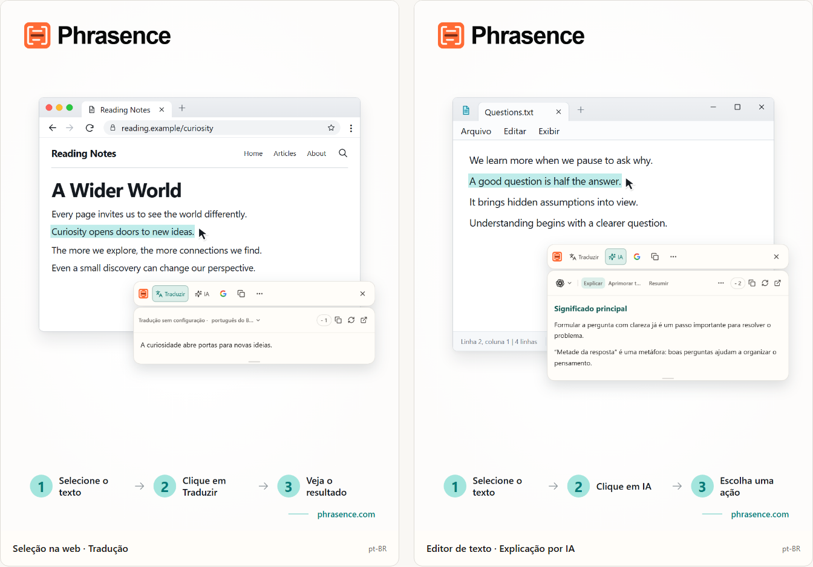

# Phrasence | Tradutor e assistente de texto com IA para desktop

[English](README.md) | [Español](README.es.md) | [Português (Brasil)](README.pt-BR.md) | [Português (Portugal)](README.pt-PT.md) | [Français](README.fr.md) | [Deutsch](README.de.md) | [Italiano](README.it.md) | [Nederlands](README.nl.md)

[Русский](README.ru.md) | [Polski](README.pl.md) | [Türkçe](README.tr.md) | [Українська](README.uk.md) | [日本語](README.ja.md) | [한국어](README.ko.md) | [Bahasa Indonesia](README.id.md) | [Tiếng Việt](README.vi.md)

[ไทย](README.th.md) | [Bahasa Melayu](README.ms.md) | [हिन्दी](README.hi.md) | [বাংলা](README.bn.md) | [简体中文](README.zh-CN.md) | [繁體中文](README.zh-TW.md)

[Site oficial](https://phrasence.com/) · [Baixar](https://phrasence.com/pt-BR/download) · [Guia do usuário](https://phrasence.com/pt-BR/docs/getting-started)

## O que é o Phrasence

Com o Phrasence, selecione texto em um navegador, documento ou editor e escolha traduzir, explicar, resumir ou aprimorar. As ferramentas ficam ao lado da seleção para você continuar lendo e escrevendo sem perder o ritmo.

O Phrasence coloca as ações de texto mais usadas ao lado da seleção. Você decide o que acontece depois.

**Selecione o texto → Abra a barra → Escolha o próximo passo**



_Ilustração da interface: tradução do texto selecionado e explicação de IA. O texto e os créditos exibidos são exemplos. O uso real segue as regras atuais do aplicativo._

## Para quem é

- **Quem lê em outros idiomas**: Traduza uma frase de uma página ou documento sem copiá-la para outra aba.
- **Estudantes e pesquisadores**: Explique um termo, desvende uma frase longa ou resuma um trecho difícil sem perder o contexto da leitura.
- **Desenvolvedores e leitores de documentação técnica**: Acrescente contexto a um termo técnico, uma frase complexa, um trecho acadêmico ou um bloco de código sem perder o ponto em que estava.
- **Quem escreve ou trabalha em escritório**: Selecione uma parte do rascunho e peça à IA para reformular, condensar a ideia ou ajustar o tom.

## Principais recursos

- **Tradução do texto selecionado**: Escolha um serviço de tradução disponível e o idioma de destino, veja o resultado ao lado do aplicativo atual e depois copie ou gere novamente.
- **Explicação, resumo e prompts personalizados com IA**: Explicam, resumem, aprimoram, extraem pontos principais ou revisam o texto selecionado. Você também pode criar ações como “Reescrever como e-mail” ou “Gerar resposta”.
- **Área de trabalho completa**: Para textos mais longos, edite o original manualmente e alterne com tranquilidade entre os resultados de tradução e IA.
- **Pesquise ou copie**: Copie o texto selecionado diretamente ou envie-o ao mecanismo de busca de sua preferência para continuar no navegador do sistema.
- **Histórico local**: Reabra traduções e resultados de IA anteriores. O histórico fica neste dispositivo e pode ser desativado ou apagado quando você quiser.
- **Adapta-se à sua área de trabalho**: Horizontal ou vertical, claro ou escuro, fixo ou livre: ajuste o Phrasence à sua tela e à sua rotina.

### Serviços de tradução

**Configurações → Serviços de tradução**

Como escolher: Há três opções: tradução sem configuração, modelo local e provedores de tradução. Escolha uma e clique em “Usar”; a área de trabalho e a barra rápida passarão a usá-la para traduzir.

- Tradução sem configuração: Não exige configuração. Faça login e clique em “Usar”. Cada tradução consome créditos calculados pela quantidade de caracteres do texto original; vale o desconto real.
- Modelo de tradução local: Baixe o modelo antes do primeiro uso. Depois, traduza offline sem gastar créditos; o texto é processado somente neste computador.
- Provedores de tradução: Se já tiver uma chave de API do Baidu, Microsoft, DeepL ou Google, informe-a aqui. A chave fica neste computador; preços e cotas gratuitas são definidos pelo provedor.

O modelo local precisa oferecer suporte aos idiomas que você usa. É necessário ter conexão para baixar ou atualizar o modelo. Traduzir com um modelo local ou com sua própria API não consome créditos do Phrasence. O provedor da API pode cobrar pelo serviço. Salve os dados de conexão exigidos e teste a conexão.

As ações de tradução e IA dependem do provedor configurado, da conexão, dos créditos disponíveis e do status atual da versão.

[Preços](https://phrasence.com/pt-BR/pricing)

## Como usar

### 1. Baixar e instalar

Abra a [página de download](https://phrasence.com/pt-BR/download). Escolha a versão correta para o seu sistema operacional e processador.

Se não houver um botão de download, o instalador correspondente ainda não está disponível. Não baixe o Phrasence de sites não oficiais.

### 2. Fazer a configuração inicial

Abra o Phrasence e entre em **Configurações**. Confira os itens nesta ordem:

1. Em **Configurações gerais**, escolha o idioma da interface, o tema e o layout padrão.
2. Em **Ações rápidas**, ative pelo menos uma forma de selecionar texto.
3. Em **Serviços de tradução**, veja quais serviços estão disponíveis.
4. **Ferramentas de IA**: Escolha o idioma de saída e as ações que deseja usar.
5. Se o sistema pedir uma permissão, siga o aviso para abrir as configurações do sistema.

**Provedores de tradução → Salvar configuração → Testar conexão**

### 3. Selecionar texto e abrir a barra

#### Mostrar ao selecionar texto

1. Ative **Mostrar ao selecionar texto**.
2. Selecione o texto em outro aplicativo.
3. Quando o Phrasence receber o texto, a barra aparecerá perto da seleção.
4. Escolha Traduzir, IA, Copiar ou Pesquisar.

#### Mostrar usando um atalho

1. Ative **Mostrar usando um atalho**.
2. Pressione o atalho atual da barra.
3. A barra aparecerá primeiro perto do ponteiro.
4. Selecione o texto que você quer processar.
5. Quando o Phrasence receber o texto, as ações ficarão disponíveis.

**Configurações → Ações rápidas → Atalho atual**

Enquanto a barra estiver visível, pressione Esc para ocultá-la. O efeito é o mesmo do botão Fechar.

### 4. Escolher uma ação

- **Traduzir**: usa o serviço de tradução e o idioma de destino atuais.
- **IA**: explica, melhora, resume ou executa outra ação configurada. Exige login e créditos disponíveis.
- **Pesquisar**: abre o buscador escolhido no navegador do sistema.
- **Copiar**: coloca o texto atual na área de transferência.
- **Mais**: abre o espaço de trabalho, o histórico, as configurações e os controles de seleção.
- **Fechar**: oculta a barra. Você também pode pressionar `Esc`.

Custo: Editar configurações, reordenar e criar ações não gasta créditos. Para executar uma ação, faça login; serão descontados os créditos mostrados para o modelo escolhido.

### 5. Continuar no espaço de trabalho

**Mais → Abrir área de trabalho**

A barra rápida serve para processar uma seleção ao lado do aplicativo que você está usando. A área de trabalho completa oferece espaço para editar ou trabalhar com textos mais longos. As duas continuam com o mesmo resultado atual, então não é necessário repetir a solicitação.

Na aba de tradução do espaço de trabalho, alterar uma entrada que não esteja vazia pode iniciar uma tradução automática. As ações de IA ainda precisam ser escolhidas por você. O histórico só é salvo quando suas configurações e as regras do serviço permitem.

### 6. Salvar uma ação de IA personalizada

**Configurações → Ferramentas de IA → Criar ação**

Dê um nome à ação e escreva uma instrução. Salve e depois escolha a ação na lista de ações de IA. Por exemplo, salve esta instrução para ajudar na leitura de um texto difícil:

Como configurar: “Ativada” define se uma ação pode ser usada. O botão “Barra rápida” define se ela aparece na barra rápida. Arraste as ações para reordenar.

```text
Explique a ideia principal do texto selecionado e liste os pontos-chave.
Mantenha os nomes, números e condições do original.
Indique claramente qualquer incerteza. Não acrescente informações sem fundamento.
```

A instrução é um exemplo. Compare as traduções e respostas de IA com o original, principalmente nomes, números, datas e condições.

## Perguntas frequentes

### O que fazer se a barra não aparecer?

Confira se o Phrasence está aberto e se pelo menos um método de abertura está ativado em Ações rápidas. Verifique as permissões do sistema e se o aplicativo de origem permite selecionar texto. Se não for possível ler a seleção, digite ou cole o texto no espaço de trabalho.

### Por que o aplicativo pede para copiar ou colar?

Alguns aplicativos mostram uma seleção sem disponibilizar o texto. Se a mensagem pedir para copiar, mantenha o aplicativo de origem ativo e pressione `Ctrl+C`, ou `⌘C` no macOS. Se pedir para colar manualmente, abra a área indicada e pressione `Ctrl+V`, ou `⌘V` no macOS. A cópia manual ou automática pode substituir o conteúdo da área de transferência. Você pode desativar a cópia automática em Configurações → Ações rápidas.

### Preciso ter uma conta para usar o Phrasence?

Não para os recursos básicos, que funcionam sem login. As ferramentas de IA, os benefícios do plano e os recursos da conta solicitam o login quando necessário.

Custo: Editar configurações, reordenar e criar ações não gasta créditos. Para executar uma ação, faça login; serão descontados os créditos mostrados para o modelo escolhido.

## Dados e privacidade

- Selecionar um texto apenas prepara o contexto. Isso não envia solicitações, não consome créditos nem adiciona um item concluído ao histórico.
- Para onde o texto vai: Na tradução pronta para uso, ele vai ao serviço do Phrasence e depois ao mecanismo atual. Com sua própria chave, o computador envia o texto direto ao provedor. Com o modelo local, ele fica no computador.
- Para onde o texto vai: O texto selecionado e as instruções são enviados pelo Phrasence ao serviço de IA escolhido. O registro de cobrança não guarda o texto original; registra apenas o modelo e os créditos usados.
- Quando ativado, o histórico é salvo apenas neste dispositivo e nunca é sincronizado com a nuvem. Desative ou apague quando quiser.

Na aba de tradução do espaço de trabalho, alterar uma entrada que não esteja vazia pode iniciar uma tradução automática. As ações de IA ainda precisam ser escolhidas por você. O histórico só é salvo quando suas configurações e as regras do serviço permitem.

[Privacidade e dados](https://phrasence.com/pt-BR/docs/privacy-security) · [Política de Privacidade (EN)](https://phrasence.com/privacy-policy)

## Site oficial e suporte

- [Site oficial: phrasence.com](https://phrasence.com/)
- [Baixar, instalar e abrir pela primeira vez](https://phrasence.com/pt-BR/docs/getting-started)
- [Solução de problemas](https://phrasence.com/pt-BR/docs/troubleshooting)
- [Contato pelo Telegram](https://t.me/phrasence)

Para pedir ajuda ou relatar um erro, entre na sua conta no site e abra Ajuda e feedback nas configurações. Informe o sistema operacional, a versão do aplicativo, o serviço escolhido e os passos para reproduzir o problema.
