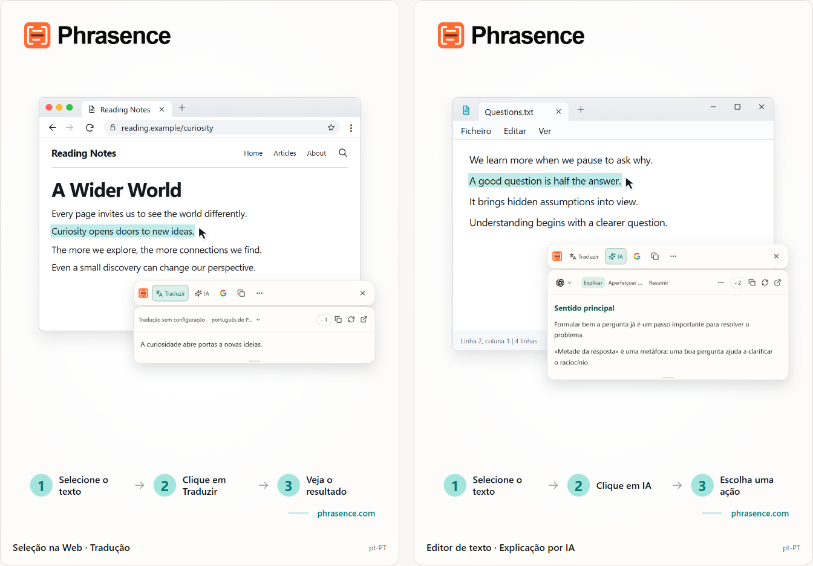

# Phrasence | Tradutor e assistente de texto com IA para computador

[English](README.md) | [Español](README.es.md) | [Português (Brasil)](README.pt-BR.md) | [Português (Portugal)](README.pt-PT.md) | [Français](README.fr.md) | [Deutsch](README.de.md) | [Italiano](README.it.md) | [Nederlands](README.nl.md)

[Русский](README.ru.md) | [Polski](README.pl.md) | [Türkçe](README.tr.md) | [Українська](README.uk.md) | [日本語](README.ja.md) | [한국어](README.ko.md) | [Bahasa Indonesia](README.id.md) | [Tiếng Việt](README.vi.md)

[ไทย](README.th.md) | [Bahasa Melayu](README.ms.md) | [हिन्दी](README.hi.md) | [বাংলা](README.bn.md) | [简体中文](README.zh-CN.md) | [繁體中文](README.zh-TW.md)

[Site oficial](https://phrasence.com/) · [Transferir](https://phrasence.com/pt-PT/download) · [Guia do utilizador](https://phrasence.com/pt-PT/docs/getting-started)

## O que é o Phrasence

Com o Phrasence, selecione texto num navegador, documento ou editor e escolha traduzir, explicar, resumir ou melhorar. As ferramentas ficam junto da seleção para continuar a ler e a escrever sem perder o ritmo.

O Phrasence coloca as ações de texto mais usadas junto à seleção. É o utilizador que decide o que acontece a seguir.

**Selecione o texto → Abra a barra → Escolha o próximo passo**



_Ilustração da interface: tradução do texto selecionado e explicação de IA. O texto e os créditos apresentados são exemplos. A utilização real segue as regras atuais da aplicação._

## A quem se destina

- **Quem lê noutras línguas**: Traduza uma frase de uma página ou documento sem a copiar para outro separador.
- **Estudantes e investigadores**: Explique um termo, decifre uma frase longa ou resuma um excerto difícil sem perder o contexto da leitura.
- **Programadores e leitores de documentação técnica**: Acrescente o contexto necessário a um termo técnico, uma frase complexa, um excerto académico ou um bloco de código sem perder o fio à leitura.
- **Quem escreve ou trabalha num escritório**: Selecione parte de um rascunho e peça à IA para a reformular, condensar a ideia ou ajustar o tom.

## Funcionalidades principais

- **Tradução do texto selecionado**: Escolha um serviço de tradução disponível e o idioma de destino, veja o resultado junto à aplicação atual e depois copie ou volte a gerar.
- **Explicação, resumo e prompts personalizados com IA**: Explicam, resumem, melhoram, extraem pontos principais ou revêem o texto selecionado. Também pode criar ações como «Reescrever como e-mail» ou «Gerar resposta».
- **Área de trabalho completa**: Para textos mais longos, edite manualmente o original e alterne com facilidade entre os resultados de tradução e IA.
- **Pesquise ou copie**: Copie diretamente o texto selecionado ou envie-o para o seu motor de pesquisa preferido e continue no navegador do sistema.
- **Histórico local**: Volte a abrir traduções e resultados de IA anteriores. O histórico permanece neste dispositivo e pode ser desativado ou eliminado em qualquer altura.
- **Adapta-se ao seu ambiente de trabalho**: Horizontal ou vertical, claro ou escuro, fixo ou livre: adapte o Phrasence ao seu ecrã e à sua rotina.

### Serviços de tradução

**Definições → Serviços de tradução**

Como escolher: Existem três opções: tradução sem configuração, modelo local e fornecedores de tradução. Escolha uma e clique em «Usar»; a área de trabalho e a barra rápida passam a usá-la para traduzir.

- Tradução sem configuração: Não exige configuração. Inicie sessão e clique em «Usar». Cada tradução consome créditos calculados pelo número de carateres do texto original; prevalece o desconto real.
- Modelo de tradução local: Transfira o modelo antes da primeira utilização. Depois, traduza offline sem gastar créditos; o texto é processado apenas neste computador.
- Fornecedores de tradução: Se já tiver uma chave de API do Baidu, Microsoft, DeepL ou Google, introduza-a aqui. A chave fica neste computador; preços e limites gratuitos são definidos pelo fornecedor.

O modelo local tem de suportar os idiomas de que precisa. É necessária uma ligação à Internet para transferir ou atualizar o modelo. A tradução com um modelo local ou com a sua própria API não consome créditos do Phrasence. O fornecedor da API pode cobrar pelo serviço. Guarde os dados de ligação pedidos e teste a ligação.

As ações de tradução e IA dependem do fornecedor configurado, da ligação à rede, dos créditos disponíveis e do estado atual da versão.

[Preços](https://phrasence.com/pt-PT/pricing)

## Como utilizar

### 1. Transferir e instalar

Abra a [página de transferências](https://phrasence.com/pt-PT/download). Escolha a versão adequada ao seu sistema operativo e processador.

Se não existir um botão de transferência, o respetivo instalador ainda não está disponível. Não transfira o Phrasence a partir de sites não oficiais.

### 2. Concluir a configuração inicial

Abra o Phrasence e aceda a **Definições**. Confirme os seguintes pontos por ordem:

1. Em **Definições gerais**, escolha o idioma da interface, o tema e a disposição predefinida.
2. Em **Ações rápidas**, ative pelo menos uma forma de selecionar texto.
3. Em **Serviços de tradução**, veja que serviços estão disponíveis.
4. **Ferramentas de IA**: Escolha o idioma do resultado e as ações que pretende utilizar.
5. Se o sistema pedir uma permissão, siga o aviso para abrir as definições do sistema.

**Fornecedores de tradução → Guardar configuração → Testar ligação**

### 3. Selecionar texto e abrir a barra

#### Mostrar ao selecionar texto

1. Ative **Mostrar ao selecionar texto**.
2. Selecione o texto noutra aplicação.
3. Quando o Phrasence receber o texto, a barra aparece junto à seleção.
4. Escolha Traduzir, IA, Copiar ou Pesquisar.

#### Mostrar através de um atalho

1. Ative **Mostrar através de um atalho**.
2. Prima o atalho atual da barra.
3. A barra aparece primeiro junto ao ponteiro do rato.
4. Selecione o texto que pretende processar.
5. Quando o Phrasence receber o texto, as ações ficam disponíveis.

**Definições → Ações rápidas → Atalho atual**

Enquanto a barra estiver visível, prima Esc para a ocultar. O efeito é igual ao do botão Fechar.

### 4. Escolher uma ação

- **Traduzir**: utiliza o serviço de tradução e o idioma de destino atuais.
- **IA**: explica, melhora, resume ou executa outra ação configurada. Exige início de sessão e créditos disponíveis.
- **Pesquisar**: abre o motor de pesquisa escolhido no navegador do sistema.
- **Copiar**: coloca o texto atual na área de transferência.
- **Mais**: abre a área de trabalho, o histórico, as definições e os controlos de seleção.
- **Fechar**: oculta a barra. Também pode premir `Esc`.

Custo: Editar definições, alterar a ordem e criar ações não gasta créditos. Para executar uma ação, inicie sessão; serão descontados os créditos apresentados para o modelo escolhido.

### 5. Continuar no espaço de trabalho

**Mais → Abrir área de trabalho**

A barra rápida serve para processar uma seleção junto à aplicação que está a utilizar. A área de trabalho completa oferece espaço para editar ou tratar textos mais longos. Ambas continuam com o mesmo resultado atual, pelo que não é necessário repetir o pedido.

No separador de tradução do espaço de trabalho, alterar uma entrada que não esteja vazia pode iniciar uma tradução automática. As ações de IA continuam a exigir uma escolha explícita. A gravação do histórico depende das suas definições e das regras do serviço escolhido.

### 6. Guardar uma ação de IA personalizada

**Definições → Ferramentas de IA → Criar ação**

Dê um nome à ação e escreva uma instrução. Guarde-a e depois escolha-a na lista de ações de IA. Por exemplo, pode guardar esta instrução para ler um texto difícil:

Como configurar: «Ativada» define se uma ação pode ser usada. O botão «Barra rápida» define se aparece na barra rápida. Arraste as ações para alterar a ordem.

```text
Explica a ideia principal do texto selecionado e enumera os pontos principais.
Mantém os nomes, números e condições do original.
Indica claramente qualquer incerteza. Não acrescentes factos sem fundamento.
```

A instrução é um exemplo. Compare as traduções e respostas de IA com o original, em especial nomes, números, datas e condições.

## Perguntas frequentes

### O que fazer se a barra não aparecer?

Confirme que o Phrasence está aberto e que pelo menos um método de abertura está ativo em Ações rápidas. Verifique as permissões do sistema e se a aplicação de origem permite selecionar texto. Se não for possível ler a seleção, escreva ou cole o texto no espaço de trabalho.

### Porque é pedido que copie ou cole o texto?

Algumas aplicações mostram uma seleção sem disponibilizar o texto. Se a mensagem pedir uma cópia, mantenha a aplicação de origem ativa e prima `Ctrl+C`, ou `⌘C` no macOS. Se pedir uma colagem manual, abra a área indicada e prima `Ctrl+V`, ou `⌘V` no macOS. A cópia manual ou automática pode substituir o conteúdo da área de transferência. Pode desativar a cópia automática em Definições → Ações rápidas.

### Preciso de uma conta para utilizar o Phrasence?

Não para as funcionalidades básicas, que funcionam sem iniciar sessão. As ferramentas de IA, os benefícios do plano e as funcionalidades da conta pedem-lhe que inicie sessão quando necessário.

Custo: Editar definições, alterar a ordem e criar ações não gasta créditos. Para executar uma ação, inicie sessão; serão descontados os créditos apresentados para o modelo escolhido.

## Dados e privacidade

- Selecionar texto apenas prepara o contexto. Não envia pedidos, não utiliza créditos nem acrescenta um item concluído ao histórico.
- Para onde vai o texto: Na tradução pronta a usar, vai para o serviço Phrasence e depois para o motor atual. Com a sua chave, o computador envia-o diretamente ao fornecedor. Com o modelo local, fica no computador.
- Para onde vai o texto: O texto selecionado e as instruções são enviados pelo Phrasence ao serviço de IA escolhido. O registo de cobrança não guarda o texto original; regista apenas o modelo e os créditos usados.
- Quando ativado, o histórico só é guardado neste dispositivo e nunca é sincronizado com a nuvem. Desative-o ou elimine-o quando quiser.

No separador de tradução do espaço de trabalho, alterar uma entrada que não esteja vazia pode iniciar uma tradução automática. As ações de IA continuam a exigir uma escolha explícita. A gravação do histórico depende das suas definições e das regras do serviço escolhido.

[Privacidade e dados](https://phrasence.com/pt-PT/docs/privacy-security) · [Política de Privacidade (EN)](https://phrasence.com/privacy-policy)

## Site oficial e apoio

- [Site oficial: phrasence.com](https://phrasence.com/)
- [Transferir, instalar e abrir pela primeira vez](https://phrasence.com/pt-PT/docs/getting-started)
- [Resolução de problemas](https://phrasence.com/pt-PT/docs/troubleshooting)
- [Contacto pelo Telegram](https://t.me/phrasence)

Para pedir ajuda ou comunicar um erro, inicie sessão no site e abra Ajuda e comentários nas definições. Indique o sistema operativo, a versão da aplicação, o serviço escolhido e os passos para reproduzir o problema.
