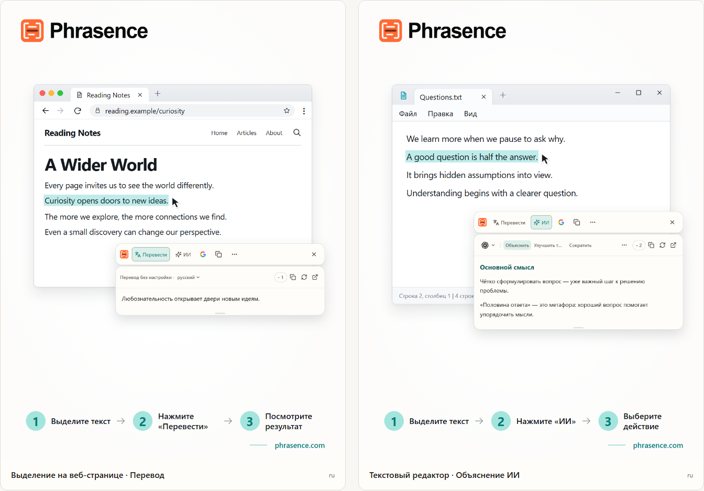

# Phrasence | Переводчик и текстовый ИИ-помощник для компьютера

[English](README.md) | [Español](README.es.md) | [Português (Brasil)](README.pt-BR.md) | [Português (Portugal)](README.pt-PT.md) | [Français](README.fr.md) | [Deutsch](README.de.md) | [Italiano](README.it.md) | [Nederlands](README.nl.md)

[Русский](README.ru.md) | [Polski](README.pl.md) | [Türkçe](README.tr.md) | [Українська](README.uk.md) | [日本語](README.ja.md) | [한국어](README.ko.md) | [Bahasa Indonesia](README.id.md) | [Tiếng Việt](README.vi.md)

[ไทย](README.th.md) | [Bahasa Melayu](README.ms.md) | [हिन्दी](README.hi.md) | [বাংলা](README.bn.md) | [简体中文](README.zh-CN.md) | [繁體中文](README.zh-TW.md)

[Официальный сайт](https://phrasence.com/) · [Скачать](https://phrasence.com/ru/download) · [Руководство пользователя](https://phrasence.com/ru/docs/getting-started)

## О Phrasence

С Phrasence выделите текст в браузере, документе или редакторе и выберите перевод, объяснение, краткое изложение или редактирование. Инструменты остаются рядом с выделением, чтобы вы могли продолжать читать и писать.

Phrasence размещает привычные действия рядом с выделением. Что делать дальше, решаете вы.

**Выделите текст → Вызовите панель → Выберите следующее действие**



_Иллюстрация интерфейса: перевод выделенного текста и объяснение ИИ. Текст и значения кредитов приведены для примера. Фактическое использование регулируется текущими правилами приложения._

## Для кого подходит

- **Читатели текстов на другом языке**: Переводите предложение на странице или в документе, не копируя его в другую вкладку.
- **Студенты и исследователи**: Объясняйте термины, разбирайте длинные предложения и кратко излагайте сложные отрывки, сохраняя контекст чтения.
- **Разработчики и читатели технической документации**: Получите контекст для специального термина, сложного предложения, отрывка из научной работы или фрагмента кода, не теряя место чтения.
- **Авторы текстов и офисные сотрудники**: Выделите часть черновика и попросите ИИ переформулировать её, сделать мысль короче или изменить тон.

## Основные возможности

- **Перевод выделенного текста**: Выберите доступный сервис перевода и язык, посмотрите результат рядом с текущей программой, а затем скопируйте или создайте его заново.
- **Объяснение, краткое изложение и пользовательские подсказки с ИИ**: Объяснять, кратко излагать, улучшать, выделять главное или исправлять выбранный текст. Можно создавать и свои действия, например «Переписать как письмо».
- **Полное рабочее пространство**: Для длинного текста откройте рабочее пространство, отредактируйте оригинал вручную и удобно переключайтесь между переводом и результатами ИИ.
- **Найти или скопировать**: Скопируйте выделенный текст или отправьте его в привычную поисковую систему и продолжите работу в системном браузере.
- **Локальная история**: Возвращайтесь к прошлым переводам и результатам ИИ. История остаётся на этом устройстве, и её можно в любой момент отключить или очистить.
- **Подстраивается под ваш рабочий стол**: Горизонтальный или вертикальный вид, светлая или тёмная тема, поверх других окон или свободное размещение — настройте Phrasence под свой экран и привычки.

### Сервисы перевода

**Настройки → Сервисы перевода**

Как выбрать: Есть три варианта — перевод без настройки, локальная модель перевода и поставщики перевода. Выберите вариант и нажмите «Использовать»; рабочая область и быстрая панель будут переводить с его помощью.

- Перевод без настройки: Настройка не требуется. Войдите в аккаунт и нажмите «Использовать». Каждый перевод расходует кредиты, рассчитанные по числу символов исходного текста; окончательным считается фактическое списание.
- Локальная модель: Скачайте модель перед первым использованием. После этого можно переводить без сети и без расхода кредитов; текст обрабатывается только на этом компьютере.
- Внешние поставщики: Если у вас уже есть API-ключ Baidu, Microsoft, DeepL или Google, введите его здесь. Ключ остаётся на компьютере; стоимость и бесплатные квоты определяет поставщик.

Локальная модель должна поддерживать нужные языки. Для её скачивания и обновления нужен интернет. Перевод с локальной моделью или через собственный API не расходует кредиты Phrasence. Поставщик API может взимать свою плату. Сохраните необходимые данные подключения и проверьте соединение.

Доступность перевода и действий ИИ зависит от настроенного сервиса, подключения к сети, доступных кредитов и текущего статуса выпуска.

[Тарифы](https://phrasence.com/ru/pricing)

## Как пользоваться

### 1. Скачайте и установите приложение

Откройте [страницу скачивания](https://phrasence.com/ru/download). Выберите версию для вашей операционной системы и процессора.

Если кнопки скачивания нет, соответствующий файл ещё не опубликован. Не скачивайте Phrasence с неофициальных сайтов.

### 2. Выполните начальную настройку

Запустите Phrasence и откройте **Настройки**. По порядку проверьте следующее:

1. В разделе **Основные** выберите язык интерфейса, тему и стандартный макет.
2. В разделе **Быстрые действия** включите хотя бы один способ работы с выделенным текстом.
3. В разделе **Сервисы перевода** проверьте доступные службы.
4. **Инструменты ИИ**: Выберите язык результата и нужные действия.
5. Если система запрашивает разрешение, перейдите в настройки системы по подсказке.

**Внешние поставщики → Сохранить настройки → Проверить подключение**

### 3. Выделите текст и откройте панель

#### Открывать при выделении текста

1. Включите **Открывать при выделении текста**.
2. Выделите текст в другом приложении.
3. Когда Phrasence получит текст, рядом с выделением появится панель.
4. Выберите Перевести, ИИ, Копировать или Найти.

#### Открывать сочетанием клавиш

1. Включите **Открывать сочетанием клавиш**.
2. Нажмите текущее сочетание для вызова панели.
3. Сначала панель появится рядом с указателем мыши.
4. Выделите нужный текст.
5. Когда Phrasence получит текст, действия станут доступны.

**Настройки → Быстрые действия → Текущее сочетание**

Когда панель открыта, её можно скрыть клавишей Esc — это равнозначно нажатию кнопки закрытия.

### 4. Выберите действие

- **Перевести**: использует текущую службу перевода и целевой язык.
- **ИИ**: объясняет, улучшает, сокращает или выполняет другое настроенное действие. Требуются вход и доступные кредиты.
- **Найти**: открывает выбранную поисковую систему в системном браузере.
- **Копировать**: помещает текущий текст в буфер обмена.
- **Ещё**: открывает рабочую область, историю, настройки и переключатели способов выделения.
- **Закрыть**: скрывает панель. Также можно нажать `Esc`.

Стоимость: Изменение настроек, порядка и создание действий не расходует кредиты. Для запуска войдите в аккаунт; спишутся кредиты, указанные для выбранной модели.

### 5. Продолжите в рабочей области

**Ещё → Открыть рабочую область**

Быстрая панель подходит для обработки выделения рядом с используемой программой. Полное рабочее пространство даёт место для редактирования и длинных текстов. Оба режима продолжают работу с одним текущим результатом, поэтому повторять запрос не нужно.

На вкладке перевода в рабочей области изменение непустого текста может автоматически запустить перевод. Действия ИИ по-прежнему нужно выбирать явно. Сохранение истории зависит от ваших настроек и правил выбранного сервиса.

### 6. Сохраните собственное действие ИИ

**Настройки → Инструменты ИИ → Новое действие**

Укажите название действия и инструкцию. Сохраните действие, затем выберите его в списке действий ИИ. Например, для сложного текста можно сохранить такую инструкцию:

Настройка: «Включено» определяет, можно ли использовать действие. Переключатель «Панель инструментов» определяет, будет ли оно на быстрой панели. Перетаскивайте действия, чтобы менять порядок.

```text
Объясни основную мысль выделенного текста и перечисли ключевые пункты.
Сохрани имена, числа и условия из оригинала.
Ясно укажи, в чём есть неопределённость. Не добавляй неподтверждённые факты.
```

Эта инструкция приведена для примера. Сверяйте переводы и ответы ИИ с оригиналом, особенно имена, числа, даты и условия.

## Частые вопросы

### Что делать, если панель не появляется?

Убедитесь, что Phrasence запущен и в быстрых действиях включён хотя бы один способ открытия. Проверьте системные разрешения и возможность выделения текста в исходном приложении. Если прочитать выделение не удаётся, введите или вставьте текст в рабочую область.

### Почему приложение просит скопировать или вставить текст?

Некоторые приложения показывают выделение, но не предоставляют сам текст. Если сообщение просит скопировать текст, оставьте исходное приложение активным и нажмите `Ctrl+C` или `⌘C` в macOS. Если оно просит вставить текст вручную, откройте указанное поле и нажмите `Ctrl+V` или `⌘V` в macOS. Ручное и автоматическое копирование могут заменить содержимое буфера обмена. Автоматическое копирование можно отключить в настройках быстрых действий.

### Для работы с Phrasence нужен аккаунт?

Для основных возможностей — нет, они доступны без входа. Инструменты ИИ, преимущества тарифа и функции аккаунта попросят войти, когда это потребуется.

Стоимость: Изменение настроек, порядка и создание действий не расходует кредиты. Для запуска войдите в аккаунт; спишутся кредиты, указанные для выбранной модели.

## Данные и конфиденциальность

- Выделение текста лишь подготавливает контекст. Оно не отправляет запрос, не расходует кредиты и не добавляет завершённую операцию в историю.
- Куда отправляется текст: При готовом переводе — в сервис Phrasence, затем в текущий механизм. С личным API-ключом компьютер отправляет текст напрямую поставщику. При локальной модели текст остаётся на компьютере.
- Куда отправляется текст: Выбранный текст и инструкция передаются через Phrasence выбранному сервису ИИ. Запись о списании не хранит исходный текст, а только модель и потраченные кредиты.
- Если история включена, она хранится только на этом устройстве и никогда не синхронизируется с облаком. Её можно в любой момент отключить или очистить.

На вкладке перевода в рабочей области изменение непустого текста может автоматически запустить перевод. Действия ИИ по-прежнему нужно выбирать явно. Сохранение истории зависит от ваших настроек и правил выбранного сервиса.

[Конфиденциальность и данные](https://phrasence.com/ru/docs/privacy-security) · [Политика конфиденциальности (EN)](https://phrasence.com/privacy-policy)

## Официальный сайт и помощь

- [Официальный сайт: phrasence.com](https://phrasence.com/)
- [Скачивание, установка и первый запуск](https://phrasence.com/ru/docs/getting-started)
- [Устранение неполадок](https://phrasence.com/ru/docs/troubleshooting)
- [Связаться в Telegram](https://t.me/phrasence)

Чтобы получить помощь или сообщить об ошибке, войдите на сайт и откройте раздел помощи и обратной связи в настройках. Укажите операционную систему, версию приложения, выбранный сервис и шаги для воспроизведения проблемы.
