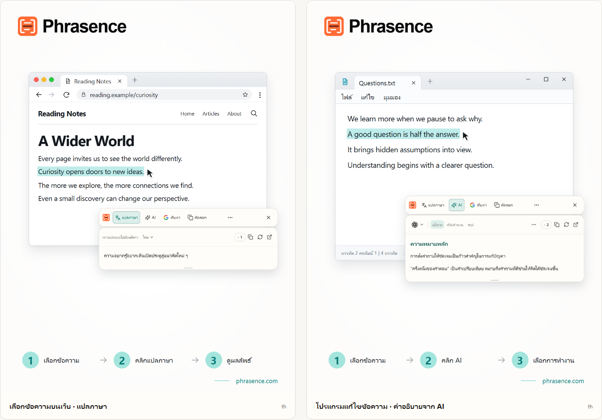

# Phrasence | เครื่องมือแปลและผู้ช่วยจัดการข้อความด้วย AI บนเดสก์ท็อป

[English](README.md) | [Español](README.es.md) | [Português (Brasil)](README.pt-BR.md) | [Português (Portugal)](README.pt-PT.md) | [Français](README.fr.md) | [Deutsch](README.de.md) | [Italiano](README.it.md) | [Nederlands](README.nl.md)

[Русский](README.ru.md) | [Polski](README.pl.md) | [Türkçe](README.tr.md) | [Українська](README.uk.md) | [日本語](README.ja.md) | [한국어](README.ko.md) | [Bahasa Indonesia](README.id.md) | [Tiếng Việt](README.vi.md)

[ไทย](README.th.md) | [Bahasa Melayu](README.ms.md) | [हिन्दी](README.hi.md) | [বাংলা](README.bn.md) | [简体中文](README.zh-CN.md) | [繁體中文](README.zh-TW.md)

[เว็บไซต์ทางการ](https://phrasence.com/) · [ดาวน์โหลด](https://phrasence.com/th/download) · [คู่มือผู้ใช้](https://phrasence.com/th/docs/getting-started)

## เกี่ยวกับ Phrasence

ใช้ Phrasence เลือกข้อความในเบราว์เซอร์ เอกสาร หรือโปรแกรมแก้ไข แล้วเลือกแปล อธิบาย สรุป หรือปรับสำนวน เครื่องมือจะอยู่ข้างข้อความที่เลือก เพื่อให้คุณอ่านและเขียนต่อได้อย่างลื่นไหล

Phrasence วางการดำเนินการกับข้อความที่ใช้บ่อยไว้ข้างส่วนที่เลือก และคุณเป็นผู้ตัดสินใจว่าจะทำอะไรต่อ

**เลือกข้อความ → เปิดแถบเครื่องมือ → เลือกการดำเนินการถัดไป**



_ภาพประกอบหน้าจอ: การแปลข้อความที่เลือกและคำอธิบายจาก AI ข้อความและจำนวนเครดิตในภาพเป็นตัวอย่าง การใช้งานจริงเป็นไปตามกติกาปัจจุบันในแอป_

## เหมาะกับใคร

- **ผู้ที่อ่านเนื้อหาภาษาต่างประเทศ**: แปลประโยคบนหน้าเว็บหรือในเอกสารได้โดยไม่ต้องคัดลอกไปยังแท็บอื่น
- **นักเรียน นักศึกษา และนักวิจัย**: ขอคำอธิบายคำศัพท์ แยกความหมายของประโยคยาว หรือสรุปย่อหน้าที่ยาก โดยยังคงบริบทที่กำลังอ่าน
- **นักพัฒนาและผู้อ่านเอกสารทางเทคนิค**: รับบริบทที่จำเป็นสำหรับศัพท์เฉพาะ ประโยคซับซ้อน เนื้อหางานวิจัย หรือโค้ด โดยไม่เสียตำแหน่งที่กำลังอ่าน
- **ผู้เขียนและพนักงานสำนักงาน**: เลือกส่วนหนึ่งของฉบับร่าง แล้วให้ AI เรียบเรียงใหม่ กระชับประเด็น หรือปรับน้ำเสียง

## คุณสมบัติหลัก

- **แปลข้อความที่เลือก**: เลือกบริการแปลที่ใช้ได้และภาษาปลายทาง ดูผลลัพธ์ข้างแอปที่กำลังใช้ แล้วคัดลอกหรือสร้างคำแปลใหม่
- **อธิบาย สรุป และพรอมต์ที่กำหนดเองด้วย AI**: อธิบาย สรุป ปรับสำนวน ดึงประเด็นสำคัญ หรือแก้ไขข้อความที่เลือก และสร้างการทำงานของตนเอง เช่น “เขียนเป็นอีเมล”
- **พื้นที่ทำงานแบบเต็ม**: เมื่อต้องจัดการข้อความยาว คุณสามารถแก้ไขต้นฉบับเองและสลับระหว่างผลการแปลกับผลลัพธ์จาก AI ได้อย่างสะดวก
- **ค้นหาหรือคัดลอก**: คัดลอกข้อความที่เลือกได้โดยตรง หรือส่งไปยังเครื่องมือค้นหาที่ต้องการแล้วค้นหาต่อในเบราว์เซอร์ของระบบ
- **ประวัติในเครื่อง**: เปิดดูคำแปลและผลลัพธ์จาก AI ก่อนหน้าได้อีกครั้ง ประวัติจะอยู่ในอุปกรณ์นี้ และคุณปิดหรือล้างได้ทุกเมื่อ
- **ปรับให้เข้ากับเดสก์ท็อปของคุณ**: แนวนอนหรือแนวตั้ง สว่างหรือมืด ตรึงไว้ด้านบนหรือปล่อยอิสระ—ปรับ Phrasence ให้เข้ากับหน้าจอและวิธีทำงานของคุณ

### บริการแปลภาษา

**การตั้งค่า → บริการแปลภาษา**

วิธีเลือก: มี 3 ตัวเลือก ได้แก่ การแปลแบบไม่ต้องตั้งค่า โมเดลในเครื่อง และผู้ให้บริการแปล เลือกหนึ่งตัวเลือกแล้วกด “ใช้” จากนั้นพื้นที่ทำงานและแถบเครื่องมือด่วนจะใช้ตัวเลือกนี้แปลภาษา

- การแปลแบบไม่ต้องตั้งค่า: ไม่ต้องตั้งค่า เพียงเข้าสู่ระบบแล้วกด “ใช้” การแปลแต่ละครั้งจะใช้เครดิตซึ่งคำนวณจากจำนวนอักขระของข้อความต้นฉบับ โดยยึดจำนวนที่หักจริงเป็นหลัก
- โมเดลแปลในเครื่อง: ดาวน์โหลดโมเดลก่อนใช้ครั้งแรก จากนั้นแปลแบบออฟไลน์ได้โดยไม่ใช้เครดิต และข้อความจะประมวลผลบนคอมพิวเตอร์นี้เท่านั้น
- ผู้ให้บริการแปล: หากมีคีย์ API ของ Baidu, Microsoft, DeepL หรือ Google ให้นำมาใส่ที่นี่ คีย์จะอยู่บนคอมพิวเตอร์นี้ ส่วนค่าบริการและโควตาฟรีกำหนดโดยผู้ให้บริการ

โมเดลในเครื่องต้องรองรับภาษาที่คุณต้องการ การดาวน์โหลดและอัปเดตโมเดลต้องใช้อินเทอร์เน็ต การแปลด้วยโมเดลในเครื่องหรือ API ของคุณเองไม่ใช้เครดิต Phrasence แต่ผู้ให้บริการ API อาจคิดค่าบริการแยกต่างหาก บันทึกข้อมูลการเชื่อมต่อที่จำเป็นและทดสอบการเชื่อมต่อก่อนใช้

การแปลและการดำเนินการด้วย AI ขึ้นอยู่กับผู้ให้บริการที่กำหนดไว้ การเชื่อมต่อเครือข่าย เครดิตที่ใช้ได้ และสถานะการเผยแพร่ปัจจุบัน

[ราคา](https://phrasence.com/th/pricing)

## วิธีใช้งาน

### 1. ดาวน์โหลดและติดตั้ง

เปิด[หน้าดาวน์โหลด](https://phrasence.com/th/download) เลือกเวอร์ชันที่ตรงกับระบบปฏิบัติการและหน่วยประมวลผลของคุณ

หากไม่มีปุ่มดาวน์โหลด แสดงว่าตัวติดตั้งนั้นยังไม่เปิดให้ใช้ อย่าดาวน์โหลด Phrasence จากเว็บไซต์ที่ไม่เป็นทางการ

### 2. ตั้งค่าเริ่มต้น

เปิด Phrasence แล้วไปที่ **การตั้งค่า** ตรวจสอบรายการต่อไปนี้ตามลำดับ

1. ใน **การตั้งค่าทั่วไป** ให้เลือกภาษาของหน้าจอ ธีม และรูปแบบเริ่มต้น
2. ใน **การทำงานด่วน** ให้เปิดวิธีเลือกข้อความอย่างน้อยหนึ่งแบบ
3. ใน **บริการแปลภาษา** ให้ดูว่ามีบริการใดใช้งานได้
4. **เครื่องมือ AI**: เลือกภาษาของผลลัพธ์และการทำงานที่ต้องการใช้
5. หากระบบขอสิทธิ์ ให้ทำตามข้อความเพื่อเปิดการตั้งค่าระบบ

**ผู้ให้บริการแปล → บันทึกการตั้งค่า → ทดสอบการเชื่อมต่อ**

### 3. เลือกข้อความและเปิดแถบเครื่องมือ

#### แสดงอัตโนมัติเมื่อเลือกข้อความ

1. เปิด **แสดงอัตโนมัติเมื่อเลือกข้อความ**
2. เลือกข้อความในแอปอื่น
3. เมื่อ Phrasence ได้รับข้อความ แถบเครื่องมือจะปรากฏใกล้ข้อความที่เลือก
4. เลือก แปล, AI, คัดลอก หรือค้นหา

#### แสดงด้วยปุ่มลัด

1. เปิด **แสดงด้วยปุ่มลัด**
2. กดคีย์ลัดปัจจุบันของแถบเครื่องมือ
3. แถบเครื่องมือจะปรากฏใกล้ตัวชี้เมาส์ก่อน
4. เลือกข้อความที่ต้องการใช้
5. เมื่อ Phrasence ได้รับข้อความ การทำงานต่าง ๆ จะใช้ได้

**การตั้งค่า → การทำงานด่วน → ปุ่มลัดปัจจุบัน**

เมื่อแถบเครื่องมือแสดงอยู่ คุณสามารถกด Esc เพื่อซ่อนได้ทุกเมื่อ ซึ่งทำงานเหมือนกับปุ่มปิด

### 4. เลือกการทำงาน

- **แปล**: ใช้บริการแปลและภาษาเป้าหมายปัจจุบัน
- **AI**: อธิบาย ปรับสำนวน สรุป หรือทำงานอื่นที่ตั้งไว้ ต้องเข้าสู่ระบบและมีเครดิต
- **ค้นหา**: เปิดเครื่องมือค้นหาที่เลือกในเบราว์เซอร์ระบบ
- **คัดลอก**: เขียนข้อความปัจจุบันลงในคลิปบอร์ด
- **เพิ่มเติม**: เปิดพื้นที่ทำงาน ประวัติ การตั้งค่า และตัวเลือกวิธีเลือกข้อความ
- **ปิด**: ซ่อนแถบเครื่องมือ กด `Esc` ก็ได้

ค่าใช้จ่าย: การแก้ไขการตั้งค่า จัดลำดับ และสร้างการทำงานไม่ใช้เครดิต การเรียกใช้ต้องเข้าสู่ระบบและจะหักเครดิตที่แสดงสำหรับโมเดลที่เลือก

### 5. ทำงานต่อในพื้นที่ทำงาน

**เพิ่มเติม → เปิดพื้นที่ทำงาน**

แถบเครื่องมือด่วนเหมาะสำหรับจัดการข้อความที่เลือกข้างแอปที่กำลังใช้ ส่วนพื้นที่ทำงานแบบเต็มมีพื้นที่สำหรับแก้ไขหรือจัดการเนื้อหาที่ยาวกว่า ทั้งสองจะแสดงผลลัพธ์ปัจจุบันชุดเดียวกันต่อเนื่อง จึงไม่ต้องส่งคำขอซ้ำ

ในแท็บแปลของพื้นที่ทำงาน การแก้ไขข้อความที่ไม่ว่างอาจเริ่มแปลโดยอัตโนมัติ ส่วนการทำงาน AI ยังต้องเลือกเองก่อนจึงจะเริ่ม การบันทึกประวัติขึ้นอยู่กับการตั้งค่าของคุณและกติกาของบริการที่เลือก

### 6. บันทึกการทำงาน AI แบบกำหนดเอง

**การตั้งค่า → เครื่องมือ AI → สร้างการทำงาน**

ตั้งชื่อและเขียนคำสั่งสำหรับการทำงานนั้น บันทึกแล้วเลือกจากรายการการทำงาน AI ได้ ตัวอย่างเช่น คุณบันทึกคำสั่งนี้ไว้ใช้กับข้อความที่เข้าใจยากได้:

วิธีตั้งค่า: “เปิดใช้” กำหนดว่าใช้การทำงานได้หรือไม่ สวิตช์ “แถบเครื่องมือ” กำหนดว่าจะแสดงในแถบด่วนหรือไม่ ลากเพื่อเปลี่ยนลำดับ

```text
อธิบายใจความหลักของข้อความที่เลือกและระบุประเด็นสำคัญ
คงชื่อ ตัวเลข และเงื่อนไขจากต้นฉบับไว้
ระบุส่วนที่ไม่แน่ใจให้ชัดเจน และอย่าเพิ่มข้อมูลที่ไม่มีหลักฐานรองรับ
```

คำสั่งนี้เป็นเพียงตัวอย่าง ตรวจสอบคำแปลและคำตอบจาก AI เทียบกับต้นฉบับ โดยเฉพาะชื่อ ตัวเลข วันที่ และเงื่อนไข

## คำถามที่พบบ่อย

### ทำอย่างไรเมื่อแถบเครื่องมือไม่ปรากฏ?

ตรวจสอบว่า Phrasence กำลังทำงานอยู่ และเปิดวิธีเรียกแถบเครื่องมืออย่างน้อยหนึ่งวิธีในการทำงานด่วน ตรวจสอบสิทธิ์ของระบบและดูว่าแอปต้นทางเลือกข้อความได้หรือไม่ หากอ่านข้อความที่เลือกไม่ได้ ให้พิมพ์หรือวางข้อความในพื้นที่ทำงานแทน

### ทำไมแอปจึงขอให้คัดลอกหรือวางข้อความ?

บางแอปแสดงส่วนที่เลือก แต่ไม่ส่งข้อความให้ระบบ หากข้อความแจ้งให้คัดลอก ให้คงแอปต้นทางไว้เป็นหน้าต่างที่ใช้งาน แล้วกด `Ctrl+C` หรือ `⌘C` บน macOS หากแจ้งให้วางด้วยตนเอง ให้เปิดช่องที่ระบุแล้วกด `Ctrl+V` หรือ `⌘V` บน macOS การคัดลอกด้วยตนเองหรือโดยอัตโนมัติอาจแทนที่ข้อมูลในคลิปบอร์ด คุณปิดการคัดลอกอัตโนมัติได้ที่ การตั้งค่า → การทำงานด่วน

### ต้องมีบัญชีจึงจะใช้ Phrasence ได้หรือไม่?

ฟีเจอร์พื้นฐานใช้ได้โดยไม่ต้องเข้าสู่ระบบ ส่วนเครื่องมือ AI สิทธิประโยชน์ของแพ็กเกจ และฟีเจอร์บัญชีจะแจ้งให้คุณเข้าสู่ระบบเมื่อจำเป็น

ค่าใช้จ่าย: การแก้ไขการตั้งค่า จัดลำดับ และสร้างการทำงานไม่ใช้เครดิต การเรียกใช้ต้องเข้าสู่ระบบและจะหักเครดิตที่แสดงสำหรับโมเดลที่เลือก

## ข้อมูลและความเป็นส่วนตัว

- การเลือกข้อความเป็นเพียงการเตรียมบริบท ระบบจะไม่ส่งคำขอ ไม่หักเครดิต และไม่บันทึกรายการที่สำเร็จลงในประวัติ
- ข้อความถูกส่งไปที่ไหน: การแปลพร้อมใช้ส่งไปยังบริการ Phrasence แล้วต่อไปยังเครื่องมือปัจจุบัน คีย์ของคุณจะส่งข้อความจากคอมพิวเตอร์ไปยังผู้ให้บริการโดยตรง ส่วนโมเดลในเครื่องจะเก็บข้อความไว้บนคอมพิวเตอร์
- ข้อความถูกส่งไปที่ไหน: ข้อความที่เลือกและคำสั่งจะส่งผ่าน Phrasence ไปยังบริการ AI ที่เลือก บันทึกการคิดค่าบริการไม่เก็บข้อความต้นฉบับ แต่เก็บเฉพาะโมเดลและเครดิตที่ใช้
- เมื่อเปิดใช้ ประวัติจะบันทึกไว้ในอุปกรณ์นี้เท่านั้นและจะไม่ซิงค์กับคลาวด์ คุณปิดหรือล้างประวัติได้ทุกเมื่อ

ในแท็บแปลของพื้นที่ทำงาน การแก้ไขข้อความที่ไม่ว่างอาจเริ่มแปลโดยอัตโนมัติ ส่วนการทำงาน AI ยังต้องเลือกเองก่อนจึงจะเริ่ม การบันทึกประวัติขึ้นอยู่กับการตั้งค่าของคุณและกติกาของบริการที่เลือก

[ความเป็นส่วนตัวและข้อมูล](https://phrasence.com/th/docs/privacy-security) · [นโยบายความเป็นส่วนตัว (EN)](https://phrasence.com/privacy-policy)

## เว็บไซต์ทางการและความช่วยเหลือ

- [เว็บไซต์ทางการ: phrasence.com](https://phrasence.com/)
- [ดาวน์โหลด ติดตั้ง และเปิดใช้ครั้งแรก](https://phrasence.com/th/docs/getting-started)
- [การแก้ปัญหา](https://phrasence.com/th/docs/troubleshooting)
- [ติดต่อผ่าน Telegram](https://t.me/phrasence)

หากต้องการความช่วยเหลือหรือแจ้งข้อผิดพลาด ให้เข้าสู่ระบบบนเว็บไซต์แล้วเปิดส่วนช่วยเหลือและข้อเสนอแนะในการตั้งค่า ระบุระบบปฏิบัติการ เวอร์ชันแอป บริการที่เลือก และขั้นตอนที่ทำให้เกิดปัญหา
