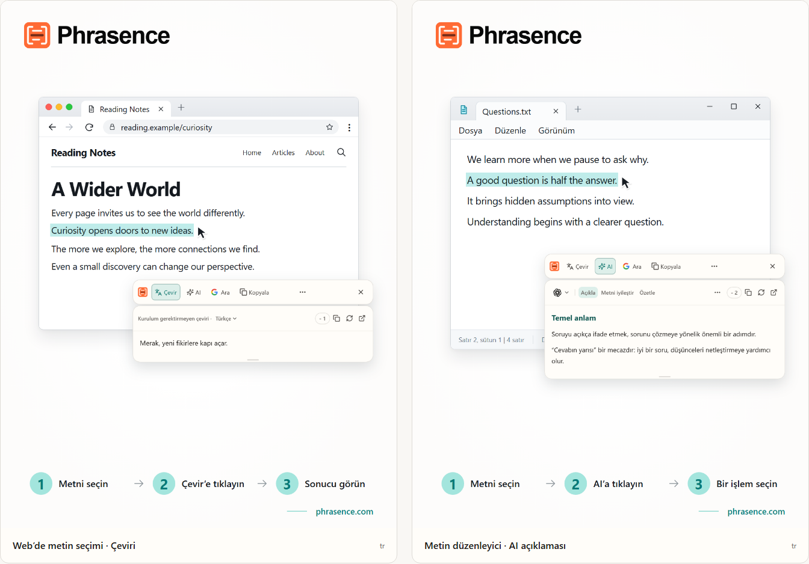

# Phrasence | Masaüstü AI çeviri ve metin yardımcısı

[English](README.md) | [Español](README.es.md) | [Português (Brasil)](README.pt-BR.md) | [Português (Portugal)](README.pt-PT.md) | [Français](README.fr.md) | [Deutsch](README.de.md) | [Italiano](README.it.md) | [Nederlands](README.nl.md)

[Русский](README.ru.md) | [Polski](README.pl.md) | [Türkçe](README.tr.md) | [Українська](README.uk.md) | [日本語](README.ja.md) | [한국어](README.ko.md) | [Bahasa Indonesia](README.id.md) | [Tiếng Việt](README.vi.md)

[ไทย](README.th.md) | [Bahasa Melayu](README.ms.md) | [हिन्दी](README.hi.md) | [বাংলা](README.bn.md) | [简体中文](README.zh-CN.md) | [繁體中文](README.zh-TW.md)

[Resmî web sitesi](https://phrasence.com/) · [İndir](https://phrasence.com/tr/download) · [Kullanım kılavuzu](https://phrasence.com/tr/docs/getting-started)

## Phrasence nedir

Phrasence ile tarayıcıda, belgede veya düzenleyicide metni seçin; ardından çeviri, açıklama, özetleme veya düzenleme işlemini seçin. Araçlar seçiminizin yanında kalır, böylece okumaya ve yazmaya devam edebilirsiniz.

Phrasence sık kullanılan metin işlemlerini seçimin yanına getirir. Sırada ne olacağına siz karar verirsiniz.

**Metni seçin → Araç çubuğunu açın → Sonraki işlemi seçin**



_Arayüz gösterimi: seçili metnin çevirisi ve yapay zekâ açıklaması. Görünen metin ve kredi değerleri örnektir. Gerçek kullanım, uygulamadaki güncel kurallara bağlıdır._

## Kimler için uygundur

- **Başka bir dilde metin okuyanlar**: Bir sayfa veya belgedeki cümleyi başka bir sekmeye kopyalamadan çevirin.
- **Öğrenciler ve araştırmacılar**: Okuma bağlamınızı korurken bir terimi açıklatın, uzun bir cümleyi çözümleyin veya zor bir bölümü özetleyin.
- **Geliştiriciler ve teknik belge okuyanlar**: Okuduğunuz yeri kaybetmeden teknik bir terim, karmaşık bir cümle, akademik bir bölüm veya kod parçası için gerekli bağlamı edinin.
- **Metin yazanlar ve ofis çalışanları**: Taslağın bir bölümünü seçip AI'dan farklı ifade etmesini, ana fikri kısaltmasını veya tonu ayarlamasını isteyin.

## Temel özellikler

- **Seçili metin çevirisi**: Kullanılabilir bir çeviri hizmetiyle hedef dili seçin, sonucu geçerli uygulamanın yanında görün; ardından kopyalayın veya yeniden oluşturun.
- **AI ile açıklama, özetleme ve özel istemler**: Seçilen metni açıklar, özetler, iyileştirir, önemli noktaları çıkarır veya düzeltir. “E-posta olarak yeniden yaz” gibi kendi işlemlerinizi de oluşturabilirsiniz.
- **Tam çalışma alanı**: Uzun metinlerde kaynak içeriği elle düzenleyin ve çeviri ile AI sonuçları arasında rahatça geçiş yapın.
- **Arayın veya kopyalayın**: Seçili metni doğrudan kopyalayın ya da tercih ettiğiniz arama motoruna gönderip sistem tarayıcısında devam edin.
- **Yerel geçmiş**: Önceki çeviri ve AI sonuçlarını yeniden açın. Geçmiş bu cihazda kalır ve istediğiniz zaman kapatılabilir veya temizlenebilir.
- **Masaüstünüze uyum sağlar**: Yatay veya dikey, açık veya koyu, sabitlenmiş veya serbest: Phrasence'ı ekranınıza ve çalışma alışkanlıklarınıza göre düzenleyin.

### Çeviri hizmetleri

**Ayarlar → Çeviri hizmetleri**

Nasıl seçilir: Üç seçenek vardır: kurulum gerektirmeyen çeviri, yerel model ve çeviri sağlayıcıları. Birini seçip “Kullan”a tıklayın; çalışma alanı ve hızlı araç çubuğu çeviride onu kullanır.

- Kurulum gerektirmeyen çeviri: Kurulum gerekmez. Oturum açıp “Kullan”a tıklayın. Her çeviri kredi harcar; miktar kaynak metnin karakter sayısına göre hesaplanır ve gerçek kesinti geçerlidir.
- Yerel çeviri modeli: İlk kullanımdan önce modeli indirin. Sonrasında kredi harcamadan çevrimdışı çeviri yapabilirsiniz; metin yalnızca bu bilgisayarda işlenir.
- Çeviri sağlayıcıları: Baidu, Microsoft, DeepL veya Google API anahtarınız varsa buraya girin. Anahtar bu bilgisayarda kalır; ücretleri ve ücretsiz kotaları sağlayıcı belirler.

Yerel model, ihtiyacınız olan dilleri desteklemelidir. Modeli indirmek ve güncellemek için internet bağlantısı gerekir. Yerel model veya kendi sağlayıcı API’niz ile çeviri yapmak Phrasence kredisi kullanmaz. API sağlayıcısı ayrıca ücret alabilir. İstenen bağlantı bilgilerini kaydedin ve bağlantıyı test edin.

Çeviri ve AI işlemlerinin kullanılabilirliği yapılandırılmış sağlayıcıya, ağ bağlantısına, kullanılabilir kredilere ve güncel yayın durumuna bağlıdır.

[Fiyatlar](https://phrasence.com/tr/pricing)

## Kullanım kılavuzu

### 1. İndirin ve kurun

[İndirme sayfasını](https://phrasence.com/tr/download) açın. İşletim sisteminize ve işlemcinize uygun sürümü seçin.

İndirme düğmesi yoksa ilgili kurulum dosyası henüz yayınlanmamıştır. Phrasence’ı resmî olmayan sitelerden indirmeyin.

### 2. İlk ayarları tamamlayın

Phrasence’ı başlatın ve **Ayarlar** bölümünü açın. Şu öğeleri sırayla kontrol edin:

1. **Temel ayarlar** bölümünde arayüz dilini, temayı ve varsayılan düzeni seçin.
2. **Hızlı işlemler** bölümünde en az bir metin seçme yöntemini açın.
3. **Çeviri hizmetleri** bölümünde kullanılabilir hizmetleri kontrol edin.
4. **AI araçları**: Çıktı dilini ve kullanmak istediğiniz işlemleri seçin.
5. Sistem izin isterse uyarıyı izleyerek sistem ayarlarını açın.

**Çeviri sağlayıcıları → Yapılandırmayı kaydet → Bağlantıyı sına**

### 3. Metni seçin ve araç çubuğunu açın

#### Metin seçilince otomatik göster

1. **Metin seçilince otomatik göster** seçeneğini açın.
2. Başka bir uygulamada metin seçin.
3. Phrasence metni aldığında araç çubuğu seçimin yanında görünür.
4. Çevir, AI, Kopyala veya Ara seçeneklerinden birini seçin.

#### Kısayolla göster

1. **Kısayolla göster** seçeneğini açın.
2. Araç çubuğunun geçerli kısayoluna basın.
3. Araç çubuğu önce fare işaretçisinin yanında görünür.
4. İşlemek istediğiniz metni seçin.
5. Phrasence metni aldığında işlemler kullanılabilir olur.

**Ayarlar → Hızlı işlemler → Mevcut kısayol**

Araç çubuğu görünürken Esc'ye basarak istediğiniz zaman gizleyebilirsiniz; bu, kapat düğmesiyle aynı şekilde çalışır.

### 4. Bir işlem seçin

- **Çevir**: geçerli çeviri hizmetini ve hedef dili kullanır.
- **AI**: açıklar, geliştirir, özetler veya ayarlanmış başka bir işlemi çalıştırır. Oturum ve kullanılabilir kredi gerekir.
- **Ara**: seçilen arama motorunu sistem tarayıcısında açar.
- **Kopyala**: geçerli metni panoya yazar.
- **Diğer**: çalışma alanını, geçmişi, ayarları ve seçim yöntemi denetimlerini açar.
- **Kapat**: araç çubuğunu gizler. `Esc` tuşuna da basabilirsiniz.

Ücret: Ayarları düzenlemek, sıralamak ve işlem oluşturmak kredi harcamaz. Çalıştırmak için oturum açmanız gerekir; seçilen modelde gösterilen kredi düşülür.

### 5. Çalışma alanında devam edin

**Diğer → Çalışma alanını aç**

Hızlı araç çubuğu, kullandığınız uygulamanın yanında bir seçimi işlemek içindir. Tam çalışma alanı düzenleme ve uzun metinler için daha fazla alan sunar. İkisi de aynı geçerli sonuçla devam ettiği için isteği yeniden çalıştırmanız gerekmez.

Çalışma alanının çeviri sekmesinde, boş olmayan bir metni değiştirmek çeviriyi otomatik başlatabilir. Yapay zekâ işlemleri için yine açıkça bir işlem seçmeniz gerekir. Geçmişin kaydedilmesi, ayarlarınıza ve seçtiğiniz hizmetin kurallarına bağlıdır.

### 6. Özel bir yapay zekâ işlemi kaydedin

**Ayarlar → AI araçları → Yeni işlem**

İşleme bir ad ve yönerge verin. Kaydettikten sonra yapay zekâ işlemleri listesinden seçin. Zor bir metni okumak için örneğin şu yönergeyi kaydedebilirsiniz:

Nasıl ayarlanır: “Etkin” işlemin kullanılıp kullanılamayacağını belirler. “Araç çubuğu” anahtarı hızlı araç çubuğunda gösterilip gösterilmeyeceğini belirler. Sıralamak için sürükleyin.

```text
Seçili metnin ana fikrini açıkla ve önemli noktaları listele.
Özgün metindeki adları, sayıları ve koşulları koru.
Belirsizlikleri açıkça belirt. Dayanağı olmayan bilgiler ekleme.
```

Bu yönerge bir örnektir. Çevirileri ve yapay zekâ yanıtlarını özgün metinle karşılaştırın. Özellikle adları, sayıları, tarihleri ve koşulları kontrol edin.

## Sık sorulan sorular

### Araç çubuğu görünmüyorsa ne yapmalıyım?

Phrasence’ın açık olduğundan ve Hızlı işlemler bölümünde en az bir açma yönteminin etkin olduğundan emin olun. Sistem izinlerini ve kaynak uygulamada metin seçilebildiğini kontrol edin. Seçim okunamıyorsa metni çalışma alanına yazın veya yapıştırın.

### Neden metni kopyalamam veya yapıştırmam isteniyor?

Bazı uygulamalar seçimi gösterir ancak metni erişime açmaz. İleti kopyalamanızı istiyorsa kaynak uygulamayı etkin tutun ve `Ctrl+C`, macOS’ta `⌘C` tuşlarına basın. Elle yapıştırmanızı istiyorsa belirtilen alanı açın ve `Ctrl+V`, macOS’ta `⌘V` tuşlarına basın. Elle veya otomatik kopyalama panonun içeriğini değiştirebilir. Otomatik kopyalamayı Ayarlar → Hızlı işlemler bölümünden kapatabilirsiniz.

### Phrasence'ı kullanmak için hesap gerekir mi?

Temel özellikler için gerekmez; bunlar oturum açmadan çalışır. AI araçları, plan hakları ve hesap özellikleri gerektiğinde oturum açmanızı ister.

Ücret: Ayarları düzenlemek, sıralamak ve işlem oluşturmak kredi harcamaz. Çalıştırmak için oturum açmanız gerekir; seçilen modelde gösterilen kredi düşülür.

## Veriler ve gizlilik

- Metin seçmek yalnızca bağlamı hazırlar; istek göndermez, kredi harcamaz veya geçmişe tamamlanmış bir işlem eklemez.
- Metin nereye gider: Kullanıma hazır çeviride Phrasence hizmetine, ardından geçerli motora gider. Kendi API anahtarınızla bilgisayar metni doğrudan sağlayıcıya gönderir. Yerel modelde metin bilgisayarda kalır.
- Metin nereye gider: Seçilen metin ve işlem talimatı Phrasence üzerinden seçilen AI hizmetine gönderilir. Ücret kaydı kaynak metni tutmaz; yalnızca kullanılan modeli ve harcanan krediyi kaydeder.
- Geçmiş açıldığında yalnızca bu cihazda saklanır ve bulutla hiçbir zaman eşitlenmez. İstediğiniz zaman kapatabilir veya temizleyebilirsiniz.

Çalışma alanının çeviri sekmesinde, boş olmayan bir metni değiştirmek çeviriyi otomatik başlatabilir. Yapay zekâ işlemleri için yine açıkça bir işlem seçmeniz gerekir. Geçmişin kaydedilmesi, ayarlarınıza ve seçtiğiniz hizmetin kurallarına bağlıdır.

[Gizlilik ve veriler](https://phrasence.com/tr/docs/privacy-security) · [Gizlilik Politikası (EN)](https://phrasence.com/privacy-policy)

## Resmî site ve destek

- [Resmî web sitesi: phrasence.com](https://phrasence.com/)
- [İndirme, kurulum ve ilk çalıştırma](https://phrasence.com/tr/docs/getting-started)
- [Sorun giderme](https://phrasence.com/tr/docs/troubleshooting)
- [Telegram üzerinden iletişim](https://t.me/phrasence)

Yardım istemek veya hata bildirmek için web sitesinde oturum açın ve ayarlardan Yardım ve geri bildirim bölümünü açın. İşletim sisteminizi, uygulama sürümünü, seçtiğiniz hizmeti ve sorunu yeniden oluşturma adımlarını ekleyin.
