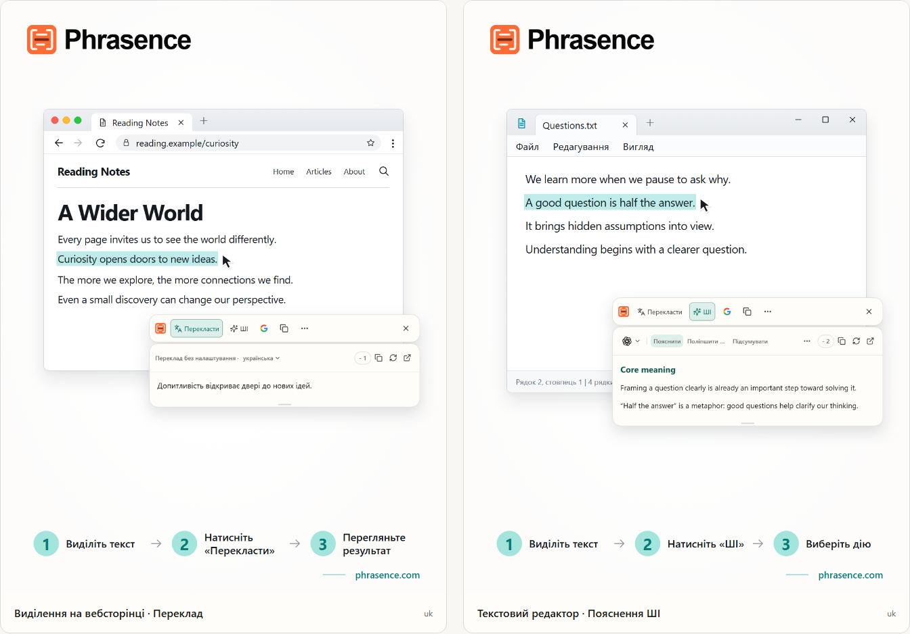

# Phrasence | Перекладач і текстовий ШІ-помічник для комп'ютера

[English](README.md) | [Español](README.es.md) | [Português (Brasil)](README.pt-BR.md) | [Português (Portugal)](README.pt-PT.md) | [Français](README.fr.md) | [Deutsch](README.de.md) | [Italiano](README.it.md) | [Nederlands](README.nl.md)

[Русский](README.ru.md) | [Polski](README.pl.md) | [Türkçe](README.tr.md) | [Українська](README.uk.md) | [日本語](README.ja.md) | [한국어](README.ko.md) | [Bahasa Indonesia](README.id.md) | [Tiếng Việt](README.vi.md)

[ไทย](README.th.md) | [Bahasa Melayu](README.ms.md) | [हिन्दी](README.hi.md) | [বাংলা](README.bn.md) | [简体中文](README.zh-CN.md) | [繁體中文](README.zh-TW.md)

[Офіційний сайт](https://phrasence.com/) · [Завантажити](https://phrasence.com/uk/download) · [Посібник користувача](https://phrasence.com/uk/docs/getting-started)

## Про Phrasence

З Phrasence виділіть текст у браузері, документі або редакторі та виберіть переклад, пояснення, підсумок або редагування. Інструменти залишаються поруч із виділенням, щоб ви могли продовжувати читати й писати.

Phrasence розміщує поширені дії поруч із виділенням. Що відбудеться далі, вирішуєте ви.

**Виділіть текст → Викличте панель → Виберіть наступну дію**



_Ілюстрація інтерфейсу: переклад виділеного тексту та пояснення ШІ. Текст і значення кредитів наведено як приклад. Фактичне використання залежить від поточних правил у застосунку._

## Кому підходить

- **Читачі текстів іншою мовою**: Перекладайте речення на сторінці або в документі, не копіюючи його в іншу вкладку.
- **Студенти й дослідники**: Пояснюйте терміни, розбирайте довгі речення або підсумовуйте складні уривки, зберігаючи контекст читання.
- **Розробники й читачі технічної документації**: Отримайте потрібний контекст для спеціального терміна, складного речення, уривка дослідження або коду, не втрачаючи місця читання.
- **Автори текстів та офісні працівники**: Виділіть частину чернетки й попросіть ШІ перефразувати її, зробити думку стислою або змінити тон.

## Основні можливості

- **Переклад виділеного тексту**: Виберіть доступний сервіс перекладу й цільову мову, перегляньте результат поруч із поточною програмою, а потім скопіюйте або створіть його знову.
- **Пояснення, підсумок і власні підказки з ШІ**: Пояснювати, підсумовувати, покращувати, виділяти головне або виправляти вибраний текст. Можна створювати й власні дії, наприклад «Переписати як лист».
- **Повний робочий простір**: Для довгого тексту відредагуйте оригінал вручну й зручно переходьте між перекладом і результатами ШІ.
- **Знайдіть або скопіюйте**: Скопіюйте виділений текст або надішліть його у звичну пошукову систему й продовжте роботу в системному браузері.
- **Локальна історія**: Повертайтеся до попередніх перекладів і результатів ШІ. Історія залишається на цьому пристрої, і її можна будь-коли вимкнути або очистити.
- **Пристосовується до вашого робочого столу**: Горизонтально чи вертикально, світла чи темна тема, поверх інших вікон чи вільне розташування — налаштуйте Phrasence під свій екран і звички.

### Сервіси перекладу

**Налаштування → Сервіси перекладу**

Як вибрати: Є три варіанти — переклад без налаштування, локальна модель перекладу і постачальники перекладу. Виберіть варіант і натисніть «Використовувати»; робоча область і швидка панель перекладатимуть за його допомогою.

- Переклад без налаштування: Налаштування не потрібне. Увійдіть в обліковий запис і натисніть «Використовувати». Кожен переклад витрачає кредити, розраховані за кількістю символів вихідного тексту; остаточним є фактичне списання.
- Локальна модель: Завантажте модель перед першим використанням. Після цього можна перекладати без мережі та без витрати кредитів; текст обробляється лише на цьому комп’ютері.
- Зовнішні постачальники: Якщо у вас є API-ключ Baidu, Microsoft, DeepL або Google, введіть його тут. Ключ залишається на комп’ютері; вартість і безплатні квоти визначає постачальник.

Локальна модель має підтримувати потрібні мови. Для її завантаження й оновлення потрібен інтернет. Переклад за допомогою локальної моделі або власного API не витрачає кредити Phrasence. Постачальник API може стягувати окрему плату. Збережіть потрібні дані підключення та перевірте з’єднання.

Доступність перекладу та дій ШІ залежить від налаштованого постачальника, підключення до мережі, наявних кредитів і поточного стану випуску.

[Ціни](https://phrasence.com/uk/pricing)

## Як користуватися

### 1. Завантажте та встановіть застосунок

Відкрийте [сторінку завантаження](https://phrasence.com/uk/download). Виберіть версію для своєї операційної системи та процесора.

Якщо кнопки завантаження немає, відповідний інсталятор ще не доступний. Не завантажуйте Phrasence з неофіційних сайтів.

### 2. Виконайте початкове налаштування

Запустіть Phrasence і відкрийте **Налаштування**. Послідовно перевірте:

1. У розділі **Основні налаштування** виберіть мову інтерфейсу, тему й стандартний макет.
2. У розділі **Швидкі дії** увімкніть принаймні один спосіб виділення тексту.
3. У розділі **Сервіси перекладу** перевірте доступні служби.
4. **Інструменти ШІ**: Виберіть мову результату та потрібні дії.
5. Якщо система просить дозвіл, перейдіть за повідомленням до системних налаштувань.

**Зовнішні постачальники → Зберегти налаштування → Перевірити підключення**

### 3. Виділіть текст і відкрийте панель

#### Відкривати після виділення тексту

1. Увімкніть **Відкривати після виділення тексту**.
2. Виділіть текст в іншому застосунку.
3. Коли Phrasence отримає текст, поруч із виділенням з’явиться панель.
4. Виберіть Перекласти, ШІ, Копіювати або Знайти.

#### Відкривати сполученням клавіш

1. Увімкніть **Відкривати сполученням клавіш**.
2. Натисніть поточне сполучення для панелі.
3. Спочатку панель з’явиться поруч із вказівником миші.
4. Виділіть потрібний текст.
5. Коли Phrasence отримає текст, дії стануть доступні.

**Налаштування → Швидкі дії → Поточне сполучення**

Коли панель відкрита, її можна будь-коли приховати клавішею Esc — це те саме, що натиснути кнопку закриття.

### 4. Виберіть дію

- **Перекласти**: використовує поточну службу перекладу й цільову мову.
- **ШІ**: пояснює, покращує, підсумовує або виконує іншу налаштовану дію. Потрібні вхід і доступні кредити.
- **Знайти**: відкриває вибрану пошукову систему в системному браузері.
- **Копіювати**: записує поточний текст у буфер обміну.
- **Ще**: відкриває робочий простір, історію, налаштування й перемикачі способів.
- **Закрити**: приховує панель. Також можна натиснути `Esc`.

Вартість: Зміна налаштувань, порядку та створення дій не витрачає кредити. Для запуску ввійдіть в обліковий запис; спишуться кредити, указані для вибраної моделі.

### 5. Продовжте в робочій області

**Ще → Відкрити робочу область**

Швидка панель призначена для обробки виділення поруч із програмою, якою ви користуєтеся. Повний робочий простір дає місце для редагування й довгого тексту. Обидва режими продовжують роботу з тим самим поточним результатом, тому повторювати запит не потрібно.

На вкладці перекладу в робочій області зміна непорожнього тексту може автоматично запустити переклад. Дії ШІ й надалі потребують явного вибору. Збереження історії залежить від ваших налаштувань і правил вибраного сервісу.

### 6. Збережіть власну дію ШІ

**Налаштування → Інструменти ШІ → Нова дія**

Укажіть назву дії та інструкцію. Збережіть її, а потім виберіть у списку дій ШІ. Наприклад, для складного тексту можна зберегти таку інструкцію:

Налаштування: «Увімкнено» визначає, чи можна використовувати дію. Перемикач «Панель інструментів» визначає, чи буде вона на швидкій панелі. Перетягуйте дії, щоб змінювати порядок.

```text
Поясни основну думку виділеного тексту та переліч ключові пункти.
Збережи імена, числа й умови з оригіналу.
Чітко познач невизначеність. Не додавай непідтверджених фактів.
```

Ця інструкція є прикладом. Звіряйте переклади й відповіді ШІ з оригіналом, особливо імена, числа, дати та умови.

## Поширені запитання

### Що робити, якщо панель не з’являється?

Переконайтеся, що Phrasence запущено, а у швидких діях увімкнено хоча б один спосіб відкриття. Перевірте системні дозволи та можливість виділяти текст у вихідному застосунку. Якщо виділення не вдається прочитати, введіть або вставте текст у робочу область.

### Чому застосунок просить скопіювати або вставити текст?

Деякі застосунки показують виділення, але не надають сам текст. Якщо повідомлення просить скопіювати текст, залиште вихідний застосунок активним і натисніть `Ctrl+C` або `⌘C` у macOS. Якщо потрібно вставити текст вручну, відкрийте вказане поле й натисніть `Ctrl+V` або `⌘V` у macOS. Ручне чи автоматичне копіювання може замінити вміст буфера обміну. Автоматичне копіювання можна вимкнути в налаштуваннях швидких дій.

### Чи потрібен обліковий запис для роботи з Phrasence?

Для основних можливостей — ні, вони доступні без входу. Інструменти ШІ, переваги плану й функції облікового запису запропонують увійти, коли це буде потрібно.

Вартість: Зміна налаштувань, порядку та створення дій не витрачає кредити. Для запуску ввійдіть в обліковий запис; спишуться кредити, указані для вибраної моделі.

## Дані та конфіденційність

- Виділення тексту лише готує контекст. Воно не надсилає запит, не витрачає кредити й не додає успішну операцію до історії.
- Куди надсилається текст: Під час готового перекладу — у сервіс Phrasence, а потім у поточний механізм. З власним API-ключем комп’ютер надсилає текст безпосередньо постачальнику. За локальної моделі текст залишається на комп’ютері.
- Куди надсилається текст: Вибраний текст та інструкція передаються через Phrasence вибраному сервісу ШІ. Запис про списання не зберігає вихідний текст, а лише модель і витрачені кредити.
- Якщо історію ввімкнено, вона зберігається лише на цьому пристрої й ніколи не синхронізується з хмарою. Її можна будь-коли вимкнути або очистити.

На вкладці перекладу в робочій області зміна непорожнього тексту може автоматично запустити переклад. Дії ШІ й надалі потребують явного вибору. Збереження історії залежить від ваших налаштувань і правил вибраного сервісу.

[Конфіденційність і дані](https://phrasence.com/uk/docs/privacy-security) · [Політика конфіденційності (EN)](https://phrasence.com/privacy-policy)

## Офіційний сайт і допомога

- [Офіційний сайт: phrasence.com](https://phrasence.com/)
- [Завантаження, установлення й перший запуск](https://phrasence.com/uk/docs/getting-started)
- [Усунення проблем](https://phrasence.com/uk/docs/troubleshooting)
- [Зв’язатися в Telegram](https://t.me/phrasence)

Щоб отримати допомогу або повідомити про помилку, увійдіть на сайт і відкрийте розділ допомоги та відгуків у налаштуваннях. Укажіть операційну систему, версію застосунку, вибраний сервіс і кроки для відтворення проблеми.
