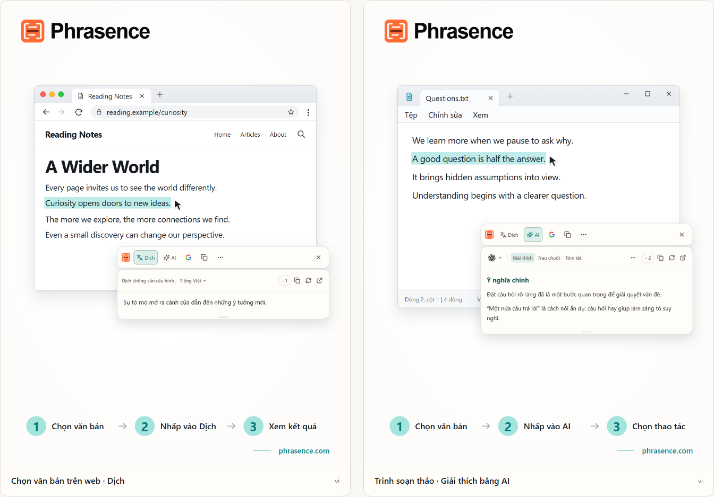

# Phrasence | Công cụ dịch và trợ lý văn bản AI trên máy tính

[English](README.md) | [Español](README.es.md) | [Português (Brasil)](README.pt-BR.md) | [Português (Portugal)](README.pt-PT.md) | [Français](README.fr.md) | [Deutsch](README.de.md) | [Italiano](README.it.md) | [Nederlands](README.nl.md)

[Русский](README.ru.md) | [Polski](README.pl.md) | [Türkçe](README.tr.md) | [Українська](README.uk.md) | [日本語](README.ja.md) | [한국어](README.ko.md) | [Bahasa Indonesia](README.id.md) | [Tiếng Việt](README.vi.md)

[ไทย](README.th.md) | [Bahasa Melayu](README.ms.md) | [हिन्दी](README.hi.md) | [বাংলা](README.bn.md) | [简体中文](README.zh-CN.md) | [繁體中文](README.zh-TW.md)

[Trang web chính thức](https://phrasence.com/) · [Tải xuống](https://phrasence.com/vi/download) · [Hướng dẫn sử dụng](https://phrasence.com/vi/docs/getting-started)

## Phrasence là gì

Với Phrasence, chọn văn bản trong trình duyệt, tài liệu hoặc trình soạn thảo, rồi chọn dịch, giải thích, tóm tắt hoặc chỉnh sửa. Công cụ luôn ở cạnh phần được chọn để bạn tiếp tục đọc và viết liền mạch.

Phrasence đặt những thao tác văn bản thường dùng cạnh vùng chọn. Bạn quyết định bước tiếp theo.

**Chọn văn bản → Mở thanh công cụ → Chọn thao tác tiếp theo**



_Hình minh họa giao diện: bản dịch văn bản được chọn và phần giải thích của AI. Nội dung và số tín dụng trong hình chỉ là ví dụ. Việc sử dụng thực tế tuân theo quy định hiện hành trong ứng dụng._

## Dành cho ai

- **Người đọc nội dung bằng ngôn ngữ khác**: Dịch một câu trên trang web hoặc trong tài liệu mà không phải sao chép sang thẻ khác.
- **Học sinh, sinh viên và nhà nghiên cứu**: Giải thích thuật ngữ, phân tích câu dài hoặc tóm tắt đoạn khó mà vẫn giữ được ngữ cảnh đang đọc.
- **Lập trình viên và người đọc tài liệu kỹ thuật**: Bổ sung ngữ cảnh cần thiết cho thuật ngữ chuyên môn, câu phức tạp, đoạn nghiên cứu hoặc mã nguồn mà không làm bạn mất vị trí đang đọc.
- **Người viết và nhân viên văn phòng**: Chọn một phần bản nháp và nhờ AI diễn đạt lại, cô đọng ý chính hoặc điều chỉnh giọng văn.

## Tính năng chính

- **Dịch văn bản đã chọn**: Chọn dịch vụ dịch thuật hiện có và ngôn ngữ đích, xem kết quả cạnh ứng dụng đang dùng, rồi sao chép hoặc tạo lại bản dịch.
- **Giải thích, tóm tắt và lời nhắc tùy chỉnh với AI**: Giải thích, tóm tắt, trau chuốt, rút ra ý chính hoặc sửa lỗi văn bản đã chọn. Bạn cũng có thể tạo tác vụ như “Viết lại thành email”.
- **Không gian làm việc đầy đủ**: Với văn bản dài, bạn có thể tự chỉnh sửa nội dung gốc và chuyển đổi thoải mái giữa kết quả dịch và kết quả AI.
- **Tìm kiếm hoặc sao chép**: Sao chép trực tiếp văn bản đã chọn hoặc đưa sang công cụ tìm kiếm bạn muốn dùng và tiếp tục trong trình duyệt hệ thống.
- **Lịch sử cục bộ**: Mở lại các bản dịch và kết quả AI trước đây. Lịch sử chỉ lưu trên thiết bị này và có thể tắt hoặc xóa bất cứ lúc nào.
- **Phù hợp với màn hình của bạn**: Ngang hoặc dọc, sáng hoặc tối, luôn nổi trên cùng hoặc tự do—hãy điều chỉnh Phrasence theo màn hình và thói quen làm việc.

### Dịch vụ dịch

**Cài đặt → Dịch vụ dịch**

Cách chọn: Có ba lựa chọn—dịch không cần cấu hình, mô hình cục bộ và nhà cung cấp dịch. Chọn một cách rồi nhấn “Sử dụng”; khu vực làm việc và thanh công cụ nhanh sẽ dùng cách đó để dịch.

- Dịch không cần cấu hình: Không cần cấu hình. Hãy đăng nhập rồi nhấn “Sử dụng”. Mỗi lần dịch đều tiêu tốn tín dụng được tính theo số ký tự của văn bản nguồn; số thực tế bị trừ là số cuối cùng.
- Mô hình dịch cục bộ: Tải mô hình trước lần dùng đầu tiên. Sau đó có thể dịch ngoại tuyến mà không tốn tín dụng; văn bản chỉ được xử lý trên máy tính này.
- Nhà cung cấp dịch: Nếu đã có khóa API Baidu, Microsoft, DeepL hoặc Google, hãy nhập tại đây. Khóa ở lại trên máy tính này; mức phí và hạn mức miễn phí do nhà cung cấp quyết định.

Mô hình cục bộ phải hỗ trợ các ngôn ngữ bạn cần. Bạn cần kết nối mạng để tải xuống hoặc cập nhật mô hình. Dịch bằng mô hình cục bộ hoặc API riêng không dùng tín dụng Phrasence. Nhà cung cấp API có thể thu phí riêng. Hãy lưu thông tin kết nối được yêu cầu rồi kiểm tra kết nối.

Các thao tác dịch và AI phụ thuộc vào nhà cung cấp đã cấu hình, kết nối mạng, số điểm khả dụng và trạng thái phát hành hiện tại.

[Bảng giá](https://phrasence.com/vi/pricing)

## Hướng dẫn sử dụng

### 1. Tải xuống và cài đặt

Mở [trang tải xuống](https://phrasence.com/vi/download). Chọn phiên bản phù hợp với hệ điều hành và bộ xử lý.

Nếu không có nút tải xuống, bộ cài tương ứng chưa được phát hành. Không tải Phrasence từ trang web không chính thức.

### 2. Hoàn tất thiết lập ban đầu

Khởi chạy Phrasence và mở **Cài đặt**. Kiểm tra lần lượt các mục sau:

1. Trong **Cài đặt cơ bản**, chọn ngôn ngữ giao diện, giao diện màu và bố cục mặc định.
2. Trong **Tác vụ nhanh**, bật ít nhất một cách chọn văn bản.
3. Trong **Dịch vụ dịch**, kiểm tra các dịch vụ hiện có.
4. **Công cụ AI**: Chọn ngôn ngữ đầu ra và các thao tác bạn muốn dùng.
5. Nếu hệ thống yêu cầu quyền, hãy làm theo thông báo để mở cài đặt hệ thống.

**Nhà cung cấp dịch → Lưu cấu hình → Kiểm tra kết nối**

### 3. Chọn văn bản và mở thanh công cụ

#### Tự động hiển thị khi chọn văn bản

1. Bật **Tự động hiển thị khi chọn văn bản**.
2. Chọn văn bản trong một ứng dụng khác.
3. Khi Phrasence nhận được văn bản, thanh công cụ xuất hiện gần vùng chọn.
4. Chọn Dịch, AI, Sao chép hoặc Tìm kiếm.

#### Hiển thị bằng phím tắt

1. Bật **Hiển thị bằng phím tắt**.
2. Nhấn phím tắt hiện tại của thanh công cụ.
3. Thanh công cụ xuất hiện trước ở gần con trỏ chuột.
4. Chọn văn bản cần xử lý.
5. Khi Phrasence nhận được văn bản, các tác vụ sẽ dùng được.

**Cài đặt → Tác vụ nhanh → Phím tắt hiện tại**

Khi thanh công cụ đang hiển thị, bạn có thể nhấn Esc bất cứ lúc nào để ẩn, tương tự như bấm nút đóng.

### 4. Chọn thao tác

- **Dịch**: dùng dịch vụ dịch và ngôn ngữ đích hiện tại.
- **AI**: giải thích, trau chuốt, tóm tắt hoặc chạy một tác vụ đã thiết lập. Cần đăng nhập và có điểm.
- **Tìm kiếm**: mở công cụ tìm kiếm đã chọn trong trình duyệt hệ thống.
- **Sao chép**: ghi văn bản hiện tại vào bảng tạm.
- **Thêm**: mở không gian làm việc, lịch sử, cài đặt và các nút điều khiển cách chọn.
- **Đóng**: ẩn thanh công cụ. Bạn cũng có thể nhấn `Esc`.

Chi phí: Chỉnh cài đặt, sắp xếp và tạo tác vụ không tốn tín dụng. Để chạy tác vụ, bạn cần đăng nhập và số tín dụng hiển thị cho mô hình đã chọn sẽ bị trừ.

### 5. Tiếp tục trong không gian làm việc

**Thêm → Mở không gian làm việc**

Thanh công cụ nhanh dùng để xử lý vùng chọn ngay cạnh ứng dụng đang mở. Không gian làm việc đầy đủ cung cấp chỗ để chỉnh sửa hoặc xử lý nội dung dài hơn. Cả hai tiếp tục dùng cùng một kết quả hiện tại, nên bạn không phải chạy lại yêu cầu.

Trong thẻ dịch của không gian làm việc, việc thay đổi nội dung nhập không trống có thể tự động bắt đầu dịch. Bạn vẫn phải chủ động chọn để chạy thao tác AI. Việc lưu lịch sử phụ thuộc vào cài đặt và quy định của dịch vụ đã chọn.

### 6. Lưu thao tác AI tùy chỉnh

**Cài đặt → Công cụ AI → Tác vụ mới**

Đặt tên và viết hướng dẫn cho thao tác. Lưu lại rồi chọn thao tác đó trong danh sách thao tác AI. Ví dụ, bạn có thể lưu hướng dẫn sau để đọc một đoạn văn khó:

Cách cài đặt: “Bật” quyết định tác vụ có thể dùng hay không. Công tắc “Thanh công cụ” quyết định tác vụ có xuất hiện trên thanh nhanh hay không. Kéo để đổi thứ tự.

```text
Giải thích ý chính của văn bản được chọn và liệt kê các điểm quan trọng.
Giữ nguyên tên, số liệu và điều kiện trong bản gốc.
Nêu rõ những điểm chưa chắc chắn. Không thêm thông tin thiếu căn cứ.
```

Hướng dẫn này là ví dụ. Hãy đối chiếu bản dịch và câu trả lời AI với bản gốc, đặc biệt là tên, số liệu, ngày tháng và điều kiện.

## Câu hỏi thường gặp

### Làm gì khi thanh công cụ không xuất hiện?

Kiểm tra xem Phrasence có đang chạy và ít nhất một cách mở có được bật trong Tác vụ nhanh hay không. Kiểm tra quyền của hệ thống và khả năng chọn văn bản trong ứng dụng gốc. Nếu không đọc được vùng chọn, hãy nhập hoặc dán văn bản vào không gian làm việc.

### Tại sao ứng dụng yêu cầu sao chép hoặc dán?

Một số ứng dụng hiển thị vùng chọn nhưng không cung cấp nội dung văn bản. Nếu thông báo yêu cầu sao chép, hãy giữ ứng dụng gốc hoạt động và nhấn `Ctrl+C`, hoặc `⌘C` trên macOS. Nếu cần dán thủ công, hãy mở vùng nhập được chỉ định rồi nhấn `Ctrl+V`, hoặc `⌘V` trên macOS. Sao chép thủ công hoặc tự động có thể thay thế nội dung bảng nhớ tạm. Bạn có thể tắt sao chép tự động trong Cài đặt → Tác vụ nhanh.

### Tôi có cần tài khoản để dùng Phrasence không?

Không cần đối với các tính năng cơ bản, vì chúng hoạt động khi chưa đăng nhập. Công cụ AI, quyền lợi của gói và tính năng tài khoản sẽ yêu cầu bạn đăng nhập khi cần.

Chi phí: Chỉnh cài đặt, sắp xếp và tạo tác vụ không tốn tín dụng. Để chạy tác vụ, bạn cần đăng nhập và số tín dụng hiển thị cho mô hình đã chọn sẽ bị trừ.

## Dữ liệu và quyền riêng tư

- Việc chọn văn bản chỉ chuẩn bị ngữ cảnh; thao tác này không gửi yêu cầu, không trừ điểm và không ghi một kết quả thành công vào lịch sử.
- Văn bản được gửi đi đâu: Với dịch dùng ngay, văn bản được gửi tới dịch vụ Phrasence rồi tới công cụ hiện tại. Với khóa riêng, máy tính gửi thẳng tới nhà cung cấp. Với mô hình cục bộ, văn bản ở lại trên máy tính.
- Văn bản được gửi đi đâu: Văn bản đã chọn và yêu cầu được gửi qua Phrasence tới dịch vụ AI đã chọn. Bản ghi tính phí không lưu văn bản nguồn; chỉ lưu mô hình và tín dụng đã dùng.
- Khi được bật, lịch sử chỉ lưu trên thiết bị này và không bao giờ đồng bộ lên đám mây. Bạn có thể tắt hoặc xóa bất cứ lúc nào.

Trong thẻ dịch của không gian làm việc, việc thay đổi nội dung nhập không trống có thể tự động bắt đầu dịch. Bạn vẫn phải chủ động chọn để chạy thao tác AI. Việc lưu lịch sử phụ thuộc vào cài đặt và quy định của dịch vụ đã chọn.

[Quyền riêng tư và dữ liệu](https://phrasence.com/vi/docs/privacy-security) · [Chính sách quyền riêng tư (EN)](https://phrasence.com/privacy-policy)

## Trang web chính thức và hỗ trợ

- [Trang web chính thức: phrasence.com](https://phrasence.com/)
- [Tải xuống, cài đặt và khởi chạy lần đầu](https://phrasence.com/vi/docs/getting-started)
- [Xử lý sự cố](https://phrasence.com/vi/docs/troubleshooting)
- [Liên hệ qua Telegram](https://t.me/phrasence)

Để yêu cầu hỗ trợ hoặc báo lỗi, hãy đăng nhập vào trang web và mở Trợ giúp và phản hồi trong cài đặt. Ghi rõ hệ điều hành, phiên bản ứng dụng, dịch vụ đã chọn và các bước để tái hiện lỗi.
