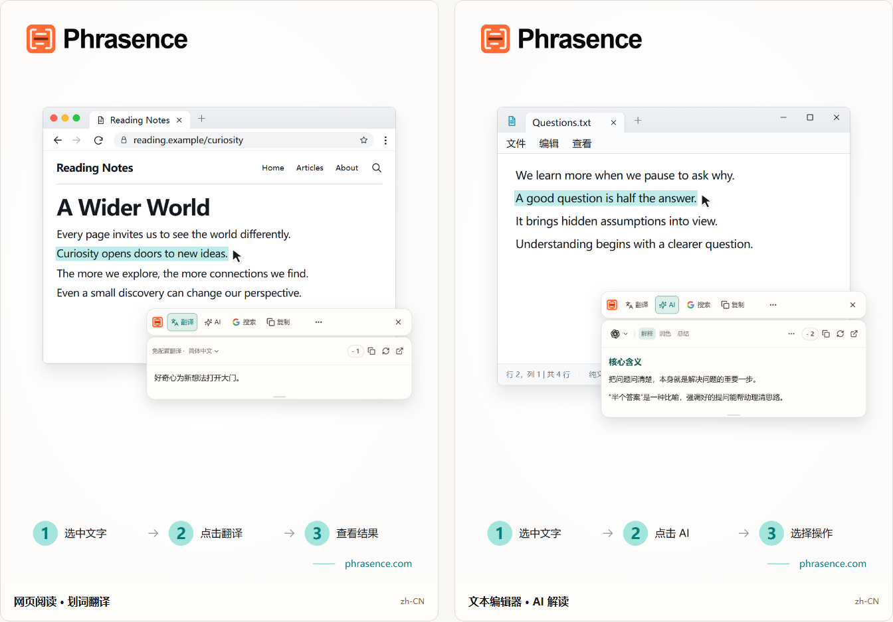

# Phrasence 桌面划词翻译与 AI 文本助手

[English](README.md) | [Español](README.es.md) | [Português (Brasil)](README.pt-BR.md) | [Português (Portugal)](README.pt-PT.md) | [Français](README.fr.md) | [Deutsch](README.de.md) | [Italiano](README.it.md) | [Nederlands](README.nl.md)

[Русский](README.ru.md) | [Polski](README.pl.md) | [Türkçe](README.tr.md) | [Українська](README.uk.md) | [日本語](README.ja.md) | [한국어](README.ko.md) | [Bahasa Indonesia](README.id.md) | [Tiếng Việt](README.vi.md)

[ไทย](README.th.md) | [Bahasa Melayu](README.ms.md) | [हिन्दी](README.hi.md) | [বাংলা](README.bn.md) | [简体中文](README.zh-CN.md) | [繁體中文](README.zh-TW.md)

[官方网站](https://phrasence.com/) · [下载桌面应用](https://phrasence.com/zh-CN/download) · [官方使用文档](https://phrasence.com/zh-CN/docs/getting-started)

## 产品介绍

Phrasence 是一款跨软件使用的桌面划词翻译与 AI 文本助手。阅读网页、文档、邮件或代码时，你可以选中一段文字，通过选区旁的工具条进行翻译、解释、总结、润色、复制或搜索。

Phrasence 提供两种处理文字的方式：

- **快捷工具条：** 在当前应用旁处理选中的内容，适合查询一句话、理解术语或快速调整表达。
- **完整工作台：** 手动输入或粘贴文字，修改原文并对照结果，适合处理较长内容。

基本流程是：**选中文字 → 调出工具条 → 选择操作 → 查看或复制结果 → 按需要进入工作台**。



_界面示意：左侧展示划词翻译，右侧展示 AI 解释。图中文字与点数为示例，实际用量以应用当前显示的规则为准。_

## 适用人群

| 人群               | 常见需求                     | 可以怎样使用 Phrasence                     |
| ------------------ | ---------------------------- | ------------------------------------------ |
| 外语内容读者       | 阅读外语网页、邮件和文档     | 翻译当前句子或段落，边看原文边理解内容     |
| 学生与研究人员     | 阅读教材、论文和专业资料     | 解释术语、拆解长句、总结选中段落的要点     |
| 开发者与技术从业者 | 查阅技术文档、说明和代码片段 | 翻译或解释当前文字，再通过搜索查找相关资料 |
| 写作者与办公用户   | 修改邮件、笔记和文案草稿     | 对选中的段落进行润色、校对或表达调整       |

## 核心功能

| 功能           | 能做什么                                                 |
| -------------- | -------------------------------------------------------- |
| 划词翻译       | 选择可用的翻译服务和目标语言，在当前应用旁查看结果       |
| AI 文字处理    | 解释、润色、总结、提取要点和校对，也支持自定义操作       |
| 完整工作台     | 输入或粘贴文字，编辑原文，对照翻译和 AI 结果             |
| 复制与网页搜索 | 复制当前文字，或在系统浏览器中打开所选搜索引擎           |
| 本地历史       | 在设置及服务规则允许记录时，回看和清理当前设备上的结果   |
| 界面与布局     | 按使用习惯调整横向或纵向布局、浅色或深色主题以及窗口置顶 |

### 三种翻译方式

在 **设置 → 翻译服务** 中选择适合自己的方式。可用服务以当前版本和界面状态为准。

| 方式                   | 适合的使用条件               | 准备与费用                                                                        |
| ---------------------- | ---------------------------- | --------------------------------------------------------------------------------- |
| 免配置翻译             | 希望直接使用在线翻译服务     | 无需自备服务密钥，按提示完成登录及使用条件；联网翻译按当前规则消耗 Phrasence 积分 |
| 本地翻译模型           | 希望在模型安装完成后离线翻译 | 首次下载和更新模型需要网络；模型需支持所选语言，翻译不扣 Phrasence 积分           |
| 翻译厂商，也称自配 API | 已有翻译服务商的账号或密钥   | 配置所选厂商要求的密钥等信息；不扣 Phrasence 积分，服务商可能另行收费             |

AI 操作与翻译服务分别配置，使用前查看所选模型、输出语言及界面显示的费用。方案说明见官网[价格页面](https://phrasence.com/zh-CN/pricing)。

## 操作指南

### 1. 下载并安装

打开[官方下载页面](https://phrasence.com/zh-CN/download)，按操作系统和处理器选择安装包，再按安装程序提示完成安装。

系统要求和可下载的平台以该页面为准。没有下载按钮的平台尚未提供可用安装包。

### 2. 完成首次设置

启动 Phrasence，打开 **设置**，依次检查：

1. **基础设置：** 选择界面语言、主题和默认布局。
2. **快捷操作：** 开启“选中文字自动调出”或“使用快捷键调出”，至少启用一种。
3. **翻译服务：** 选择可用服务。使用本地模型时先下载模型，使用自配 API 时先保存并测试连接信息。
4. **AI 工具：** 按需要选择输出语言和常用操作。

如果系统提示需要权限，按设置页中的入口打开系统设置，完成所需授权后再试。

### 3. 选中文字并调出工具条

| 调出方式         | 操作顺序                                       |
| ---------------- | ---------------------------------------------- |
| 选中文字自动调出 | 在其他应用中选中文字，等待工具条出现在选区附近 |
| 使用快捷键调出   | 先按设置中显示的快捷键，再选择要处理的文字     |

两种方式可以同时开启，也可以只保留一种。快捷键可在 **设置 → 快捷操作** 中查看和修改。

确认工具条已读到当前选区，再选择下一步操作。按 `Esc` 可以隐藏工具条。

### 4. 选择要执行的操作

- **翻译：** 选择翻译服务和目标语言，再点击翻译，查看结果。
- **AI：** 按提示登录，选择解释、润色、总结、要点、校对或自定义操作，核对模型、输出语言及费用后执行。
- **复制：** 将当前文字写入剪贴板。
- **网页搜索：** 选择搜索引擎，在系统浏览器中继续查询。

首次使用时，可以选中下面这句示例文字测试翻译：

> The meeting has moved to Thursday. Please send your comments by Wednesday.

将结果与原文对照，检查星期、名称和数字是否准确。AI 结果也需要结合原文核对，尤其是条件、例外和承诺。

### 5. 在工作台中继续处理

需要编辑原文或处理较长内容时，从工具条的 **更多 → 打开工作台** 进入完整工作台。当前结果可以延续到工作台，你也可以重新输入或粘贴文字。

注意当前标签页的行为：翻译页中的非空输入改变后，可能自动开始翻译；AI 操作仍需主动选择。

需要回看结果时，打开历史记录。是否保存新记录取决于历史开关和所选服务的规则。

### 6. 保存常用 AI 操作

在 **设置 → AI 工具** 中新建自定义操作，填写名称和指令，保存后从 AI 操作列表中选择使用。

例如，可以保存一条用于理解资料的指令：

```text
请解释选中文字的主要意思，并列出关键点。
保留原文的名称、数字和条件。
不确定的信息请明确说明，不要补充没有依据的事实。
```

这是提示词示例。执行后仍需对照原文检查输出。

## 常见问题

### 工具条没有出现怎么办

先确认 Phrasence 正在运行，并在快捷操作中启用了至少一种调出方式。再检查当前应用是否允许选中文字，以及系统所需权限是否已经开启。

如果当前应用或桌面环境无法提供选区，可以在工作台中手动输入或粘贴文字。

### 为什么会提示复制或粘贴

有些应用显示了选区，却不能直接提供其中的文字。按当前提示处理即可：

| 当前提示     | 处理方法                                             |
| ------------ | ---------------------------------------------------- |
| 复制当前选区 | 保持原应用处于当前窗口，按 `Ctrl+C`；macOS 使用 `⌘C` |
| 手动粘贴     | 打开提示中的粘贴区域，按 `Ctrl+V`；macOS 使用 `⌘V`   |
| 打开系统设置 | 按提示完成所需权限设置，再重新选中文字               |

自动复制或手动复制可能替换当前剪贴板内容。自动复制可在 **设置 → 快捷操作** 中关闭。

### 哪些功能需要登录或付费

本机设置、复制和网页搜索等基础操作可以不登录使用。AI 操作需要登录，并满足当前积分和服务条件。翻译的准备条件及费用取决于所选方式，执行前查看服务状态和界面说明。

## 数据与隐私

- 在快捷工具条中，选中文字本身不会发起翻译或 AI 请求。选择联网操作后，相关文字才用于对应服务处理。
- 本地模型安装完成后，可对支持的语言执行离线翻译。在线翻译、AI 和搜索由相应服务处理相关文字。
- 历史记录按设置及服务规则保存在当前设备，可以关闭后续记录或清理已有条目。
- 完整工作台的翻译页可能在输入改变后自动翻译，使用前请确认当前服务和目标语言。

更多说明见[隐私与数据指南](https://phrasence.com/zh-CN/docs/privacy-security)，正式条款以官网[隐私政策](https://phrasence.com/zh-CN/privacy-policy)为准。

## 官网与帮助

- [官方网站：phrasence.com](https://phrasence.com/)
- [安装与首次使用指南](https://phrasence.com/zh-CN/docs/getting-started)
- [常见故障排查](https://phrasence.com/zh-CN/docs/troubleshooting)
- 微信联系：`zhk188999`

需要产品帮助或反馈问题时，登录官网，在设置中打开帮助与反馈。提供操作系统、应用版本、所选服务和复现步骤，便于定位问题。
