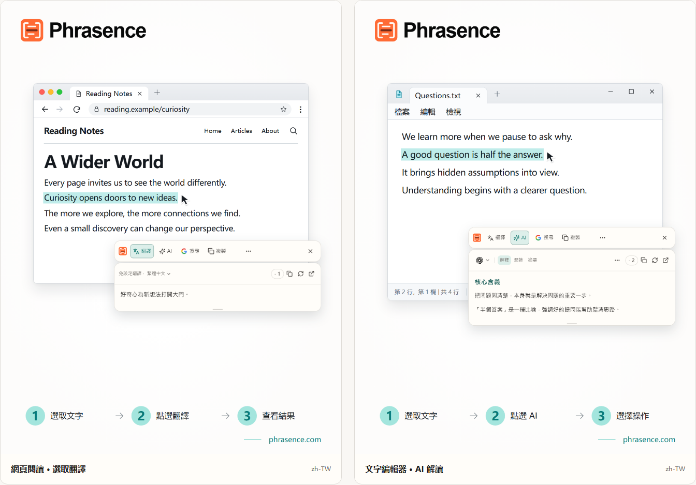

# Phrasence｜桌面選取文字翻譯與 AI 文字助手

[English](README.md) | [Español](README.es.md) | [Português (Brasil)](README.pt-BR.md) | [Português (Portugal)](README.pt-PT.md) | [Français](README.fr.md) | [Deutsch](README.de.md) | [Italiano](README.it.md) | [Nederlands](README.nl.md)

[Русский](README.ru.md) | [Polski](README.pl.md) | [Türkçe](README.tr.md) | [Українська](README.uk.md) | [日本語](README.ja.md) | [한국어](README.ko.md) | [Bahasa Indonesia](README.id.md) | [Tiếng Việt](README.vi.md)

[ไทย](README.th.md) | [Bahasa Melayu](README.ms.md) | [हिन्दी](README.hi.md) | [বাংলা](README.bn.md) | [简体中文](README.zh-CN.md) | [繁體中文](README.zh-TW.md)

[官方網站](https://phrasence.com/) · [下載](https://phrasence.com/zh-TW/download) · [使用指南](https://phrasence.com/zh-TW/docs/getting-started)

## 產品介紹

用 Phrasence，在瀏覽器、文件或編輯器中選取文字，就能依需求翻譯、解釋、摘要或潤飾。工具就在選取內容旁，閱讀外語資料、理解複雜內容、調整表達，都更順手。

Phrasence 融入你正在使用的閱讀與寫作工具。選取文字，叫出工具列，再選擇需要的操作。

**選取文字 → 叫出工具列 → 選擇下一步**



_介面示意：左側顯示選字翻譯，右側顯示 AI 解釋。圖中文字與點數為範例，實際用量以應用程式目前顯示的規則為準。_

## 適用對象

- **外語內容讀者**：瀏覽網頁或文件時，選取句子就能查看翻譯，不必複製到另一個分頁。
- **學生與研究人員**：解讀術語、長句或複雜段落，同時保留正在閱讀的脈絡。
- **開發者與技術文件讀者**：解釋專業術語、複雜句子、論文段落或程式碼，補足理解目前內容所需的脈絡。
- **文字工作者與辦公室使用者**：選取草稿中的一段內容，請 AI 換個說法、濃縮重點或調整語氣。

## 核心功能

- **選取文字翻譯**：選擇可用的翻譯服務與目標語言，在目前應用程式旁查看結果，並繼續複製或重新產生。
- **AI 解釋、摘要與自訂提示詞**：可以解釋、摘要、潤飾、擷取重點或校對，也可以建立自己的操作，例如「改寫成郵件」或「產生回覆」。
- **完整工作區**：處理長文時，可以開啟工作區編輯原文，並在翻譯與 AI 結果之間自在切換。
- **搜尋與複製**：直接複製選取文字，或交給你慣用的搜尋引擎，並在系統瀏覽器中繼續探索。
- **本機記錄**：重新開啟過去的翻譯與 AI 結果；記錄保存在目前裝置，也能隨時關閉或清除。
- **配合你的桌面**：橫向、直向、淺色、深色與置頂選項，讓 Phrasence 適應不同螢幕與工作習慣。

### 翻譯服務

**設定 → 翻譯服務**

怎麼選擇：這裡有「免設定翻譯」「本機翻譯模型」和「翻譯服務商」三種方式。選擇一種並點擊「使用」，工作台和快捷工具列就會用它翻譯。

- 免設定翻譯：不需要進行任何設定，登入後點擊「使用」即可。每次翻譯都會消耗點數，點數依原文字數計算，實際扣除為準。
- 本機翻譯模型：第一次使用需要下載模型。下載後可以離線翻譯，不消耗點數，文字只在這台電腦上處理。
- 翻譯服務商：如果你已有百度、Microsoft、DeepL 或 Google 的 API Key，可以在這裡填寫。金鑰只儲存在這台電腦上；收費標準和免費額度由對應服務商決定。

本機模型必須支援你要使用的語言。下載或更新模型時需要網路連線。使用本機模型或自備 API 翻譯不會扣除 Phrasence 點數，但 API 服務商可能另外收費。請儲存服務商要求的連線資料，並測試連線。

翻譯和 AI 操作取決於已設定的服務、網路、可用點數與目前的發布狀態。

[價格](https://phrasence.com/zh-TW/pricing)

## 操作指南

### 1. 下載並安裝

開啟[下載頁面](https://phrasence.com/zh-TW/download)。選擇符合你的作業系統與處理器的版本。

如果沒有下載按鈕，表示對應的安裝檔尚未開放。請勿從非官方網站下載安裝檔。

### 2. 完成首次設定

啟動 Phrasence 後，開啟**設定**。依序確認下列項目：

1. 在**基礎設定**選擇介面語言、主題與預設版面。
2. 在**快捷操作**確認至少開啟一種選字方式。
3. 在**翻譯服務**查看目前可用的服務。
4. **AI 工具**：選擇輸出語言，以及要使用的操作。
5. 如果系統要求權限，請依照提示前往系統設定。

**翻譯服務商 → 儲存設定 → 測試連線**

### 3. 選取文字並開啟工具列

#### 選取文字自動叫出

1. 開啟**選取文字自動叫出**。
2. 在其他應用程式中選取文字。
3. Phrasence 讀到文字後，會在選取範圍附近顯示工具列。
4. 選擇翻譯、AI、複製或搜尋。

#### 使用快捷鍵叫出

1. 開啟**使用快捷鍵叫出**。
2. 按下目前的工具列快捷鍵。
3. 工具列會先出現在滑鼠游標附近。
4. 再選取要處理的文字。
5. Phrasence 讀到文字後，會啟用工具列功能。

**設定 → 快捷操作 → 目前快捷鍵**

工具列顯示時，按 Esc 可隨時將它隱藏，效果與點擊關閉按鈕相同。

### 4. 選擇操作

- **翻譯**：使用目前的翻譯服務與目標語言產生譯文。
- **AI**：執行解釋、潤飾、摘要等操作。AI 需要登入與可用點數。
- **搜尋**：在系統瀏覽器中開啟所選的搜尋引擎。
- **複製**：將目前的文字寫入剪貼簿。
- **更多**：開啟工作區、歷史記錄、設定與選字方式開關。
- **關閉**：隱藏工具列。也可以按 `Esc`。

是否收費：編輯設定、調整順序和建立操作都不扣點數。執行 AI 操作需要登入，並依所選模型扣除頁面顯示的點數。

### 5. 在工作區繼續處理

**更多 → 開啟工作台**

快捷工具列適合在目前應用程式旁快速處理選取文字；完整工作區則適合手動編輯或處理較長內容。兩者會接續同一份目前結果，不必重複請求。

在工作區的翻譯分頁中，修改非空白的輸入內容後，可能會自動開始翻譯。AI 操作仍需自行選擇才會執行。是否儲存歷史紀錄，取決於你的設定與所選服務的規則。

### 6. 儲存自訂 AI 操作

**設定 → AI 工具 → 新增操作**

輸入操作名稱與指令，儲存後即可從 AI 操作清單中選用。例如，閱讀較難的內容時，可以儲存以下指令：

怎麼設定：「啟用」決定操作能不能使用；「工具列」開關決定操作是否顯示在快捷工具列中。你也可以拖曳調整順序。

```text
說明選取文字的主旨，並列出重點。
保留原文中的名稱、數字與條件。
清楚標示不確定的部分，不要加入沒有依據的資訊。
```

這段指令僅為範例。使用後請對照原文，特別檢查翻譯或 AI 回答中的名稱、數字、日期與條件。

## 常見問題

### 工具列沒有出現，怎麼辦？

先確認 Phrasence 正在執行，並在快捷操作中開啟至少一種顯示方式。再檢查系統權限，以及原本的應用程式是否允許選取文字。若無法讀取選取內容，可以改在工作區輸入或貼上文字。

### 為什麼要求我複製或貼上？

部分應用程式會顯示選取範圍，卻無法提供文字內容。如果提示要求複製，請讓原本的應用程式保持在前景，按下 `Ctrl+C`，macOS 則使用 `⌘C`。如果提示要求手動貼上，請先開啟指定的貼上區，再按 `Ctrl+V`，macOS 則使用 `⌘V`。手動或自動複製都可能取代目前剪貼簿的內容。你可以在「設定 → 快捷操作」關閉自動複製。

### 一定要登入才能使用嗎？

不用。基本功能可以在未登入的情況下使用；AI 工具、方案權益與帳戶功能則會依實際情況提示登入。

是否收費：編輯設定、調整順序和建立操作都不扣點數。執行 AI 操作需要登入，並依所選模型扣除頁面顯示的點數。

## 資料與隱私

- 選取文字只會準備當下內容，不會自動送出請求、扣除點數或寫入成功記錄。
- 文字會傳到哪裡：使用免設定翻譯時，文字會傳送到 Phrasence 翻譯服務，再交給目前使用的翻譯引擎；在翻譯服務商中使用自己的 API Key 時，文字會從這台電腦直接傳送給對應服務商；使用本機模型時，文字不會離開這台電腦。
- 文字會傳到哪裡：執行 AI 操作時，選取的文字和操作要求會透過 Phrasence 傳送給所選的 AI 服務。計費記錄不儲存原文，只記錄所用模型和消耗點數。
- 啟用記錄後，內容只會保存在目前裝置，不會同步到雲端；你可以關閉記錄或清除所有內容。

在工作區的翻譯分頁中，修改非空白的輸入內容後，可能會自動開始翻譯。AI 操作仍需自行選擇才會執行。是否儲存歷史紀錄，取決於你的設定與所選服務的規則。

[隱私與資料說明](https://phrasence.com/zh-TW/docs/privacy-security) · [隱私權政策](https://phrasence.com/zh-TW/privacy-policy)

## 官方網站與協助

- [官方網站：phrasence.com](https://phrasence.com/)
- [下載、安裝與首次啟動](https://phrasence.com/zh-TW/docs/getting-started)
- [常見問題與疑難排解](https://phrasence.com/zh-TW/docs/troubleshooting)
- [透過 Telegram 聯絡我們](https://t.me/phrasence)

需要產品協助或回報問題時，請登入官方網站，在設定中開啟說明與回饋入口。請附上作業系統、應用程式版本、所選服務，以及重現問題的操作步驟。
